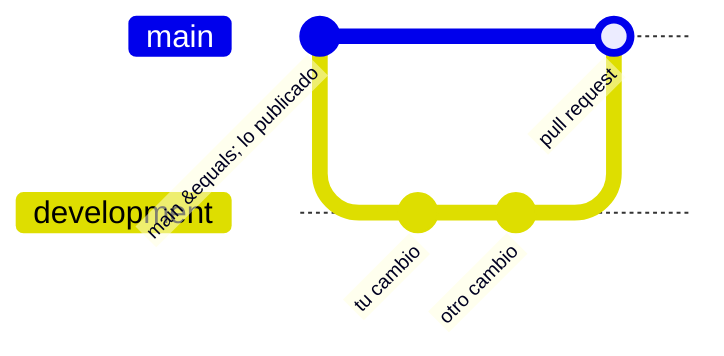

# Cómo contribuir

Gracias por querer mejorar la web. Estas son las normas del proyecto; el paso a paso está en [docs/TUTORIAL.md](docs/TUTORIAL.md).

## Avisar de un error o proponer una idea

Sin saber programar: usa los enlaces de la propia web ("¿Ves un error? Avísanos" en el pie de cada página o "¿Crees que esta pregunta tiene un error?" en el examen), o abre un aviso en <https://github.com/serbenda/radio/issues/new/choose>. Indica la **fuente** (BOE, web del Ministerio, URE…) siempre que se trate de datos o normativa.

## Ramas

- **`main`** es lo que está publicado en `radio.bendi.dev`. **Nadie hace commits directos en `main`.**
- **`development`** es donde se trabaja. Los cambios llegan a `main` con una **pull request** que fusiona el responsable del proyecto.

Las dos ramas están **protegidas en GitHub** (Settings → Branches), sin excepciones ni para administradores:

| Rama | Protección |
| --- | --- |
| `main` | Solo se cambia con pull request (sin aprobaciones obligatorias, porque el proyecto lo lleva una persona); la comprobación `comprobar` de GitHub Actions debe estar en verde; prohibido `push --force` y borrarla |
| `development` | Se puede subir directamente; prohibido `push --force` y borrarla |

## Antes de abrir una pull request

1. `node tools/check.mjs` termina en `✓`.
2. Has probado las páginas afectadas en ordenador y en móvil (390 px), con teclado.
3. Si cambias algún archivo de la web y vas a publicar: `VERSION` subida en `sw.js` y entrada en `CHANGELOG.md`.
4. Documentación actualizada (ver la tabla de abajo).
5. Rellena la plantilla de la pull request.

## Commits

- Mensajes en español, en presente, diciendo qué cambia para quien usa la web: "Examen: corrige la pregunta n17".
- Autor: tu nombre y correo reales (`git config user.name` y `user.email`).
- Un commit por cambio lógico.

## Estilo de código

- Sin dependencias ni compilación: HTML, CSS y JavaScript tal cual.
- Indentación de 2 espacios, UTF-8, saltos de línea LF (ver `.editorconfig`).
- Un módulo por funcionalidad, con la plantilla de [docs/GUIA.md](docs/GUIA.md#añadir-un-módulo-de-javascript): cabecera documentada, `'use strict'`, se desactiva solo si su sección no está.
- **Todo texto externo se escapa** con `Radio.esc()`.
- Animaciones solo con `Radio.whileVisible`; datos externos con `Radio.onceVisible`.
- Cada función con su comentario JSDoc (qué hace, parámetros, qué devuelve, efectos).
- Textos para el público en español de España, en lenguaje llano y sin jerga sin explicar ([docs/CONTENIDO.md](docs/CONTENIDO.md#estilo-de-los-textos)).

Si solo cambias comentarios, `tools/solo-comentarios.sh` confirma que no has tocado código.

## Qué documentación actualizar

| Si cambias… | Actualiza |
| --- | --- |
| Un módulo o creas uno | Su cabecera, [docs/MODULOS.md](docs/MODULOS.md) |
| Lo que se guarda en el navegador o las métricas | [docs/PRIVACIDAD.md](docs/PRIVACIDAD.md) |
| Un servicio externo | [docs/DATOS.md](docs/DATOS.md), la CSP de todas las páginas, [docs/INFRAESTRUCTURA.md](docs/INFRAESTRUCTURA.md#7-servicios-de-terceros) y, si puede fallar de una forma nueva, un runbook en [docs/OPERACIONES.md](docs/OPERACIONES.md#runbooks) |
| La estructura, el flujo o la carga | [docs/ARQUITECTURA.md](docs/ARQUITECTURA.md) |
| Colores, tipografías o componentes | [docs/ESTILOS.md](docs/ESTILOS.md) |
| Una decisión de diseño importante | Nueva entrada en [docs/DECISIONES.md](docs/DECISIONES.md) |
| Dominio, DNS, GitHub Pages o cuentas | [docs/INFRAESTRUCTURA.md](docs/INFRAESTRUCTURA.md) |
| Flujos de Actions, ramas, protecciones o el proceso de publicación | [docs/CICD.md](docs/CICD.md) |
| CSP, librerías externas o cualquier cosa que afecte a la seguridad | [docs/SEGURIDAD.md](docs/SEGURIDAD.md) |
| Algo con fecha de caducidad (autorizaciones, tasas) | Calendario de [docs/OPERACIONES.md](docs/OPERACIONES.md#calendario-de-mantenimiento) |
| El README | También [README.en.md](README.en.md) si cambia algo que diga la versión en inglés |
| Cualquier cosa publicada | [CHANGELOG.md](CHANGELOG.md) |

## Licencia de las contribuciones

Al contribuir aceptas que tu código se publique bajo la licencia [MIT](LICENSE) y tus textos, preguntas e imágenes bajo [CC BY-SA 4.0](LICENSE-CONTENIDO.md), como el resto del proyecto. No copies contenido de otras webs o libros: escríbelo con tus palabras y cita la fuente.

## Apoyar el proyecto

Además de contribuir, se puede apoyar económicamente en [GitHub Sponsors](https://github.com/sponsors/serbenda). El botón "Sponsor" del repositorio sale de `.github/FUNDING.yml`.

## Datos personales

Nunca se publican datos personales de terceros (por ejemplo, nombres, teléfonos o correos de responsables de radioclubes), aunque sean visibles en otra web. Las métricas solo cuentan hitos con nombres fijos. Detalle en [docs/PRIVACIDAD.md](docs/PRIVACIDAD.md).
