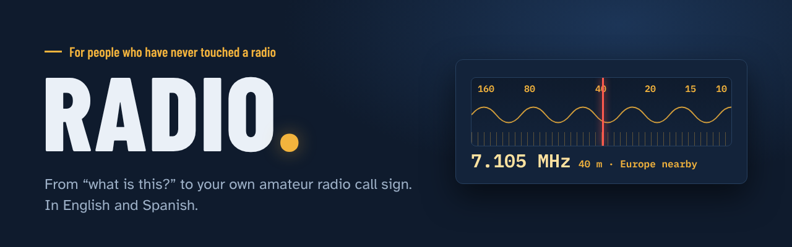
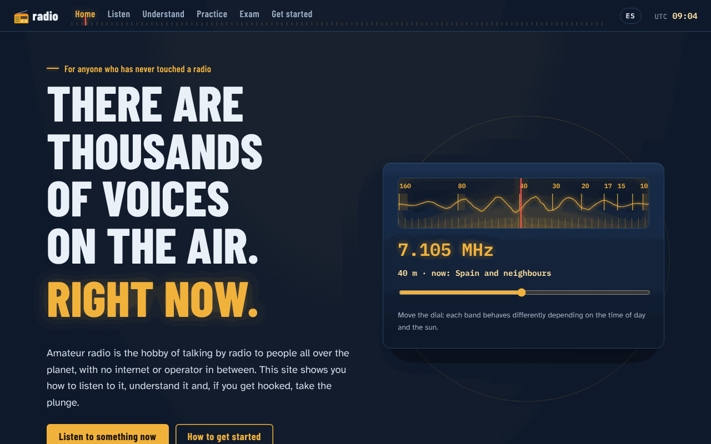
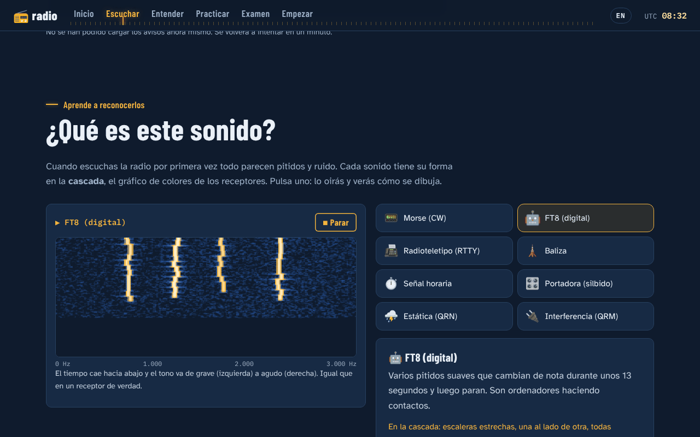
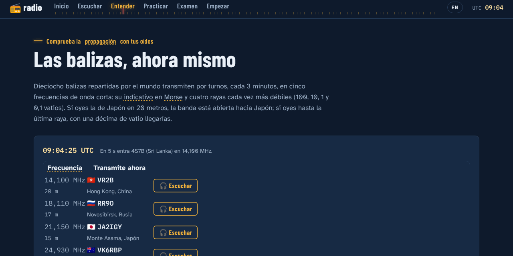
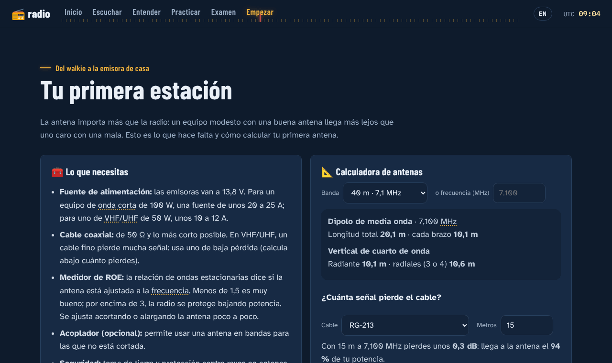
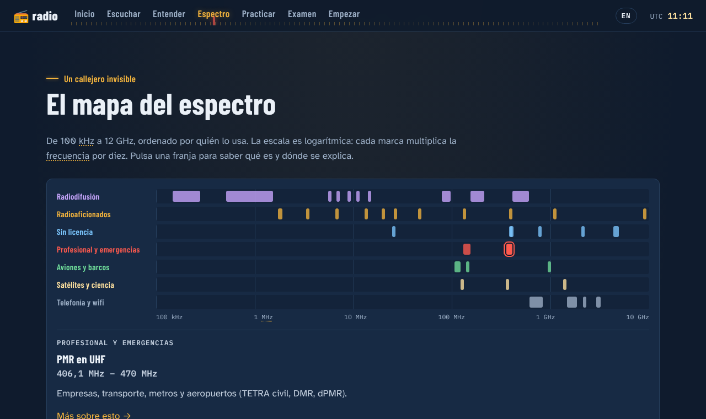
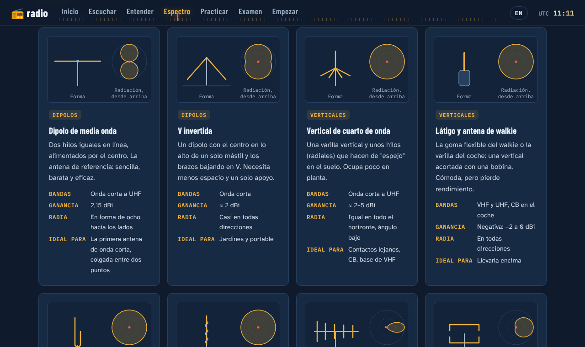
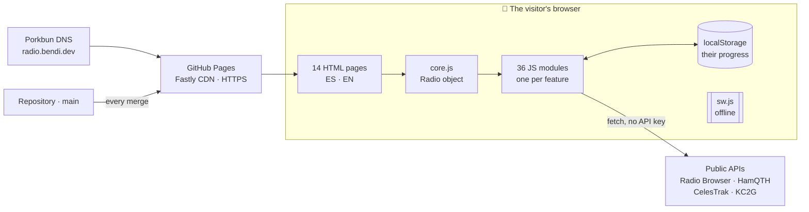

<p align="right"><a href="README.md">Español</a> · <b>English</b></p>

<p align="center">
  <a href="https://radio.bendi.dev/en/"></a>
</p>

<p align="center">
  <a href="https://radio.bendi.dev/en/"><b>📻 Open the site</b></a> &nbsp;·&nbsp;
  <a href="https://radio.bendi.dev/"><b>🇪🇸 Versión en español</b></a> &nbsp;·&nbsp;
  <a href="docs/README.md"><b>📚 Documentation (Spanish)</b></a> &nbsp;·&nbsp;
  <a href="https://github.com/sponsors/serbenda"><b>💚 Support</b></a>
</p>

<p align="center">
  <a href="https://github.com/serbenda/radio/actions/workflows/comprobaciones.yml"></a>
  <a href="https://github.com/serbenda/radio/actions/workflows/enlaces.yml"></a>
  
  
  
  
  <a href="LICENSE"></a>
  <a href="LICENSE-CONTENIDO.md"></a>
</p>

---

**There are thousands of voices on the air right now.** Radio amateurs talking from one continent to another, satellites that repeat what you say to them, beacons measuring the ionosphere every three minutes. Hardly anyone knows, and those who want to take a look find old forums, unexplained acronyms and an official exam with no study material.

**radio** is the missing front door: a free website, with no sign-up, no cookies, that works offline and takes anyone from **listening for the first time** to **passing the exam and setting up their first station**. In English and Spanish.

<table>
  <tr>
    <td width="50%"></td>
    <td width="50%"></td>
  </tr>
  <tr>
    <td></td>
    <td></td>
  </tr>
  <tr>
    <td></td>
    <td></td>
  </tr>
</table>

<sub>Screenshots of the Spanish version show the same content as the English one.</sub>

## What's inside

> Five steps, from your ears to a licence, plus a page to see the whole spectrum. Each step ticks itself off in **Your first month** (4 weeks, 14 steps, badges) as you *do* things, not as you read.

| | Step | What you can do |
| :-: | --- | --- |
| 🏠 | **[Home](https://radio.bendi.dev/en/)** | Turn a real shortwave dial · amateur radio in one minute · **Your first month** · save your progress to a file · install the app |
| 🎧 | **[Listen](https://radio.bendi.dev/en/listen/)** | World map of stations with a player · guided listening on a real receiver · **On the air now**: who's talking to whom, live · **What is this sound?**: Morse, SSB, FT8, SSTV… with a waterfall and 11 real recordings |
| 🌍 | **[Understand](https://radio.bendi.dev/en/understand/)** | Four interactive lessons at three levels · bands · today's propagation in plain words · **live beacons** · ISS passes over your home · **QO-100** and **FM satellites** |
| 📡 | **[Spectrum](https://radio.bendi.dev/en/spectrum/)** | **Who talks on each frequency**: spectrum map · CB in depth, PMR446 · **TETRA**, DMR and TETRAPOL networks · aircraft and ships (ADS-B, AIS) · weather satellites and radiosondes · **how they sound**: 7 signals with their waterfall · receivers · what is legal to listen to · repeaters · **antennas**: what they are, 18 types with drawings and radiation patterns |
| 🎙️ | **[Practice](https://radio.bendi.dev/en/practice/)** | Morse with the Koch method at real speed · phonetic alphabet and jargon · **repeaters and digital radio** (DMR, C4FM, D-STAR, APRS) with a calculator · five simulated contacts with voice and a QSL card |
| 📝 | **[Exam](https://radio.bendi.dev/en/exam/)** | **169 questions** written from Spain's licensing rules (Orden IET/1311/2013) · flashcards that repeat what you get wrong · two-part mock exam like the real one |
| 🚀 | **[Start](https://radio.bendi.dev/en/start/)** | The paperwork in numbers · licence-free CB-27 and walkie-talkies · which radio to buy (and which is legal) · **your first station with an antenna calculator** · clubs on a map · calendar · families · **radio in the classroom** with a printable worksheet · Latin America |

The exam and the paperwork follow **Spanish** regulations; everything else (listening, propagation, beacons, satellites, Morse, antennas, repeaters) applies anywhere.

<details>
<summary><b>🔧 For licensed radio amateurs</b>: what you can recommend with confidence</summary>

- **Live NCDXF/IARU beacons**: all 18 beacons on their 5 frequencies, computed second by second with the official schedule.
- **QO-100**: dish azimuth and elevation from the city you choose, narrowband transponder frequencies and the Spanish 2.4 GHz authorisation.
- **FM satellites** (SO-50, AO-91) and the **ISS**: upcoming passes computed in the browser with SGP4 and CelesTrak elements.
- **Calculators**: dipole and vertical for any band, coax loss and repeater offsets for 2 m and 70 cm.
- **Checked data** with source and date in [docs/DATOS.md](docs/DATOS.md). Spotted a mistake? [Let us know](https://github.com/serbenda/radio/issues/new/choose).

</details>

<details>
<summary><b>🍎 For teachers</b>: a ready-to-run 50-minute session</summary>

In **[Start → Radio in the classroom](https://radio.bendi.dev/en/start/#docentes)**: a lesson plan for ages 10 to 16 and a **printable A4 worksheet** (phonetic alphabet, Morse, a contact script and a logbook). No accounts, nothing to install, works on an interactive whiteboard.

</details>

<details>
<summary><b>📲 As an app</b>: on your phone and offline</summary>

Install it on **Android, iPhone, iPad and desktop** ("Install the app" button in the footer, or [steps for each system](https://radio.bendi.dev/en/#instalar)). After the first visit it works **offline**: lessons, Morse, exam, simulated contacts and calculators. Only the live sections need a connection.

</details>

## In numbers

| | | | |
| :-: | :-: | :-: | :-: |
| **14** pages | **2** languages | **169** exam questions | **14** steps with badges |
| **0** dependencies | **0** cookies | **0** own servers | **0** build steps |
| **≈ 85 KB** per page (gzip) | **116** automated checks | **23** documented decisions | **11** operations runbooks |

## How it's built



| Principle | What it means here |
| --- | --- |
| **No magic** | Plain HTML, CSS and JavaScript. No frameworks, no `npm`, no build: what you see in the repository is exactly what gets published |
| **No server** | Live data is requested from public services by the browser; progress stays on your device |
| **Degrades gracefully** | If an external service goes down, its section says so and everything else keeps working. Offline, the app keeps working |
| **Accessible** | Audited with axe (WCAG 2.2 AA), a typeface designed for low vision, fully keyboard-operable, no information only in a chart |
| **Secure** | Strict Content-Security-Policy, Subresource Integrity on external libraries, all external text escaped |
| **Private** | No cookies, no Google Fonts, milestone metrics without personal data |
| **Documented to the extreme** | Every file explains what it does and how to change it; 21 documents, one set per role |

## Run it locally

```bash
git clone https://github.com/serbenda/radio.git && cd radio
python3 -m http.server 8000      # open http://localhost:8000/ (English: /en/)
node tools/check.mjs             # 116 checks (Node 18+)
```

Nothing to install.

## Documentation

The project is maintained in Spanish, so **the documentation, code comments and commit messages are in Spanish**. Your browser’s built-in translation works well on GitHub. Where to start, by role:

| If you are… | Start with | What it covers |
| --- | --- | --- |
| 🆕 **New to the project** | [HISTORIA](docs/HISTORIA.md) → [ARQUITECTURA](docs/ARQUITECTURA.md) → [TUTORIAL](docs/TUTORIAL.md) | How it was built, how it fits together, your first change |
| 💻 **Developer** | [DESARROLLO](docs/DESARROLLO.md) | Environment, code rules, debugging, browser support, page-weight budget, definition of done |
| 🌐 **Translator** | [IDIOMAS](docs/IDIOMAS.md) | How the English version is built and how to translate something new |
| 🖧 **Systems engineer** | [INFRAESTRUCTURA](docs/INFRAESTRUCTURA.md) | Domain and DNS, GitHub Pages, certificates, caches, limits, disaster recovery |
| 🚨 **SRE** | [OPERACIONES](docs/OPERACIONES.md) | SLOs, monitoring, severity levels, 11 runbooks, postmortem template, maintenance calendar |
| ⚙️ **DevOps** | [CICD](docs/CICD.md) | Protected branches, GitHub Actions, versioning, release and rollback, DORA metrics |
| 🔒 **Security** | [SEGURIDAD](docs/SEGURIDAD.md) | Threat model, CSP directive by directive, supply chain, accepted risks |

Full index: [docs/README.md](docs/README.md). Contribution rules: [CONTRIBUTING.md](CONTRIBUTING.md).

## Workflow

1. Work happens on **`development`**; `main` is protected (pull request and passing checks required, admins included).
2. `node tools/check.mjs` must pass.
3. Pull request to `main` → GitHub Actions checks it → merge → **live in 1–2 minutes**.
4. Every release bumps `VERSION` in `sw.js` and gets an entry in the [CHANGELOG](CHANGELOG.md).
5. Something went wrong? **Revert** the pull request.

## Data, services and credits

| What | From | Licence or terms |
| --- | --- | --- |
| Stations | [Radio Browser](https://www.radio-browser.info) | Open data |
| Live spots and solar data | [HamQTH.com](https://www.hamqth.com/developers.php) | Credit the source; ≤ 1 request / 15 s |
| Ionosphere map | [KC2G](https://prop.kc2g.com/) | Credit the source |
| Orbits (ISS, SO-50, AO-91) | [CelesTrak](https://celestrak.org/) with [satellite.js](https://github.com/shashwatak/satellite-js) | satellite.js: MIT |
| Maps | [Leaflet](https://leafletjs.com) with [Esri](https://www.esri.com/) tiles | Leaflet: BSD-2; Esri attribution on every map |
| Web receiver | [University of Twente WebSDR](http://websdr.ewi.utwente.nl:8901/) | Link |
| Beacons | [NCDXF/IARU International Beacon Project](https://www.ncdxf.org/beacon/) | Public schedule |
| Real recordings | [Wikimedia Commons](https://commons.wikimedia.org/wiki/Category:Audio_files_of_amateur_radio) | CC0, CC BY, CC BY-SA; author and licence on each one |
| Club sections | [URE](https://www.ure.es/secciones/) | Public data of each section only |
| Exam questions | Written from [Orden IET/1311/2013](https://www.boe.es/buscar/doc.php?id=BOE-A-2013-7624) | Original |
| Typefaces | [Barlow Condensed](https://github.com/jpt/barlow), [Atkinson Hyperlegible](https://www.brailleinstitute.org/freefont/), [IBM Plex Mono](https://github.com/IBM/plex) | SIL Open Font License (`fonts/`) |
| Visits and milestones | [GoatCounter](https://www.goatcounter.com/) | No cookies, no personal data |

## 💚 Support the project

<p align="center">
  <a href="https://github.com/sponsors/serbenda"></a>
</p>

The site is **free, ad-free, sign-up-free and tracks no one**, and it will stay that way. Your support pays for more exam questions, real recordings, new lessons and satellites, and keeping the data up to date.

**No budget?** It helps just as much, for free: [report a mistake](https://github.com/serbenda/radio/issues/new/choose), share the site with someone who might get hooked on radio, or give this repository a ⭐.

## Security

Found a vulnerability? Please don't open a public issue: see [SECURITY.md](SECURITY.md) (in Spanish; reports in English are welcome).

## Licence

| What | Licence |
| --- | --- |
| **Code** (HTML, CSS, JavaScript, tools) | [MIT](LICENSE) |
| **Content** (texts, exam questions, documentation, own images) | [CC BY-SA 4.0](LICENSE-CONTENIDO.md): reuse it with credit, share alike |
| Third-party resources (typefaces, libraries, recordings, data) | Their own; details in [LICENSE-CONTENIDO.md](LICENSE-CONTENIDO.md) |

© 2026 Sergio Santiago Bendaña Quesada

<p align="center"><b>73!</b> 📻<br><sub>“Best regards”, in the language of radio.</sub></p>
