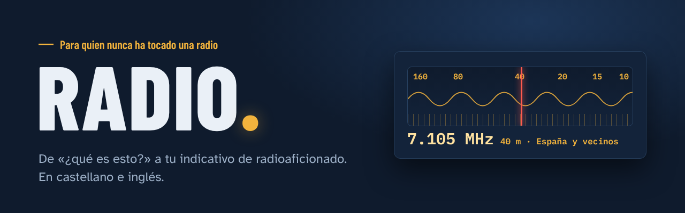
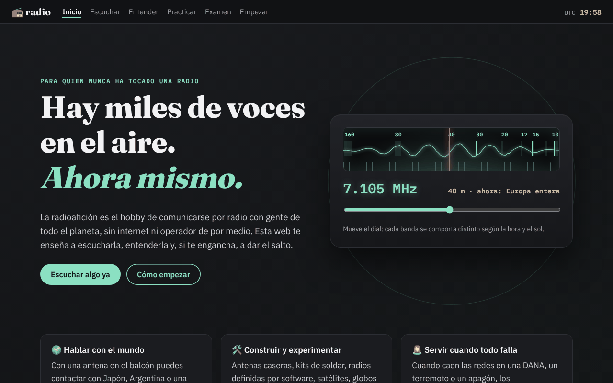
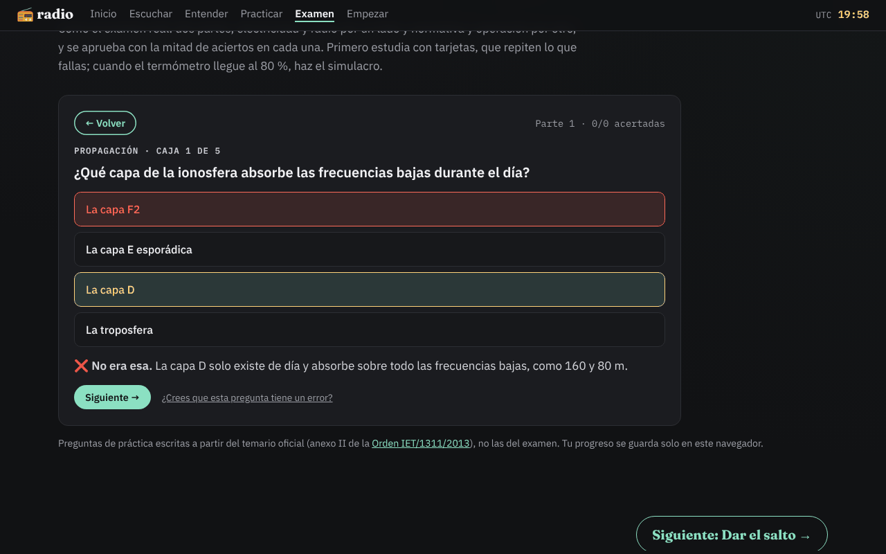
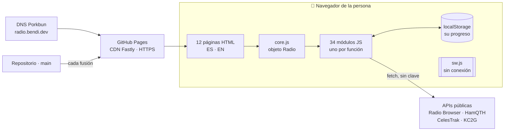
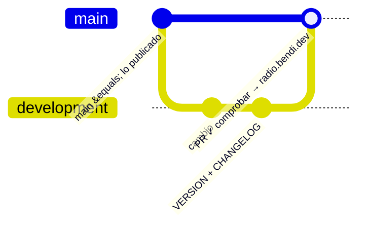

<p align="right"><b>Español</b> · <a href="README.en.md">English</a></p>

<p align="center">
  <a href="https://radio.bendi.dev"></a>
</p>

<p align="center">
  <a href="https://radio.bendi.dev"><b>📻 Abrir la web</b></a> &nbsp;·&nbsp;
  <a href="https://radio.bendi.dev/en/"><b>🇬🇧 English</b></a> &nbsp;·&nbsp;
  <a href="docs/README.md"><b>📚 Documentación</b></a> &nbsp;·&nbsp;
  <a href="https://github.com/sponsors/serbenda"><b>💚 Apoya</b></a>
</p>

<p align="center">
  <a href="https://github.com/serbenda/radio/actions/workflows/comprobaciones.yml"></a>
  <a href="https://github.com/serbenda/radio/actions/workflows/enlaces.yml"></a>
  
  
  
  
  <a href="LICENSE"></a>
  <a href="LICENSE-CONTENIDO.md"></a>
</p>

---

**Hay miles de voces en el aire ahora mismo.** Radioaficionados hablando de un continente a otro, satélites que repiten lo que les dices, balizas que miden la ionosfera cada tres minutos. Casi nadie lo sabe, y quien quiere asomarse se encuentra con foros de los años 2000, siglas sin explicar y un examen oficial sin material para estudiar.

**radio** es la puerta de entrada que faltaba: una web gratuita, sin registro, sin cookies y que funciona sin conexión, que lleva a cualquiera de **escuchar por primera vez** a **aprobar el examen y montar su primera estación**. En castellano y en inglés.

<table>
  <tr>
    <td width="50%"></td>
    <td width="50%"></td>
  </tr>
  <tr>
    <td></td>
    <td></td>
  </tr>
  <tr>
    <td></td>
    <td></td>
  </tr>
</table>

## Lo que hay dentro

> Cinco pasos, del oído a la licencia. Cada uno se marca solo en **Tu primer mes** (4 semanas, 14 pasos, insignias) a medida que haces cosas, no a medida que lees.

| | Paso | Lo que puedes hacer |
| :-: | --- | --- |
| 🏠 | **[Inicio](https://radio.bendi.dev/)** | Mover un dial de onda corta de verdad · qué es la radioafición en un minuto · **Tu primer mes** · guardar tu progreso en un archivo · instalar la app |
| 🎧 | **[Escuchar](https://radio.bendi.dev/escuchar/)** | Mapa de emisoras del mundo con reproductor · escucha guiada en un receptor real · **Ahora en el aire**: quién habla con quién, en directo · **¿Qué es este sonido?**: Morse, SSB, FT8, SSTV… con cascada y 11 grabaciones reales |
| 🌍 | **[Entender](https://radio.bendi.dev/entender/)** | Cuatro lecciones interactivas en tres niveles · bandas · propagación de hoy en lenguaje llano · **balizas en directo** · pases de la ISS sobre tu casa · **QO-100** y **satélites FM** |
| 🎙️ | **[Practicar](https://radio.bendi.dev/practicar/)** | Morse con el método Koch a velocidad real · alfabeto fonético y jerga · **repetidores y radio digital** (DMR, C4FM, D-STAR, APRS) con calculadora · cinco contactos simulados con voz y tarjeta QSL |
| 📝 | **[Examen](https://radio.bendi.dev/examen/)** | **169 preguntas** escritas a partir de la Orden IET/1311/2013 · tarjetas que repiten lo que fallas · simulacro de dos partes como el real (60 preguntas, corrección al final) |
| 🚀 | **[Empezar](https://radio.bendi.dev/empezar/)** | El trámite en cifras · CB-27 y walkies sin licencia · qué radio comprar (y cuál es legal) · **tu primera estación con calculadora de antenas** · radioclubes de la URE en un mapa · calendario · familias · **la radio en clase** con ficha imprimible · Hispanoamérica |

<details>
<summary><b>🔧 Para radioaficionados con licencia</b>: lo que puedes recomendar con tranquilidad</summary>

- **Balizas NCDXF/IARU en directo**: las 18 balizas, en sus 5 frecuencias, calculadas segundo a segundo con la regla oficial.
- **QO-100**: acimut y elevación de la parabólica desde la ciudad que elijas, frecuencias del transpondedor de banda estrecha y la autorización española de 2,4 GHz.
- **Satélites FM** (SO-50, AO-91) e **ISS**: próximos pases calculados en el navegador con SGP4 y elementos de CelesTrak.
- **Calculadoras**: dipolo y vertical para cualquier banda, pérdidas del coaxial y desplazamiento de repetidores de 2 m y 70 cm.
- **Datos comprobados** con su fuente y fecha en [docs/DATOS.md](docs/DATOS.md). ¿Ves algo mal? [Avísanos](https://github.com/serbenda/radio/issues/new/choose).

</details>

<details>
<summary><b>🍎 Para docentes</b>: una sesión de 50 minutos lista para dar</summary>

En **[Empezar → La radio en clase](https://radio.bendi.dev/empezar/#docentes)**: plan de sesión para 10 a 16 años y una **ficha A4 imprimible** (alfabeto fonético, Morse, guion de un contacto y libro de guardia), en castellano y en inglés. Sin cuentas, sin instalar nada, funciona en la pizarra digital.

</details>

<details>
<summary><b>📲 Como una app</b>: en el móvil y sin conexión</summary>

Se instala en **Android, iPhone, iPad y ordenador** (botón "Instalar la app" del pie o [pasos para cada sistema](https://radio.bendi.dev/#instalar)). Después de la primera visita funciona **sin conexión**: lecciones, Morse, examen, contactos simulados y calculadoras. Solo lo que es en directo necesita red.

</details>

## En cifras

| | | | |
| :-: | :-: | :-: | :-: |
| **12** páginas | **2** idiomas | **169** preguntas de examen | **14** pasos con insignias |
| **0** dependencias | **0** cookies | **0** servidores propios | **0** pasos de compilación |
| **≈ 85 KB** por página (gzip) | **108** comprobaciones automáticas | **22** decisiones documentadas | **11** runbooks de operación |

## Cómo está hecha



| Principio | Qué significa aquí |
| --- | --- |
| **Sin magia** | HTML, CSS y JavaScript tal cual. Sin frameworks, sin `npm`, sin compilar: lo que ves en el repositorio es exactamente lo que se publica |
| **Sin servidor** | Los datos en directo se piden desde el navegador a servicios públicos; el progreso se queda en tu dispositivo |
| **Se degrada bien** | Si un servicio externo cae, su sección lo dice y el resto sigue. Sin red, la app sigue funcionando |
| **Accesible** | Auditada con axe (WCAG 2.2 AA), tipografía para baja visión, todo con teclado, ningún dato solo en un gráfico |
| **Segura** | Content-Security-Policy estricta, integridad (SRI) en librerías externas, todo texto externo escapado |
| **Privada** | Sin cookies, sin Google Fonts, métricas de hitos sin datos personales |
| **Documentada al extremo** | Cada archivo explica qué hace y cómo cambiarlo; 21 documentos para cada papel |

Explicación completa con diagramas: [docs/ARQUITECTURA.md](docs/ARQUITECTURA.md).

## Empezar en 1 minuto

```bash
git clone https://github.com/serbenda/radio.git && cd radio
python3 -m http.server 8000      # abre http://localhost:8000/
node tools/check.mjs             # 108 comprobaciones (Node 18+)
```

No hay nada que instalar. **¿Primera vez?** El [tutorial](docs/TUTORIAL.md) te lleva de cero a tu primer cambio publicado en 30 minutos.

## Documentación para cada papel

Todo está escrito para que se pueda mantener **sin ayuda de nadie**. Índice completo en **[docs/README.md](docs/README.md)**.

| Si eres… | Empieza por | Y tendrás a mano |
| --- | --- | --- |
| 🆕 **Nuevo en el proyecto** | [Historia](docs/HISTORIA.md) → [Arquitectura](docs/ARQUITECTURA.md) → [Tutorial](docs/TUTORIAL.md) | [Glosario](docs/GLOSARIO.md) · [Decisiones](docs/DECISIONES.md) |
| 💻 **Desarrollador** | [Manual de desarrollo](docs/DESARROLLO.md) | [Módulos](docs/MODULOS.md) · [Recetas](docs/GUIA.md) · [Estilos](docs/ESTILOS.md) · [Idiomas](docs/IDIOMAS.md) |
| 🖧 **Ingeniero de sistemas** | [Infraestructura](docs/INFRAESTRUCTURA.md) | DNS, Pages, certificados, cachés, límites, recuperación ante desastres |
| 🚨 **SRE** | [Operaciones](docs/OPERACIONES.md) | SLO, monitorización, [11 runbooks](docs/OPERACIONES.md#runbooks), postmortem, calendario |
| ⚙️ **DevOps** | [CI/CD](docs/CICD.md) | Ramas protegidas, Actions, versionado, publicar y volver atrás, métricas DORA |
| 🔒 **Seguridad** | [Seguridad](docs/SEGURIDAD.md) | Modelo de amenazas, CSP directiva a directiva, cadena de suministro |
| ✍️ **Contenido** | [Contenido](docs/CONTENIDO.md) | [Datos y fuentes](docs/DATOS.md) · [Privacidad](docs/PRIVACIDAD.md) |

<details>
<summary><b>🚨 Si algo falla ahora mismo</b></summary>

| Situación | Ve a |
| --- | --- |
| La web no carga o se ve rota tras publicar | [RB-01 → revertir la PR](docs/OPERACIONES.md#rb-01--la-web-no-carga-o-se-ve-rota-tras-publicar) |
| El dominio no resuelve | [RB-02](docs/OPERACIONES.md#rb-02--el-dominio-no-resuelve-dns_probe_finished_nxdomain) (el DNS está en **Porkbun**) |
| Aviso de certificado | [RB-03](docs/OPERACIONES.md#rb-03--aviso-de-certificado-o-enforce-https-desactivado) |
| Hay gente con la versión vieja | [RB-05](docs/OPERACIONES.md#rb-05--hay-gente-que-sigue-viendo-la-versión-antigua) |
| Una sección en directo sin datos | [RB-06](docs/OPERACIONES.md#rb-06--una-sección-en-directo-no-muestra-datos) |

</details>

## Flujo de trabajo



1. Todo se hace en **`development`**; `main` está protegida (pull request y comprobaciones obligatorias, también para administradores).
2. `node tools/check.mjs` en verde y la [lista manual](docs/PRUEBAS.md#lista-de-comprobación-manual-antes-de-fusionar).
3. Pull request a `main` → GitHub Actions comprueba → se fusiona → **publicado en 1–2 minutos**.
4. Cada versión sube `VERSION` en `sw.js` y se anota en el [CHANGELOG](CHANGELOG.md).
5. ¿Algo salió mal? **Revert** de la pull request ([CI/CD → Vuelta atrás](docs/CICD.md#vuelta-atrás)).

Normas completas en [CONTRIBUTING.md](CONTRIBUTING.md).

## Estructura

```
index.html  escuchar/  entender/  practicar/  examen/  empezar/    Las seis páginas en castellano
en/  (index, listen, understand, practice, exam, start)            Las seis en inglés
404.html  offline.html                                             Error y sin conexión (bilingües)
css/style.css                                                      Estilos "Dial nocturno" (una sola hoja)
js/                                                                Un módulo por funcionalidad (+ js/en/)
fonts/  img/  og.png                                               Tipografías propias, iconos, imagen para redes
sw.js  manifest.webmanifest  sitemap.xml  robots.txt  CNAME        Sin conexión, instalación, buscadores, dominio
tools/                                                             Comprobaciones, enlaces, tipografías
.github/                                                           Actions, formularios de aviso, plantilla de PR
docs/                                                              Documentación
```

Árbol detallado en [docs/ARQUITECTURA.md §3](docs/ARQUITECTURA.md#3-estructura-de-carpetas).

## Datos, servicios y créditos

| Qué | De dónde | Licencia o condiciones |
| --- | --- | --- |
| Emisoras | [Radio Browser](https://www.radio-browser.info) | Datos abiertos |
| Avisos en directo y datos solares | [HamQTH.com](https://www.hamqth.com/developers.php) | Citar la fuente; ≤ 1 consulta/15 s |
| Mapa de la ionosfera | [KC2G](https://prop.kc2g.com/) | Citar la fuente |
| Órbitas (ISS, SO-50, AO-91) | [CelesTrak](https://celestrak.org/) con [satellite.js](https://github.com/shashwatak/satellite-js) | satellite.js: MIT |
| Mapas | [Leaflet](https://leafletjs.com) con teselas de [Esri](https://www.esri.com/) | Leaflet: BSD-2; atribución de Esri en cada mapa |
| Receptor web | [WebSDR de la Universidad de Twente](http://websdr.ewi.utwente.nl:8901/) | Enlace |
| Balizas | [NCDXF/IARU International Beacon Project](https://www.ncdxf.org/beacon/) | Horario público |
| Grabaciones reales | [Wikimedia Commons](https://commons.wikimedia.org/wiki/Category:Audio_files_of_amateur_radio) | CC0, CC BY, CC BY-SA; autor y licencia en cada una |
| Secciones de radioclub | [URE](https://www.ure.es/secciones/) | Solo datos públicos de cada sección |
| Preguntas de examen | Escritas a partir de la [Orden IET/1311/2013](https://www.boe.es/buscar/doc.php?id=BOE-A-2013-7624) | Propias |
| Tipografías | [Barlow Condensed](https://github.com/jpt/barlow), [Atkinson Hyperlegible](https://www.brailleinstitute.org/freefont/), [IBM Plex Mono](https://github.com/IBM/plex) | SIL Open Font License (`fonts/`) |
| Visitas y hitos | [GoatCounter](https://www.goatcounter.com/) | Sin cookies ni datos personales |

Detalle de cada servicio, sus límites y qué pasa si falla: [docs/DATOS.md](docs/DATOS.md).

## 💚 Apoya el proyecto

<p align="center">
  <a href="https://github.com/sponsors/serbenda"></a>
</p>

La web es **gratuita, sin publicidad, sin registro y sin rastrear a nadie**, y lo seguirá siendo. Tu apoyo sirve para:

| | |
| :-: | --- |
| 📝 | Más preguntas del examen, revisadas con la ley delante |
| 🎧 | Grabaciones reales de radioaficionados en español |
| 🛰️ | Nuevas lecciones, contactos simulados y satélites |
| 🛠️ | Mantener los datos al día (tasas, radioclubes, autorizaciones, enlaces) |

**¿Sin presupuesto?** También ayuda muchísimo, y es gratis: [avisar de un error](https://github.com/serbenda/radio/issues/new/choose), compartir la web con quien pueda engancharse a la radio o darle una ⭐ a este repositorio.

## Seguridad

¿Has encontrado una vulnerabilidad? No abras un aviso público: sigue [SECURITY.md](SECURITY.md).

## Licencia

| Qué | Licencia |
| --- | --- |
| **Código** (HTML, CSS, JavaScript, herramientas) | [MIT](LICENSE) |
| **Contenido** (textos, preguntas del examen, documentación, imágenes propias) | [CC BY-SA 4.0](LICENSE-CONTENIDO.md): puedes reutilizarlo citando la fuente y compartiendo igual |
| Recursos de terceros (tipografías, librerías, grabaciones, datos) | Los suyos; detalle en [LICENSE-CONTENIDO.md](LICENSE-CONTENIDO.md#lo-que-no-es-de-este-proyecto-conserva-su-licencia) |

© 2026 Sergio Santiago Bendaña Quesada

<p align="center"><b>73!</b> 📻<br><sub>«Saludos cordiales», en el idioma de la radio.</sub></p>
