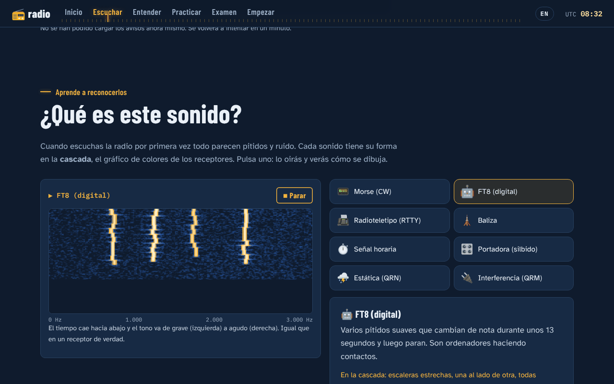
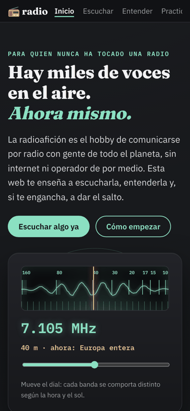
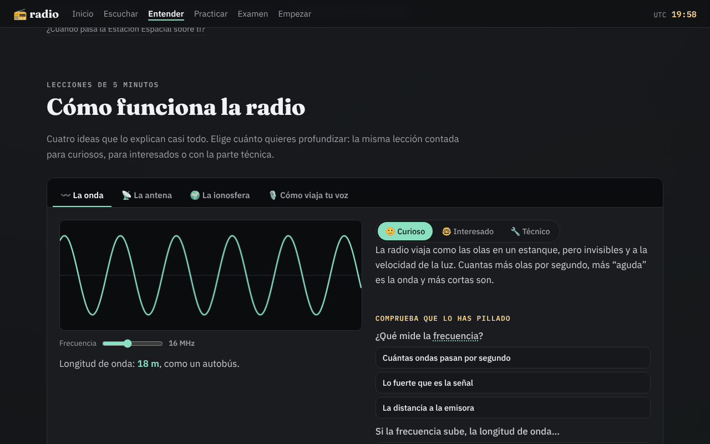
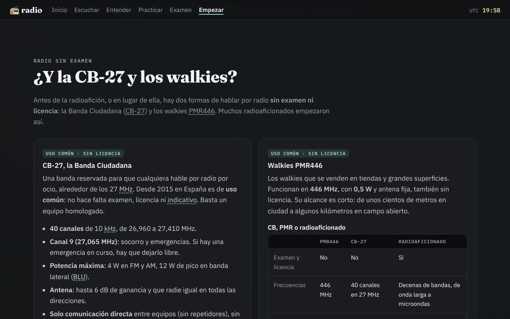
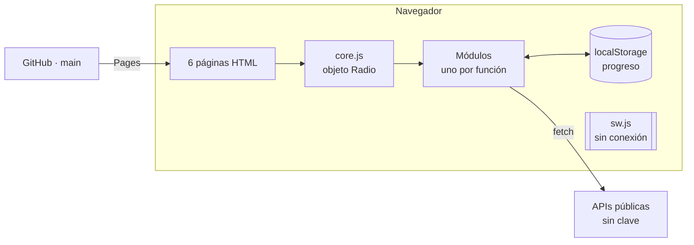

# 📻 radio

**Web de iniciación a la radioafición en español:** de "¿qué es esto?" a tu indicativo. Para quien no ha tocado nunca una radio.

**👉 https://bendi.dev/radio** · 🇬🇧 **English:** https://bendi.dev/radio/en/

[](https://github.com/serbenda/radio/actions/workflows/comprobaciones.yml)
[](https://github.com/serbenda/radio/actions/workflows/enlaces.yml)
[](LICENSE)
[](LICENSE-CONTENIDO.md)
[](https://github.com/sponsors/serbenda)


## Qué es

Una web estática, sin registro, sin cookies y que funciona sin conexión, que acompaña a un novato en cinco pasos:

| Paso | Página | Qué hay |
| --- | --- | --- |
| — | [Inicio](https://bendi.dev/radio/) | Dial de onda corta, qué es la radioafición y **Tu primer mes**: 4 semanas, 14 pasos que se marcan solos e insignias. Guardar y recuperar el progreso, instalar la app y apoyar el proyecto |
| 1 | [Escuchar](https://bendi.dev/radio/escuchar/) | Mapa de emisoras con reproductor, escucha guiada en un receptor real, **Ahora en el aire** (quién habla con quién, en directo), **¿Qué es este sonido?** con cascada y 11 grabaciones reales |
| 2 | [Entender](https://bendi.dev/radio/entender/) | Cuatro lecciones interactivas en tres niveles, bandas, propagación de hoy en lenguaje llano y pases de la ISS sobre tu ciudad |
| 3 | [Practicar](https://bendi.dev/radio/practicar/) | Entrenador de Morse con método Koch, alfabeto fonético y jerga, y cinco contactos simulados con tarjeta QSL |
| 4 | [Examen](https://bendi.dev/radio/examen/) | 169 preguntas revisadas contra la Orden IET/1311/2013, tarjetas que repiten lo que fallas y simulacro como el real |
| 5 | [Empezar](https://bendi.dev/radio/empezar/) | El trámite en cifras, CB-27 y walkies, qué radio comprar (y qué es legal), radioclubes de la URE, calendario, familias, **la radio en clase** (ficha imprimible) e Hispanoamérica |

📲 **Se instala como una app** en Android, iPhone, iPad y ordenador (botón "Instalar la app" del pie o pasos en la [portada](https://bendi.dev/radio/#instalar)) y funciona sin conexión.

<table>
  <tr>
    <td></td>
    <td></td>
    <td rowspan="2"></td>
  </tr>
  <tr>
    <td></td>
    <td></td>
  </tr>
</table>

## Empezar en 1 minuto

```bash
git clone https://github.com/serbenda/radio.git && cd radio
python3 -m http.server 8000      # abre http://localhost:8000/
node tools/check.mjs             # comprobaciones automáticas (Node 18+)
```

No hay nada que instalar ni que compilar: lo que hay en el repositorio es exactamente lo que se publica.

**¿Primera vez?** Sigue el [tutorial](docs/TUTORIAL.md): de cero a tu primer cambio publicado en 30 minutos.

## Cómo está hecha



- **HTML, CSS y JavaScript sin frameworks ni compilación.** Un módulo por funcionalidad; se comunican con eventos.
- **Sin servidor propio:** datos en directo de APIs públicas con CORS; el progreso se queda en el navegador.
- **Instalable en Android, iPhone y ordenador** y **sin conexión**, con un service worker propio.
- **Accesible:** auditada con axe (WCAG 2.2 AA), contraste ≥ 6:1, teclado y lector de pantalla.
- **Segura:** Content-Security-Policy, integridad (SRI) de librerías, todo texto externo escapado.
- **Privada:** sin cookies, tipografías propias, métricas sin datos personales.

Explicación completa con diagramas en [docs/ARQUITECTURA.md](docs/ARQUITECTURA.md).

## Documentación

Todo está documentado para poder mantenerlo sin ayuda. Índice completo y orden de lectura en **[docs/README.md](docs/README.md)**.

| Quiero… | Lee |
| --- | --- |
| Entender cómo está hecha | [Arquitectura](docs/ARQUITECTURA.md) · [Módulos](docs/MODULOS.md) · [Cómo se construyó](docs/HISTORIA.md) |
| Hacer mi primer cambio | [Tutorial](docs/TUTORIAL.md) |
| Cambiar algo concreto (pregunta, grabación, página…) | [Guía de recetas](docs/GUIA.md) |
| Arreglar algo que falla | [Solución de problemas](docs/PROBLEMAS.md) |
| Saber de dónde salen los datos | [Datos y servicios](docs/DATOS.md) · [Contenido](docs/CONTENIDO.md) |
| Cambiar el diseño | [Estilos](docs/ESTILOS.md) |
| Traducir o tocar la versión en inglés | [Idiomas](docs/IDIOMAS.md) |
| Saber por qué se hizo así | [Decisiones](docs/DECISIONES.md) · [Estudio](docs/ESTUDIO.md) |
| Comprobar la calidad | [Pruebas](docs/PRUEBAS.md) · [Calidad](docs/CALIDAD.md) · [Privacidad](docs/PRIVACIDAD.md) |
| Entender un término | [Glosario](docs/GLOSARIO.md) |
| Contribuir | [CONTRIBUTING.md](CONTRIBUTING.md) |

## Estructura

```
index.html  escuchar/  entender/  practicar/  examen/  empezar/    Las seis páginas
404.html  offline.html                                             Páginas de error y sin conexión
css/style.css                                                      Estilos (una sola hoja)
js/                                                                Un módulo por funcionalidad
fonts/  img/  og.png                                               Tipografías, iconos, imagen para redes
sw.js  manifest.webmanifest  sitemap.xml                           Sin conexión, instalación, buscadores
tools/                                                             Comprobaciones y utilidades
.github/                                                           Actions, formularios de aviso, plantilla de PR
docs/                                                              Documentación
```

Árbol detallado en [docs/ARQUITECTURA.md §3](docs/ARQUITECTURA.md#3-estructura-de-carpetas).

## Flujo de trabajo

1. Se trabaja en la rama **`development`**; nunca directamente en `main`.
2. Antes de subir: `node tools/check.mjs` sin fallos y la lista manual de [docs/PRUEBAS.md](docs/PRUEBAS.md).
3. Los cambios llegan a `main` con una **pull request**; GitHub Actions ejecuta las comprobaciones.
4. Al fusionar, GitHub Pages publica `main` en bendi.dev/radio en uno o dos minutos.
5. Cada versión sube `VERSION` en `sw.js` y se anota en [CHANGELOG.md](CHANGELOG.md).

Normas completas en [CONTRIBUTING.md](CONTRIBUTING.md).

## Datos, servicios y créditos

| Qué | De dónde | Licencia o condiciones |
| --- | --- | --- |
| Emisoras | [Radio Browser](https://www.radio-browser.info) | Datos abiertos |
| Avisos en directo y datos solares | [HamQTH.com](https://www.hamqth.com/developers.php) | Citar la fuente; ≤ 1 consulta/15 s |
| Mapa de la ionosfera | [KC2G](https://prop.kc2g.com/) | Citar la fuente |
| Órbita de la ISS | [CelesTrak](https://celestrak.org/) con [satellite.js](https://github.com/shashwatak/satellite-js) | satellite.js: MIT |
| Mapas | [Leaflet](https://leafletjs.com) con teselas de [Esri](https://www.esri.com/) | Leaflet: BSD-2; atribución de Esri en cada mapa |
| Receptor web | [WebSDR de la Universidad de Twente](http://websdr.ewi.utwente.nl:8901/) | Enlace |
| Grabaciones reales | [Wikimedia Commons](https://commons.wikimedia.org/wiki/Category:Audio_files_of_amateur_radio) | CC0, CC BY, CC BY-SA; autor y licencia en cada una |
| Secciones de radioclub | [URE](https://www.ure.es/secciones/) | Solo datos públicos de cada sección |
| Preguntas de examen | Escritas a partir de la [Orden IET/1311/2013](https://www.boe.es/buscar/doc.php?id=BOE-A-2013-7624) | Propias |
| Tipografías | [Fraunces](https://github.com/undercasetype/Fraunces), [IBM Plex](https://github.com/IBM/plex) | SIL Open Font License (`fonts/`) |
| Visitas y hitos | [GoatCounter](https://www.goatcounter.com/) | Sin cookies ni datos personales |

Detalle en [docs/DATOS.md](docs/DATOS.md).

## 💚 Apoya el proyecto

<p align="center">
  <a href="https://github.com/sponsors/serbenda"></a>
  &nbsp;
  <a href="https://github.com/serbenda/radio"></a>
</p>

La web es **gratuita, sin publicidad, sin registro y sin rastrear a nadie**, y lo seguirá siendo. Si te ha sido útil, tu apoyo sirve para:

| | Para qué |
| :-: | --- |
| 📝 | Más preguntas del examen, revisadas con la ley delante |
| 🎧 | Grabaciones reales de radioaficionados en español |
| 🛰️ | Nuevas lecciones, contactos simulados y satélites |
| 🛠️ | Mantener los datos al día (tasas, radioclubes, enlaces) |

**¿Sin presupuesto?** También ayuda muchísimo, y es gratis: [avisar de un error](https://github.com/serbenda/radio/issues/new/choose), compartir la web con quien pueda engancharse a la radio o darle una ⭐ al repositorio. 73!

## Licencia

| Qué | Licencia |
| --- | --- |
| **Código** (HTML, CSS, JavaScript, herramientas) | [MIT](LICENSE) |
| **Contenido** (textos, preguntas del examen, documentación, imágenes propias) | [CC BY-SA 4.0](LICENSE-CONTENIDO.md): puedes reutilizarlo citando la fuente y compartiendo igual |
| Recursos de terceros (tipografías, librerías, grabaciones, datos) | Los suyos; detalle en [LICENSE-CONTENIDO.md](LICENSE-CONTENIDO.md#lo-que-no-es-de-este-proyecto-conserva-su-licencia) |

© 2026 Sergio Santiago Bendaña Quesada

73! 📻 *(«saludos cordiales» en jerga de radio)*
