# Arquitectura

Cómo está montada la web, cómo encajan las piezas y por qué se hizo así. Está pensada para leerse de arriba abajo la primera vez; después sirve de consulta.

- Detalle de cada archivo de JavaScript: [MODULOS.md](MODULOS.md)
- Servicios externos, límites y qué pasa si fallan: [DATOS.md](DATOS.md)
- Colores, tipografías y componentes visuales: [ESTILOS.md](ESTILOS.md)
- Por qué se tomó cada decisión: [DECISIONES.md](DECISIONES.md)

Los diagramas están escritos en [Mermaid](https://mermaid.js.org/): GitHub los dibuja solos al abrir este archivo. Para editarlos, cambia el texto del bloque `mermaid`; puedes previsualizarlos en <https://mermaid.live>.

---

## 1. La idea en una frase

Una **web estática** (archivos HTML, CSS y JavaScript que el servidor entrega tal cual) que guarda el progreso de cada persona **en su propio navegador** y pide los datos en directo **directamente a servicios públicos**, sin servidor propio.

## 2. Vista general

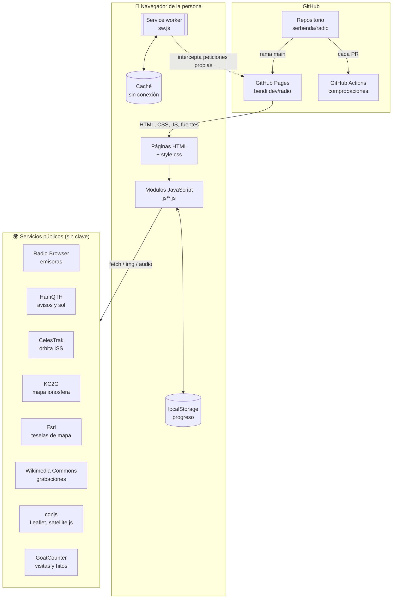

**Lo que NO hay**, a propósito:

| No hay… | Por qué | Consecuencia |
| --- | --- | --- |
| Servidor propio | GitHub Pages solo sirve archivos; además, sin servidor no hay coste ni mantenimiento ni datos personales que proteger | Solo se usan servicios con CORS abierto y sin clave (D01) |
| Base de datos ni cuentas | No hace falta registrarse para aprender | El progreso vive en el navegador; se puede exportar a un archivo |
| Paso de compilación (npm, Webpack, React…) | Lo que hay en el repositorio es exactamente lo que se publica: más fácil de entender y de mantener años | La cabecera y el pie se repiten en cada página y una comprobación vigila que sean iguales (D10) |
| Cookies | No se necesitan | Sin banner de cookies |

## 3. Estructura de carpetas

```
radio/
├── index.html                Inicio (portada)
├── escuchar/index.html       Paso 1 · Escuchar
├── entender/index.html       Paso 2 · Entender
├── practicar/index.html      Paso 3 · Practicar
├── examen/index.html         Paso 4 · Examen
├── empezar/index.html        Paso 5 · Empezar
├── en/                       Versión en inglés: index.html, listen/, understand/, practice/, exam/, start/
├── 404.html                  Página "no existe" (GitHub Pages la usa sola)
├── offline.html              Lo que se ve sin conexión en una página no visitada
│
├── css/style.css             Una sola hoja de estilos para todo (ver ESTILOS.md)
├── fonts/                    Tipografías WOFF2 recortadas + licencias OFL
├── img/                      Iconos de la web instalada (192, 512, maskable, apple, favicon)
├── og.png                    Imagen al compartir en redes (1200 × 630)
│
├── js/
│   ├── core.js               Núcleo común: objeto global Radio (va el PRIMERO)
│   ├── data.js               Contenido compartido: bandas, glosario, FAQ, grabaciones…
│   ├── journey.js            "Tu primer mes": registra logros en todas las páginas
│   ├── glossary.js           Glosario emergente (va el ÚLTIMO)
│   ├── exam-data.js          Banco de 169 preguntas
│   ├── clubs-data.js         162 secciones de la URE (solo datos públicos)
│   ├── en/exam-data.js       Las mismas 169 preguntas en inglés
│   └── …                     Un módulo por funcionalidad (ver MODULOS.md)
│
├── sw.js                     Service worker: modo sin conexión
├── manifest.webmanifest      Datos para instalar la web en el móvil
├── sitemap.xml               Mapa del sitio para buscadores
├── .nojekyll                 Le dice a GitHub Pages que no procese nada
│
├── tools/
│   ├── check.mjs             Comprobaciones automáticas (sin dependencias)
│   ├── enlaces.mjs           Comprueba enlaces externos (semanal)
│   └── solo-comentarios.sh   Verifica que un cambio solo toca comentarios
│
├── .github/
│   ├── workflows/            comprobaciones.yml (cada PR) y enlaces.yml (cada lunes)
│   ├── ISSUE_TEMPLATE/       Formularios para avisar de errores
│   ├── FUNDING.yml           Botón "Sponsor" (GitHub Sponsors)
│   └── pull_request_template.md
│
├── docs/                     Esta documentación (índice en docs/README.md)
├── README.md · CONTRIBUTING.md · CHANGELOG.md · .editorconfig
├── LICENSE (MIT, código) · LICENSE-CONTENIDO.md (CC BY-SA 4.0, contenido)
```

**Regla de las carpetas:** cada página es una carpeta con su `index.html`. Así las direcciones quedan limpias (`/radio/examen/` en vez de `/radio/examen.html`) y GitHub Pages las sirve sin configuración.

## 4. Páginas y recorrido

La web sigue el camino de alguien que no sabe nada de radio hasta que se saca la licencia:

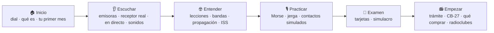

| Página | Ruta | Secciones (`id`) | Módulos que carga |
| --- | --- | --- | --- |
| Inicio | `/` | `inicio`, `mes`, `paginas`, `instalar`, `apoya` (+ `backup` dentro de `mes`) | dial, backup |
| Escuchar | `/escuchar/` | `emisoras`, `directo`, `ahora`, `sonidos` (+ `grabaciones`) | stations, guided, live, morse, sounds, recordings |
| Entender | `/entender/` | `como-funciona`, `bandas`, `propagacion`, `iss` | lessons, bands, propagation, iss |
| Practicar | `/practicar/` | `morse`, `jerga`, `qso` | morse, morse-ui, koch, jargon, qso |
| Examen | `/examen/` | `test` | exam-data, exam |
| Empezar | `/empezar/` | `empezar`, `cb27`, `equipo`, `clubes`, `familias`, `hispanoamerica`, `emergencias`, `faq` | clubs-data, clubs, family, checklist, faq |

Todas cargan además `core.js`, `data.js`, `journey.js`, `install.js` y `glossary.js`.

### Plantilla común de cada página

```html
<!doctype html>
<html lang="es">
<head>
  <meta charset="utf-8">
  <meta name="viewport" …>
  <meta http-equiv="Content-Security-Policy" …>   <!-- igual en todas: ver §9 -->
  <title>Escuchar · Radio</title>                   <!-- propio de cada página -->
  <meta name="description" …>                       <!-- propio, ≥ 50 caracteres -->
  <meta name="radio-root" content="../">            <!-- "./" en la portada: ver §6 -->
  <link rel="canonical" …> + Open Graph + Twitter
  <link rel="icon" …> <link rel="manifest" …>
  <link rel="preload" href="../fonts/ibm-plex-sans.woff2" as="font" …>
  <link rel="stylesheet" href="../css/style.css">
</head>
<body data-page="escuchar">                         <!-- marca el menú activo -->
  <a class="skip" href="#contenido">Saltar al contenido</a>
  <header class="top">…menú COMÚN…</header>
  <main id="contenido">
    <noscript>…</noscript>
    <header class="page-head">kicker · h1 · entradilla · índice "En esta página"</header>
    <section id="…">…</section>                    <!-- una por bloque -->
    <nav class="next-page">Siguiente: …</nav>
  </main>
  <footer>…pie COMÚN…</footer>
  <script src="…librerías externas con integrity…"></script>
  <script src="../js/core.js"></script>
  …
  <script src="../js/glossary.js"></script>
  <script data-goatcounter=… async src="https://gc.zgo.at/count.js"></script>
</body>
</html>
```

`tools/check.mjs` comprueba que la cabecera y el pie son idénticos en las seis páginas (sin contar las rutas `./` o `../`): si cambias el menú, cámbialo en todas.

### Versión en inglés

Cada página tiene su pareja en `en/` (`escuchar/` ↔ `en/listen/`…), con la misma estructura e ids. Los módulos son los mismos: leen el idioma de `<html lang>` y eligen el texto con `Radio.t('castellano', 'English')`. Explicación completa en [IDIOMAS.md](IDIOMAS.md).

## 5. Cómo se carga una página

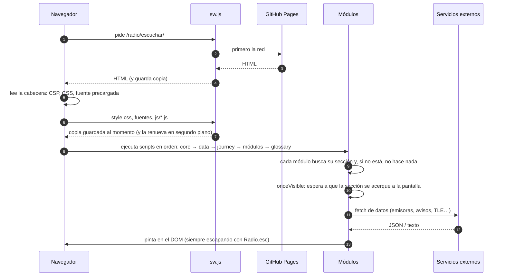

### Orden de los scripts y por qué

| Orden | Script | Por qué en ese lugar |
| --- | --- | --- |
| 1 | Librerías externas (Leaflet, satellite.js) | Los módulos las usan al ejecutarse |
| 2 | `core.js` | Crea `Radio`, que usan todos los demás |
| 3 | `data.js` | Constantes globales (`BANDS`, `FAQ`, `RECORDINGS`…) que leen varios módulos |
| 4 | `journey.js` | Debe estar escuchando eventos antes de que otros módulos los emitan |
| 5 | Módulos de la página | Cada uno pinta su sección |
| 6 | `glossary.js` | El último: marca la jerga en el texto que los demás ya han pintado |
| 7 | GoatCounter (`async`) | No bloquea nada; si falla, la web va igual |

Los scripts son **clásicos** (no `type="module"`) y van al final del `<body>`: así funcionan también abriendo el archivo con doble clic (`file://`), sin servidor.

## 6. Anatomía de un módulo

Todos los archivos de `js/` siguen el mismo patrón:

```js
/**
 * nombre.js · Qué hace en una frase.
 * Página, ids que necesita, qué guarda, qué eventos emite, cómo modificarlo…
 */
(() => {                                   // función que se ejecuta sola: nada se escapa al ámbito global
  'use strict';
  if (!document.getElementById('seccion')) return;   // ¿está mi sección en esta página? si no, salgo
  const { $, esc, store } = Radio;         // utilidades del núcleo

  /* ---------- Datos ---------- */
  /* ---------- Pintado ---------- */
  /* ---------- Eventos ---------- */
})();
```

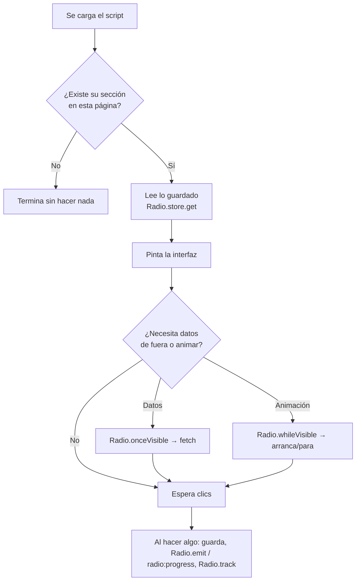

**Rutas relativas:** como las páginas están a distinta profundidad (`/` y `/escuchar/`), cada una declara dónde está la raíz con `<meta name="radio-root" content="./">` o `"../"`. `Radio.url('examen/')` construye el enlace correcto desde cualquier página.

## 7. El núcleo: `Radio`

`core.js` crea un único objeto global para que ningún módulo repita código:

| Utilidad | Para qué | Ejemplo |
| --- | --- | --- |
| `Radio.$(id)` | Atajo de `getElementById` | `$('soundGrid')` |
| `Radio.esc(texto)` | Escapar HTML de todo lo que venga de fuera | `` `<b>${esc(s.name)}</b>` `` |
| `Radio.store.get(clave, defecto)` / `.set` / `.remove` | `localStorage` con JSON y sin excepciones | `store.get('radio.koch', {})` |
| `Radio.emit(nombre, id)` | Avisar de un logro a "Tu primer mes" | `emit('station', uuid)` |
| `Radio.url(ruta)` | Enlace correcto desde cualquier página y en su idioma | `url('examen/')` → `../../en/exam/` en inglés |
| `Radio.lang` / `Radio.locale` | Idioma de la página (`es`/`en`) y formato regional (`es-ES`/`en-GB`) | — |
| `Radio.t(es, en)` | Texto en el idioma de la página | `t('Cargando…', 'Loading…')` |
| `Radio.counterpart(idioma)` | La misma página en el otro idioma | selector ES/EN |
| `Radio.root` | Raíz relativa (`./` o `../`) | — |
| `Radio.whileVisible(el, on, off)` | Arrancar y parar animaciones según se vean | dial, lecciones, cascada |
| `Radio.onceVisible(el, cb)` | Carga perezosa | mapas, datos externos |
| `Radio.reducedMotion` | `true` si el sistema pide menos movimiento | — |
| `Radio.report(plantilla, campos, título)` | URL de un formulario de GitHub ya rellenado | pie, preguntas |
| `Radio.track(hito)` | Contar un hito en GoatCounter | `track('qso/pota')` |

Al cargar, `core.js` además: redirige los enlaces antiguos (`/#ahora` → `escuchar/#ahora`), pone en hora el reloj UTC, marca la página actual en el menú (`aria-current`), prepara "Avísanos" y "Compartir" y registra el service worker.

## 8. Comunicación entre módulos: eventos

Los módulos **no se llaman entre sí**. Se avisan con eventos del `document`. Así cada página carga solo lo que necesita y quitar un módulo no rompe otro.

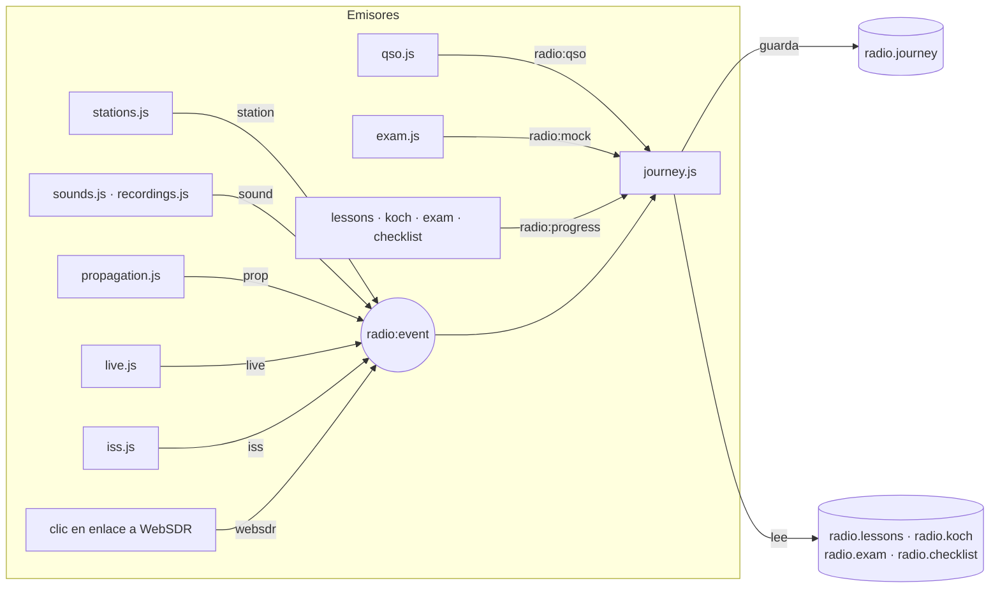

| Evento | Quién lo emite | Detalle (`event.detail`) | Quién escucha |
| --- | --- | --- | --- |
| `radio:event` | cualquier módulo vía `Radio.emit` | `{ name, id }`; `name` ∈ `station`, `websdr`, `sound`, `prop`, `live`, `iss` | journey.js |
| `radio:qso` | qso.js al terminar un contacto | `{ scenario }` (`primero`, `concurso`, `pota`, `emergencia`, `iss`) | journey.js |
| `radio:mock` | exam.js al corregir un simulacro | `{ pass }` (`true`/`false`) | journey.js |
| `radio:progress` | lessons, koch, exam, checklist | ninguno: "vuelve a calcular" | journey.js |

### Ejemplo completo: "Escucha 3 emisoras"

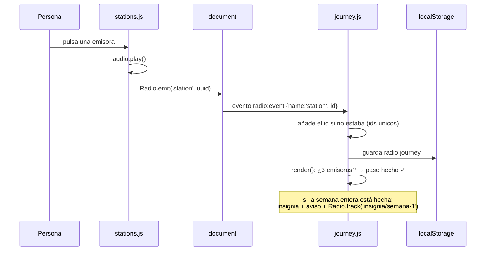

## 9. Datos: dónde vive cada cosa

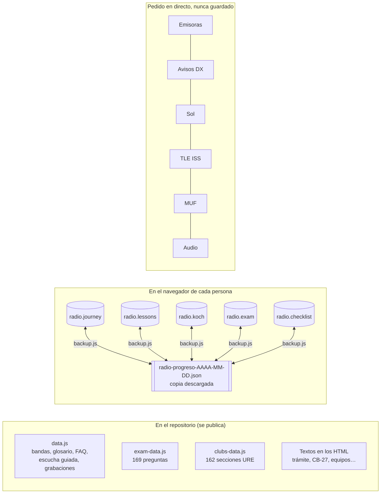

| Clave `localStorage` | Módulo | Forma |
| --- | --- | --- |
| `radio.journey` | journey.js | `{ since: ms, ev: { nombre: [ids] }, badges: { semana: ms } }` |
| `radio.lessons` | lessons.js | `{ idLeccion: true }` |
| `radio.koch` | koch.js | `{ level, hist: { letra: [...] }, recent: [10 últimos], streak, lastDay, todaySec, day }` |
| `radio.exam` | exam.js | `{ q: { id: { box: 0..4, wrong, seen } }, best: { p1, n1, p2, n2 }, ready: { 1: %, 2: % } }` |
| `radio.checklist` | checklist.js | `{ paso: true }` |

Formas exactas, comentadas campo a campo, en la cabecera de cada módulo. Política de privacidad: [PRIVACIDAD.md](PRIVACIDAD.md).

## 10. Sin conexión (service worker)

`core.js` registra `sw.js` cuando la página se sirve por HTTP o HTTPS. El service worker es un script que el navegador pone **entre la página y la red**.

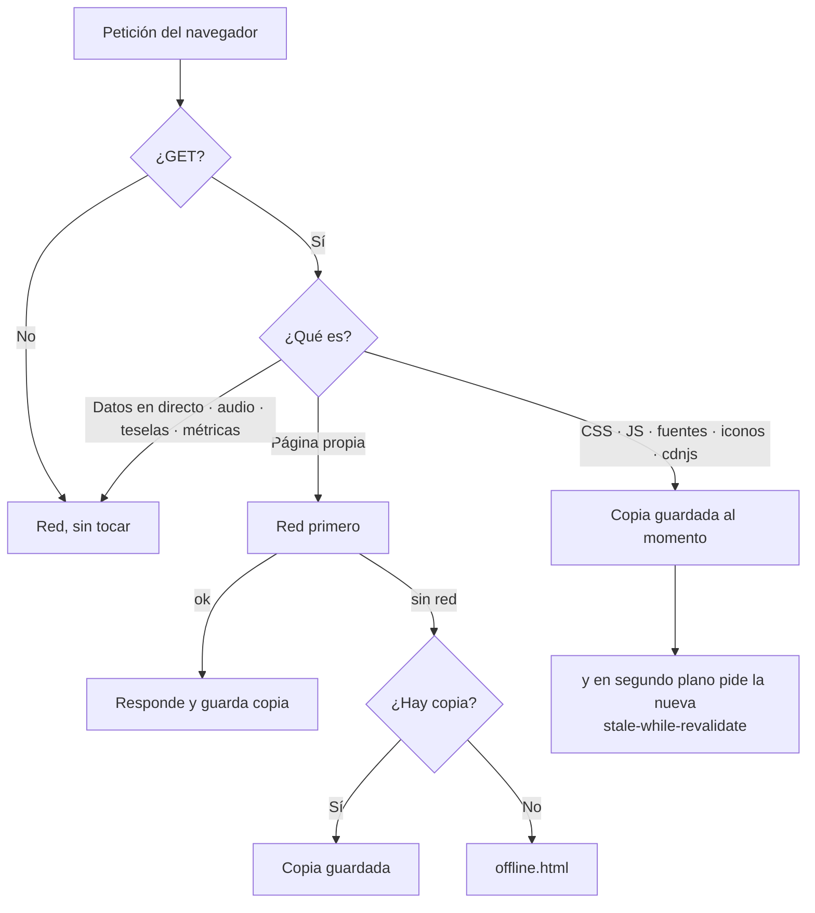

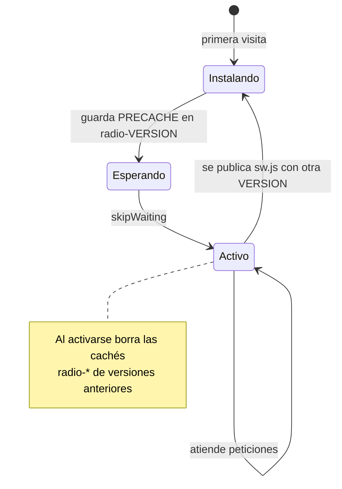

### Instalar la app

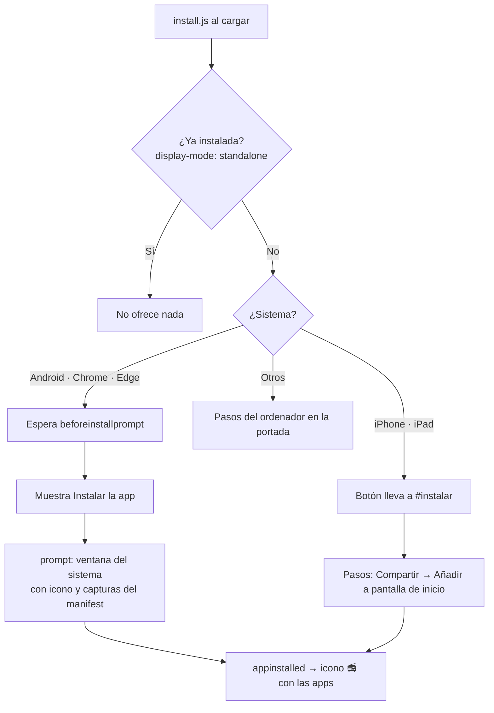

Requisitos para que Android y Chrome ofrezcan instalar (se cumplen; compruébalo en las herramientas del navegador → Aplicación → Manifest): HTTPS, `manifest.webmanifest` con nombre, `start_url`, `display: standalone` e iconos de 192 y 512 px, y un service worker con `fetch`. iPhone usa `apple-touch-icon` y las etiquetas `apple-mobile-web-app-*` del `<head>`.

**Regla de oro:** cada vez que publiques un cambio en cualquier archivo de la web, sube `VERSION` en `sw.js` (y añade la versión al CHANGELOG). Si no, quien ya tenga la web guardada seguirá viendo CSS y JS viejos hasta la siguiente visita. `tools/check.mjs` falla si `VERSION` no coincide con la última versión del CHANGELOG.

## 11. Seguridad

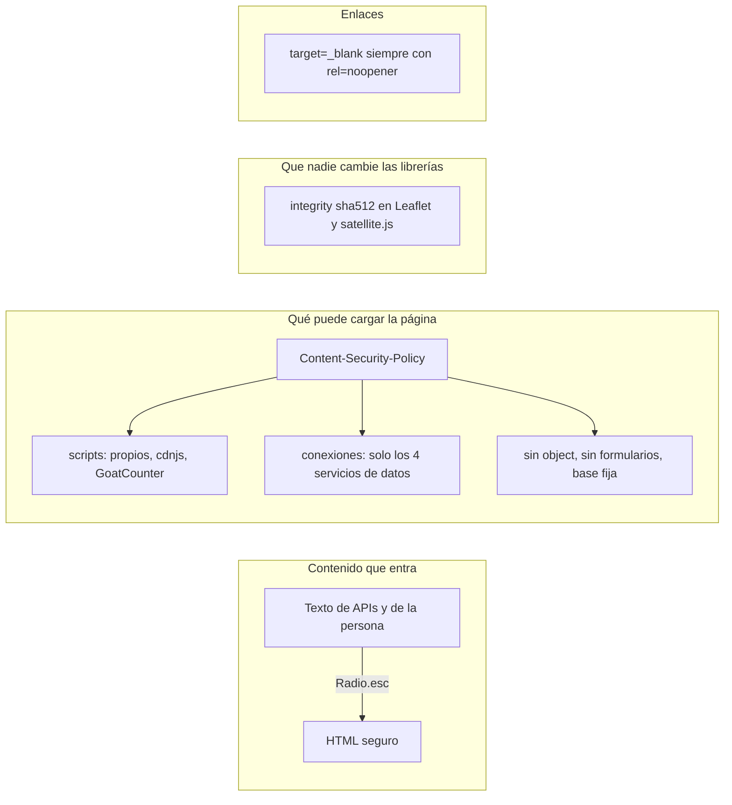

| Medida | Dónde | Lo vigila |
| --- | --- | --- |
| Escapar todo texto externo | `Radio.esc` en cada módulo | Revisión de código |
| Content-Security-Policy | `<meta>` en las 6 páginas | `check.mjs` §11 (igual en todas) |
| Subresource Integrity (SRI) | `<script>` y `<link>` de cdnjs | `check.mjs` §11 |
| Versiones fijas de librerías | URL de cdnjs con `x.y.z` | `check.mjs` §11 |
| `rel="noopener"` | Enlaces externos | `check.mjs` §11 |
| Sin datos personales en métricas | `Radio.track` con nombres fijos | `check.mjs` §10 |
| Sin datos personales de terceros | `clubs-data.js` | `check.mjs` §6 |
| Permisos mínimos en Actions | `permissions:` de cada flujo | Revisión |

**Si añades un servicio externo nuevo**, añádelo a `connect-src` (si usas `fetch`) o `script-src` (si cargas un script) de la CSP **en las seis páginas**; si no, el navegador lo bloqueará y verás un error "Refused to connect" en la consola.

## 12. Publicación

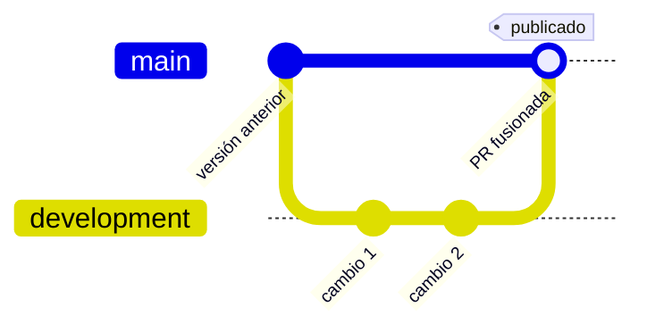

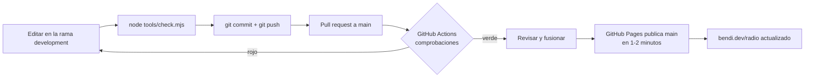

- **Nunca** se trabaja directamente en `main`: todo pasa por `development` y una pull request. GitHub lo impone: `main` está protegida (pull request obligatoria con la comprobación `comprobar` en verde, sin `push --force` ni borrado, también para administradores) y `development` no se puede forzar ni borrar.
- GitHub Pages está configurado como "Deploy from a branch" → `main` → `/ (root)`. El dominio `bendi.dev` está configurado en el repositorio de la web personal; esta web vive en la subcarpeta `/radio/`.
- Paso a paso: [TUTORIAL.md](TUTORIAL.md). Normas: [../CONTRIBUTING.md](../CONTRIBUTING.md).

## 13. Rendimiento

- **Carga perezosa:** mapas y datos externos esperan a que su sección se acerque a la pantalla (`Radio.onceVisible`, 300 px antes).
- **Animaciones solo en pantalla:** dial, lecciones y cascada se paran fuera de la vista o con la pestaña oculta (`Radio.whileVisible`), y no se animan con "reducir movimiento".
- **Consultas medidas:** avisos en directo cada 60 s, solo con la sección visible y la pestaña activa, y nunca dos en menos de 15 s (HamQTH pide ≥ 15 s); datos solares al llegar y cada 15 min (pide ≥ 5 min).
- **Tipografías propias recortadas:** cuatro archivos WOFF2 (≈ 145 KB en total), solo latín; la de texto se precarga.
- **Cada página carga solo sus módulos.** Sin frameworks: el JavaScript propio de la página más pesada son unas decenas de KB.
- **Sin conexión:** tras la primera visita, CSS, JS y fuentes salen de la caché.

Más en [CALIDAD.md](CALIDAD.md).
