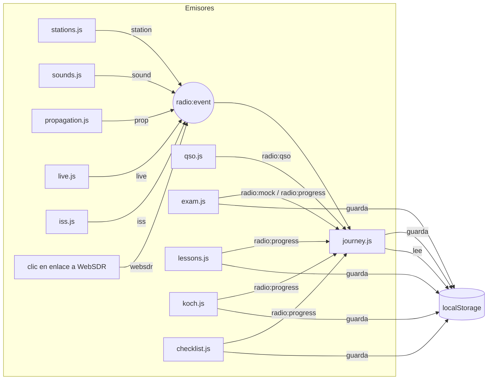

# Arquitectura

Cómo está montada la web, por qué así y cómo encajan las piezas. Para el detalle de cada archivo, ver [MODULOS.md](MODULOS.md).

## Resumen

- **Web estática** publicada con GitHub Pages desde la rama `main`, en `https://bendi.dev/radio/`.
- **Sin paso de compilación**: HTML, CSS y JavaScript tal cual. Lo que hay en el repositorio es exactamente lo que se sirve.
- **Seis páginas** independientes que comparten una hoja de estilos, una cabecera, un pie y un núcleo de JavaScript.
- **JavaScript por módulos**: un archivo por funcionalidad. Cada módulo es una función autoejecutable que comprueba si su sección está en la página y, si no, no hace nada.
- **Sin servidor propio ni base de datos**: los datos en directo vienen de APIs públicas con CORS y el progreso de cada persona se guarda en su navegador (`localStorage`).

## Páginas

| Página | Ruta | Secciones (`id`) | Para qué |
| --- | --- | --- | --- |
| Inicio | `/` | `inicio`, `mes`, `paginas` | Gancho (dial), qué es la radioafición, la ruta "Tu primer mes" y las puertas a cada paso |
| Escuchar | `/escuchar/` | `emisoras`, `directo`, `ahora`, `sonidos` | Oír radio: emisoras, receptor web guiado, quién habla ahora y qué es cada sonido |
| Entender | `/entender/` | `como-funciona`, `bandas`, `propagacion`, `iss` | Cómo funciona: lecciones, bandas, propagación de hoy y la ISS |
| Practicar | `/practicar/` | `morse`, `jerga`, `qso` | Morse, cómo se habla y contactos simulados |
| Examen | `/examen/` | `test` | Simulador del examen |
| Empezar | `/empezar/` | `empezar`, `clubes`, `familias`, `hispanoamerica`, `emergencias`, `faq` | Trámite, radioclubes, calendario, familias y dudas |

La portada tiene además la sección `intro` (tres tarjetas) sin `id`.

Cada página sigue la misma plantilla:

```html
<head>
  …metadatos propios (título, descripción, canónica, Open Graph)…
  <meta name="radio-root" content="../">   <!-- "./" en la portada -->
</head>
<body data-page="escuchar">
  <a class="skip" href="#contenido">Saltar al contenido</a>
  <header class="top">…menú común…</header>
  <main id="contenido">
    <header class="page-head">…h1, entradilla e índice "En esta página"…</header>
    <section id="…">…</section>
    <nav class="next-page">Siguiente: …</nav>
  </main>
  <footer>…pie común…</footer>
  …scripts…
</body>
```

`tools/check.mjs` comprueba que la cabecera y el pie son idénticos en todas las páginas (ignorando la ruta relativa), así que si cambias el menú, cámbialo en las seis.

## Orden de carga de los scripts

Todas las páginas cargan los scripts al final del `<body>` (sin `defer` ni módulos ES, para que funcionen también abriendo el archivo directamente):

1. **Librerías externas** que necesite la página: Leaflet (mapas) y satellite.js (órbitas).
2. **`core.js`**: crea el objeto global `Radio`. Va siempre el primero.
3. **`data.js`**: contenido estático compartido.
4. **`journey.js`**: registra los logros de "Tu primer mes" en cualquier página.
5. **Los módulos de la página**.
6. **`glossary.js`**: siempre el último, porque marca la jerga en el contenido que los demás ya han pintado.
7. **GoatCounter** (`async`), el contador de visitas.

## El núcleo: `Radio`

`core.js` expone utilidades para que ningún módulo las repita:

| Utilidad | Para qué |
| --- | --- |
| `Radio.$(id)` | Atajo de `getElementById` |
| `Radio.esc(texto)` | Escapar HTML de todo lo que venga de fuera (APIs, entradas del usuario) |
| `Radio.store.get/set/remove` | `localStorage` con JSON y sin excepciones (modo privado, cuota llena) |
| `Radio.emit(nombre, id)` | Avisar de un logro a "Tu primer mes" |
| `Radio.url(ruta)` | Construir enlaces a otras páginas desde cualquier página |
| `Radio.whileVisible(el, on, off)` | Arrancar y parar animaciones según se vean y la pestaña esté activa |
| `Radio.onceVisible(el, cb)` | Carga perezosa |
| `Radio.reducedMotion` | Respetar "reducir movimiento" del sistema |

## Comunicación entre módulos: eventos

Los módulos no se llaman entre sí. Se comunican con eventos del `document`, lo que permite que cada página cargue solo lo que necesita:



| Evento | Quién lo emite | Detalle |
| --- | --- | --- |
| `radio:event` | cualquier módulo vía `Radio.emit` | `{ name, id }`: `station`, `websdr`, `sound`, `prop`, `live`, `iss` |
| `radio:qso` | `qso.js` al terminar un contacto | `{ scenario }` |
| `radio:mock` | `exam.js` al corregir un simulacro | `{ pass }` |
| `radio:progress` | `lessons.js`, `koch.js`, `exam.js`, `checklist.js` | sin detalle: "vuelve a calcular" |

## Almacenamiento en el navegador

Todo en `localStorage`, con prefijo `radio.`. Nada sale del navegador. Detalle y política en [PRIVACIDAD.md](PRIVACIDAD.md).

| Clave | Módulo | Contenido |
| --- | --- | --- |
| `radio.journey` | journey.js | Inicio de la ruta, logros por tipo, insignias |
| `radio.lessons` | lessons.js | Lecciones completadas |
| `radio.koch` | koch.js | Nivel, historial por letra, racha |
| `radio.exam` | exam.js | Caja de cada pregunta, mejor simulacro, preparación por parte |
| `radio.checklist` | checklist.js | Pasos marcados del trámite |

## Servicios externos

| Servicio | Para qué | Página |
| --- | --- | --- |
| Radio Browser | Emisoras | Escuchar |
| HamQTH | Avisos en directo y datos solares | Escuchar, Entender |
| KC2G | Mapa de la ionosfera | Entender |
| CelesTrak + satellite.js | Órbita de la ISS | Entender |
| Esri (teselas) + Leaflet | Mapas | Escuchar, Entender, Empezar |
| WebSDR de Twente | Receptor real (enlace) | Escuchar |
| Google Fonts, cdnjs | Tipografías y librerías | Todas |
| GoatCounter | Visitas | Todas |

Endpoints, límites, atribución y qué pasa si fallan: [DATOS.md](DATOS.md).

## Rendimiento

- Mapas y datos externos se cargan **solo cuando su sección se acerca a la pantalla** (`IntersectionObserver`).
- **Ninguna animación corre fuera de pantalla** ni con la pestaña oculta (`Radio.whileVisible`), y no se animan con "reducir movimiento".
- La cascada de sonidos se para sola 1,5 s después del último sonido.
- Los avisos en directo se consultan cada minuto solo mientras la sección se ve.
- Cada página carga solo sus módulos.

Más en [CALIDAD.md](CALIDAD.md).
