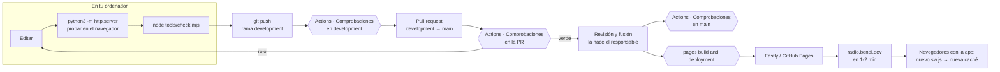
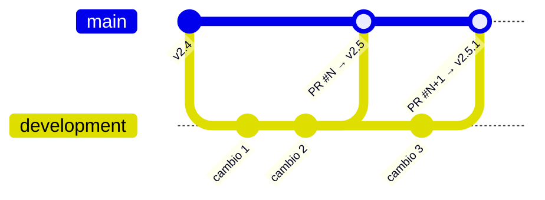
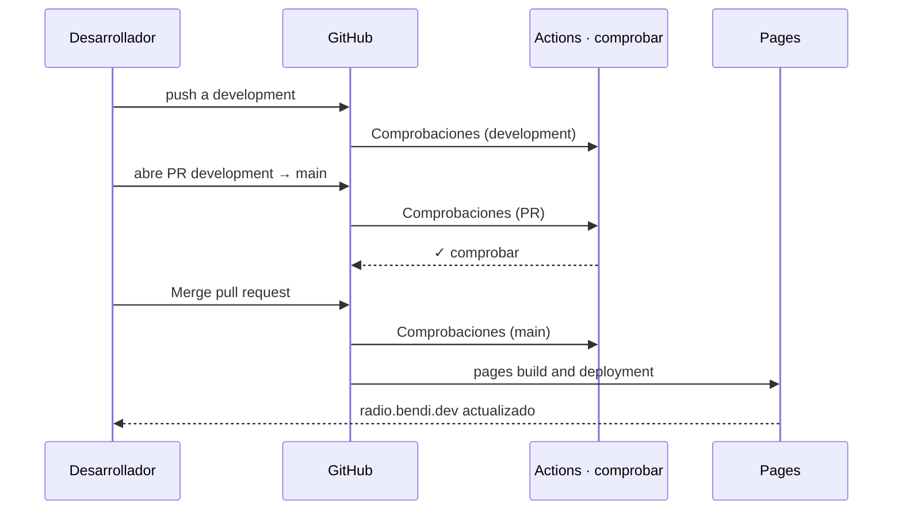
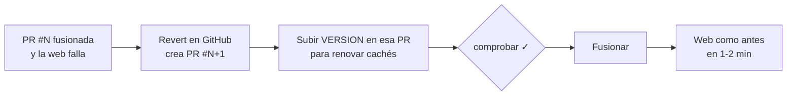

# Integración y publicación continuas (DevOps)

**Para quien lleva la tubería:** cómo viaja un cambio desde el editor hasta `radio.bendi.dev`, qué lo vigila en cada paso, cómo se versiona, cómo se publica, cómo se vuelve atrás y cómo se mantiene la propia tubería.

## Índice

1. [La tubería de un vistazo](#1-la-tubería-de-un-vistazo)
2. [Ramas y protecciones](#2-ramas-y-protecciones)
3. [Flujos de GitHub Actions](#3-flujos-de-github-actions)
4. [Las comprobaciones (`tools/check.mjs`)](#4-las-comprobaciones-toolscheckmjs)
5. [Versionado](#5-versionado)
6. [Publicar una versión](#6-publicar-una-versión)
7. [Vuelta atrás](#vuelta-atrás)
8. [Arreglo urgente](#8-arreglo-urgente)
9. [Permisos y secretos](#permisos-y-secretos)
10. [Dependencias de la tubería](#dependencias-de-la-tubería)
11. [Autoría de los commits](#11-autoría-de-los-commits)
12. [Métricas de entrega](#12-métricas-de-entrega)
13. [Ideas para mejorar la tubería](#13-ideas-para-mejorar-la-tubería)

---

## 1. La tubería de un vistazo



**Principios**
- **Lo que hay en `main` es lo que está publicado.** No hay artefactos, ni compilación, ni entornos intermedios.
- **Nada llega a `main` sin pull request y sin comprobaciones en verde**, ni siquiera del administrador.
- **Todo es reversible** con un *revert* de la pull request.
- **La tubería no tiene dependencias que instalar:** Node y los scripts de `tools/`, nada más.

## 2. Ramas y protecciones



| Rama | Para qué | Protección (Settings → Branches) |
| --- | --- | --- |
| `main` | Lo publicado | Pull request obligatoria · comprobación **`comprobar`** obligatoria y en verde · 0 aprobaciones requeridas (proyecto de una persona) · **también para administradores** · sin `push --force` · no se puede borrar |
| `development` | Integración diaria | Sin `push --force` · no se puede borrar |
| Otras (`arreglo/…`, `idea/…`) | Opcional, para cambios largos o en paralelo | Ninguna. Se fusionan en `development` |

Las pull requests se fusionan con **merge commit** (botón "Merge pull request"), así cada versión queda como un commit de fusión que se puede revertir de una vez.

**Ver o cambiar la protección** sin entrar en la web:

```bash
gh api repos/serbenda/radio/branches/main/protection \
  --jq '{checks:.required_status_checks.contexts, admins:.enforce_admins.enabled, force:.allow_force_pushes.enabled}'
```

## 3. Flujos de GitHub Actions

| Flujo | Archivo | Cuándo | Qué hace | Permisos | Duración |
| --- | --- | --- | --- | --- | --- |
| **Comprobaciones** (trabajo `comprobar`) | [`comprobaciones.yml`](../.github/workflows/comprobaciones.yml) | Cada pull request y cada push a `development` o `main` | `node tools/check.mjs` | `contents: read` | ≈ 15 s |
| **Enlaces externos** | [`enlaces.yml`](../.github/workflows/enlaces.yml) | Lunes 06:17 UTC y a mano (**Run workflow**) | `node tools/enlaces.mjs --md`; si hay rotos, abre o comenta un aviso con la etiqueta `enlaces` | `contents: read`, `issues: write` | 1–3 min |
| **pages build and deployment** | Interno de GitHub | Cada push a `main` | Publica la rama en GitHub Pages | Gestionado por GitHub | 30 s – 2 min |



**Por qué el minuto 17 en el programado:** GitHub retrasa o descarta flujos programados a las horas en punto por saturación; un minuto raro reduce el riesgo.

**Lanzar a mano:** pestaña Actions → elige el flujo → **Run workflow** (solo el de enlaces lo permite), o `gh workflow run enlaces.yml`.

## 4. Las comprobaciones (`tools/check.mjs`)

Un solo script de Node 18+ sin dependencias, que también se usa en local. Sale con código 1 si algo falla. Bloques actuales:

| § | Qué protege | Ejemplo de fallo que para |
| --- | --- | --- |
| 1 | Estructura de cada página: `lang`, título, descripción, canónica en `radio.bendi.dev`, un `<h1>`, `radio-root` | Una página nueva sin canónica |
| 2 | Cabecera y pie idénticos en las 12 páginas | Un enlace del menú cambiado solo en una |
| 3 | Todo enlace o recurso local existe, incluidos los `#anclajes` | Enlace a `#balizas` que ya no existe |
| 4 | Orden de los scripts y que cada `.js` se usa | Un módulo olvidado en la carpeta |
| 5 | Sintaxis de todo el JavaScript (`node --check`) | Una llave sin cerrar |
| 6 | Datos: examen, radioclubes, bandas, escucha guiada | Pregunta sin respuesta correcta |
| 7 | Enlaces de "Tu primer mes" | Paso que apunta a una sección borrada |
| 8 | `sitemap.xml` completo y `CNAME` con `radio.bendi.dev` | Dominio perdido |
| 9 | Manifest, iconos, `PRECACHE` y `VERSION` = última del CHANGELOG | Publicar sin subir la versión |
| 10 | Hitos de métricas con nombre fijo | Mandar a GoatCounter algo escrito por la persona |
| 11 | CSP idéntica, librerías con versión y SRI, `noopener`, sin enlaces al código en la web, tipografías propias | Una librería sin `integrity` |
| 12 | Versión inglesa con las mismas secciones, `hreflang`, selector y examen alineado | Sección nueva solo en castellano |

Detalle de cada comprobación y cómo añadir una: cabecera de [`tools/check.mjs`](../tools/check.mjs) y [PRUEBAS.md](PRUEBAS.md).

## 5. Versionado

[Versionado semántico](https://semver.org/lang/es/) **de la web vista por quien la usa**:

| Cambio | Sube | Ejemplo |
| --- | --- | --- |
| Arreglo, corrección de un dato, texto | Parche `2.5.0 → 2.5.1` | Corregir una frecuencia |
| Función o sección nueva, mejora visible | Menor `2.5.1 → 2.6.0` | Añadir un satélite |
| Rompe algo de fuera: URLs, formato del progreso guardado, dominio | Mayor `2.6.0 → 3.0.0` | Cambiar `escuchar/` por `oir/` |
| Solo documentación, `tools/` o flujos | Nada | — |

El número vive en **dos sitios que deben coincidir** (lo exige `check.mjs` §9):

- `sw.js` → `const VERSION = 'x.y.z';` (renueva la caché de los navegadores)
- `CHANGELOG.md` → `## [x.y.z] · fecha · título` (formato [Keep a Changelog](https://keepachangelog.com/es-ES/1.1.0/))

No se usan etiquetas de Git (*tags*) ni *releases* de GitHub: el commit de fusión de cada PR y el CHANGELOG cumplen esa función. Si se quisieran: `git tag -a v2.5.0 <commit-de-fusión> -m "2.5.0" && git push origin v2.5.0`.

## 6. Publicar una versión

```bash
git checkout development && git pull
# … cambios …
# 1. Versión
sed -i "s/const VERSION = '.*';/const VERSION = '2.6.0';/" sw.js
# 2. CHANGELOG: sección nueva arriba (Añadido / Cambiado / Corregido)
# 3. Comprobar
node tools/check.mjs
# 4. Subir
git add -A && git commit -m "Satélites: añade RS-44" && git push
# 5. PR
gh pr create --base main --head development --title "Versión 2.6: …" --body-file /ruta/descripcion.md
```

6. Espera a `comprobar` en verde y fusiona con **Merge pull request**.
7. Tras 1–2 minutos: `curl -s https://radio.bendi.dev/sw.js | grep "const VERSION"` debe dar la nueva.
8. Repasa en una ventana privada las páginas tocadas, en ordenador y en móvil.

Lista completa antes de fusionar: [PRUEBAS.md](PRUEBAS.md#lista-de-comprobación-manual-antes-de-fusionar). Plantilla de la descripción: [`.github/pull_request_template.md`](../.github/pull_request_template.md).

## Vuelta atrás



1. GitHub → la pull request fusionada → **Revert** → crea una PR con la reversión.
2. En esa PR, sube `VERSION` en `sw.js` y añade una línea en el CHANGELOG. Sin esto, quien tenga la app instalada seguiría con la versión mala en caché.
3. Fusiona en cuanto `comprobar` esté en verde.
4. Después, en `development`, `git pull` (trae la reversión) y arregla con calma. Para volver a aplicar el cambio arreglado: *revert del revert* o un commit nuevo.

En local: `git revert -m 1 <commit-de-fusión>`. **Nunca** `git push --force` a `main` (la protección lo impide).

## 8. Arreglo urgente

Igual que una publicación normal, pero sin esperar a juntar más cambios:

1. Si `development` tiene cosas a medio hacer que no deben salir: rama desde `main` → `git checkout -b arreglo/descripcion origin/main`, arreglo, versión de parche, PR **directa a `main`**.
2. Después, lleva el arreglo a `development`: `git checkout development && git merge origin/main`.

## Permisos y secretos

- **No hay secretos** en el repositorio ni en Settings → Secrets: la web no usa ninguna clave.
- Cada flujo declara `permissions:` con lo mínimo. El token automático (`GITHUB_TOKEN`) caduca al terminar cada ejecución.
- Las pull requests desde *forks* ejecutan las comprobaciones con permisos de solo lectura (comportamiento por defecto de GitHub).
- Si algún día hiciera falta una clave (un servicio nuevo con API key): **no** en el navegador, porque sería pública. Necesitaría un intermediario (por ejemplo, un Worker) y su propio documento de decisión.

## Dependencias de la tubería

| Dependencia | Versión | Dónde | Cómo actualizar |
| --- | --- | --- | --- |
| `actions/checkout` | `v4` | Los dos flujos | Cambiar la etiqueta; ver sus *releases* |
| `actions/setup-node` | `v4` | Los dos flujos | Igual |
| Node en Actions | `20` | `node-version` | Subir a la LTS vigente y comprobar en local con la misma |
| Node en local | ≥ 18 | — | — |
| Runner | `ubuntu-latest` | Los dos flujos | Automático |

**Recomendado:** activar Dependabot para las acciones, creando `.github/dependabot.yml`:

```yaml
version: 2
updates:
  - package-ecosystem: github-actions
    directory: /
    schedule:
      interval: monthly
    target-branch: development
```

Endurecimiento opcional: fijar cada acción por su SHA completo (`actions/checkout@<sha> # v4.x.y`) para que una etiqueta movida no cambie lo que se ejecuta.

## 11. Autoría de los commits

- Cada commit lleva **nombre y correo reales** de quien lo escribe (`git config user.name` / `user.email`); en este repositorio, *Sergio Santiago Bendaña Quesada &lt;serbenda@gmail.com&gt;*.
- Sin coautores automáticos ni firmas de herramientas en commits, pull requests o archivos.
- Mensajes en español y en presente, diciendo qué cambia para quien usa la web ([CONTRIBUTING.md](../CONTRIBUTING.md#commits)).

Comprobar la autoría de los últimos commits:

```bash
git log -10 --format='%h %an <%ae> | %s'
```

## 12. Métricas de entrega

Las cuatro métricas DORA, adaptadas a una web de una persona:

| Métrica | Cómo se obtiene | Referencia sana |
| --- | --- | --- |
| Frecuencia de publicación | `gh api 'repos/serbenda/radio/pulls?state=closed&base=main&per_page=100' --jq '[.[]\|select(.merged_at)]\|length'` por periodo | Varias por semana en fase activa |
| Tiempo de entrega | Del primer commit de la PR a su fusión | < 1 día |
| Tasa de fallos | PR de *revert* / PR fusionadas | < 10 % |
| Tiempo de recuperación | Del aviso a la fusión del *revert* | < 30 min ([OPERACIONES.md](OPERACIONES.md#2-niveles-de-servicio-sli-y-slo)) |

## 13. Ideas para mejorar la tubería

| Idea | Valor | Coste |
| --- | --- | --- |
| Dependabot para las acciones | Acciones al día sin pensar | 5 min |
| Monitor de disponibilidad externo | Saber que la web cae antes que la gente | 10 min ([OPERACIONES.md](OPERACIONES.md#lo-que-falta-y-cómo-añadirlo)) |
| Prueba de humo tras publicar: flujo que, al terminar la publicación, compruebe que `sw.js` publicado tiene la `VERSION` de `main` | Detecta publicaciones atascadas | 30 min |
| Auditoría de accesibilidad automática (axe con Playwright) en la PR | Evita regresiones de accesibilidad | 1–2 h; añade dependencias solo a la tubería |
| Lighthouse CI en la PR | Rendimiento y buenas prácticas medidos en cada cambio | 1–2 h |
| Comprobación de fechas que caducan (autorización de 2,4 GHz, tasas) | Que el contenido no se quede viejo en silencio | 1 h |
