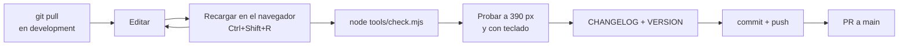
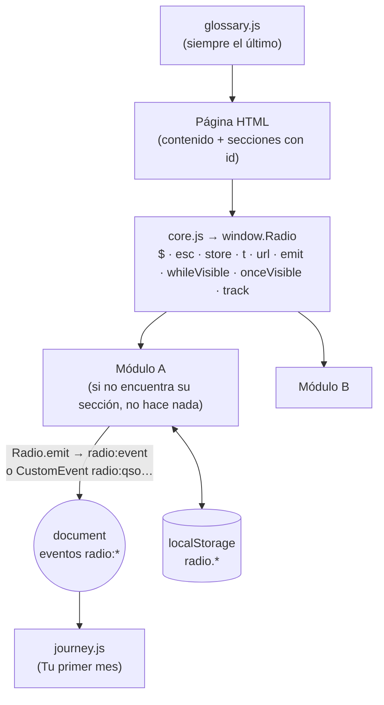

# Manual de desarrollo

**Para quien escribe código:** el entorno, el ciclo de trabajo, las reglas del código, cómo depurar cada parte, qué navegadores se soportan, el presupuesto de peso y la definición de "terminado". Es la puerta de entrada técnica: enlaza a la referencia detallada de cada tema en lugar de repetirla.

| Si necesitas… | Ve a |
| --- | --- |
| Entender cómo encaja todo | [ARQUITECTURA.md](ARQUITECTURA.md) |
| Qué hace cada archivo de `js/` | [MODULOS.md](MODULOS.md) |
| Una receta concreta (página nueva, módulo nuevo, servicio nuevo…) | [GUIA.md](GUIA.md) |
| Tu primer cambio, paso a paso | [TUTORIAL.md](TUTORIAL.md) |
| Colores, tipografías y componentes | [ESTILOS.md](ESTILOS.md) |
| Textos en dos idiomas | [IDIOMAS.md](IDIOMAS.md) |

## Índice

1. [Entorno](#1-entorno)
2. [Ciclo de trabajo diario](#2-ciclo-de-trabajo-diario)
3. [Mapa mental del código](#3-mapa-mental-del-código)
4. [Reglas del código](#4-reglas-del-código)
5. [Depurar](#5-depurar)
6. [Navegadores soportados](#6-navegadores-soportados)
7. [Presupuesto de peso y rendimiento](#7-presupuesto-de-peso-y-rendimiento)
8. [Accesibilidad al programar](#8-accesibilidad-al-programar)
9. [Definición de terminado](#9-definición-de-terminado)
10. [Revisión de código](#10-revisión-de-código)
11. [Errores frecuentes](#11-errores-frecuentes)

---

## 1. Entorno

| Herramienta | Versión | Para qué | ¿Obligatoria? |
| --- | --- | --- | --- |
| Git | Cualquiera reciente | Versiones | Sí |
| Navegador (Chrome o Firefox) | Actual | Ver y depurar | Sí |
| Python 3 | ≥ 3.8 | Servidor local (`http.server`) | Sí (o cualquier servidor estático) |
| Node.js | ≥ 18 | `tools/check.mjs` y `tools/enlaces.mjs` | Sí para comprobar |
| GitHub CLI (`gh`) | Cualquiera | Pull requests desde la terminal | No |
| Editor con EditorConfig | — | Respeta `.editorconfig` (2 espacios, UTF-8, LF) | Recomendado |
| `fonttools` + `brotli` (Python) | — | Solo para regenerar tipografías (`tools/fuentes.py`) | No |

**No hay `npm install`.** No hay `package.json`, ni `node_modules`, ni compilación. Lo que editas es lo que se publica.

```bash
git clone https://github.com/serbenda/radio.git && cd radio
git checkout development
python3 -m http.server 8000       # http://localhost:8000/
node tools/check.mjs              # 108 comprobaciones
```

## 2. Ciclo de trabajo diario



**Consejo:** con el service worker activo, una recarga normal puede servir archivos viejos. Mientras desarrollas, en F12 → Aplicación → Service workers marca **"Update on reload"** (o usa una ventana privada).

Publicación completa y vuelta atrás: [CICD.md](CICD.md).

## 3. Mapa mental del código



Tres ideas que lo explican todo:

1. **Cada página carga `core.js` primero**, luego sus módulos, y `glossary.js` el último (`check.mjs` §4 lo exige).
2. **Cada módulo es una función autoejecutable** que busca su sección por `id`; si no está, termina sin error. Por eso el mismo módulo sirve en castellano y en inglés.
3. **Los módulos no se llaman entre sí**: se avisan con eventos `radio:*` sobre `document` ([ARQUITECTURA.md §8](ARQUITECTURA.md#8-comunicación-entre-módulos-eventos)).

## 4. Reglas del código

| Regla | Por qué | Cómo se vigila |
| --- | --- | --- |
| HTML, CSS y JS sin frameworks ni compilación | Mantenible por cualquiera, para siempre | Revisión |
| `'use strict'` y una función autoejecutable por módulo | Sin variables globales salvo `window.Radio` | Revisión |
| Cabecera de documentación en cada archivo + JSDoc en cada función | Que no haga falta nadie para entenderlo | Revisión |
| Texto de fuera → `Radio.esc()` | XSS ([SEGURIDAD.md](SEGURIDAD.md#6-datos-de-fuera-cómo-se-pintan)) | Revisión |
| Nada de `onclick=` ni `<script>` en línea | La CSP los bloquea | `check.mjs` §11 |
| Textos con `Radio.t('castellano', 'English')` | Un solo módulo para los dos idiomas | `check.mjs` §12 (secciones) |
| Enlaces internos con `Radio.url('escuchar/#id')` | Traduce la ruta al idioma de la página | Revisión |
| Guardar con `Radio.store` y claves `radio.*` | Sin excepciones en modo privado; entra en la copia del progreso | Revisión |
| Animación con `Radio.whileVisible`; datos con `Radio.onceVisible` | Batería y límites de las APIs | Revisión |
| Respetar `Radio.reducedMotion` | Accesibilidad | Revisión |
| Hitos con nombre fijo en `Radio.track('…')` | Privacidad | `check.mjs` §10 |
| Botones `<button type="button">`; estado con `aria-pressed`/`aria-expanded` | Accesibilidad | Revisión, axe |
| 2 espacios, UTF-8, LF, comillas simples en JS y dobles en HTML | Uniformidad; `check.mjs` lee el HTML con expresiones regulares | `.editorconfig` |

Nombres: archivos en minúsculas y en inglés corto (`stations.js`); `id` de secciones en castellano y **iguales en las dos versiones** (`#balizas` también en `en/understand/`); eventos `radio:<cosa>`; claves `radio.<módulo>.<dato>`.

## 5. Depurar

### En la consola del navegador (F12)

```js
Radio                                  // el núcleo: qué hay disponible
Radio.lang                             // 'es' o 'en'
Object.keys(localStorage).filter(k => k.startsWith('radio.'))   // todo el progreso
Radio.store.get('radio.journey', {})   // un dato concreto
document.addEventListener('radio:qso', e => console.log('QSO', e.detail))  // espiar un evento
document.dispatchEvent(new CustomEvent('radio:mock', { detail: { pass: true } }))  // simular un simulacro aprobado (marca el paso de "Tu primer mes")
```

### Por tipo de problema

| Problema | Cómo depurarlo |
| --- | --- |
| Un módulo no hace nada | ¿Está su `<script>` en la página? ¿Existe el `id` de su sección? Pon un `console.log` al principio del módulo |
| Cambio que no aparece | Service worker: "Update on reload" o ventana privada ([OPERACIONES.md RB-05](OPERACIONES.md#rb-05--hay-gente-que-sigue-viendo-la-versión-antigua)) |
| `Refused to …` en la consola | CSP ([OPERACIONES.md RB-07](OPERACIONES.md#rb-07--la-consola-dice-refused-to--because-it-violates-the-content-security-policy)) |
| Datos en directo | Pestaña Red: filtra por el dominio del servicio; mira estado y respuesta |
| Sin conexión | F12 → Aplicación → Service workers → "Offline"; Cache Storage para ver qué hay guardado |
| Móvil | Modo dispositivo (Ctrl+Shift+M) a 390 px; para Safari de iPhone, Safari de un Mac → Desarrollo → el iPhone conectado por cable |
| Sonido | Los navegadores solo dejan sonar tras un toque: prueba siempre pulsando, no recargando |
| Empezar de cero | F12 → Aplicación → Storage → **Clear site data** (borra progreso, caché y service worker) |

### Probar sin las APIs

En F12 → Red → **bloquear dominio** (`www.hamqth.com`, `celestrak.org`…): cada sección debe mostrar su aviso, nunca quedarse en blanco ni romper otras.

## 6. Navegadores soportados

Objetivo: **las dos últimas versiones** de Chrome, Edge, Firefox y Safari (macOS e iOS), y Samsung Internet. En iPhone y iPad, iOS 16.4 o posterior (desde esa versión se puede instalar la app también desde navegadores distintos de Safari).

| Función del navegador | Dónde se usa | Si no existe |
| --- | --- | --- |
| `??` y `?.` (ES2020) | Varios módulos | El módulo no carga (por eso el mínimo de versiones) |
| `IntersectionObserver` | `Radio.whileVisible/onceVisible` | Sin animación ni datos diferidos |
| Web Audio (`AudioContext`) | Morse, sonidos, cascada | Sin sonido |
| Service worker + Cache Storage | `sw.js` | Funciona, pero no sin conexión ni instalable |
| `localStorage` | Progreso | Funciona sin guardar (modo privado) |
| `navigator.share` | Compartir web y tarjeta QSL | Se copia el enlace |
| `beforeinstallprompt` | Botón "Instalar la app" | Se muestran los pasos manuales (Safari, Firefox) |
| `speechSynthesis` | Voces de los contactos simulados | El texto sale en pantalla y se hace una pausa en lugar de la voz |
| `<canvas>` | Dial, lecciones, cascada, QSL | Imprescindible (todos los navegadores lo tienen) |

## 7. Presupuesto de peso y rendimiento

Medido el 2 nov 2026 (HTML + CSS + JS propios de cada página, sin tipografías ni librerías externas):

| Página | Módulos | Sin comprimir | Con gzip |
| --- | --- | --- | --- |
| Inicio | 7 | 177 KB | 63 KB |
| Escuchar | 11 | 238 KB | 88 KB |
| Entender | 11 | 241 KB | 89 KB |
| Practicar | 11 | 238 KB | 87 KB |
| Examen | 7 | 232 KB | 78 KB |
| Empezar | 12 | 231 KB | 82 KB |

Más tipografías (≈ 190 KB en total, solo las que use la página) y, en las páginas con mapas, Leaflet (≈ 40 KB comprimido) desde cdnjs.

**Presupuesto:** ninguna página por encima de **120 KB con gzip** en código propio. Para medirlo:

```bash
for f in index.html css/style.css js/core.js; do printf "%-20s %6s B\n" $f $(gzip -c $f | wc -c); done
```

**Prácticas obligatorias:** datos y mapas solo al acercarse la sección (`onceVisible`); animaciones solo visibles (`whileVisible`); nada de librerías para lo que se hace en 20 líneas; imágenes en SVG o comprimidas. Lista completa en [CALIDAD.md](CALIDAD.md#rendimiento).

## 8. Accesibilidad al programar

- Cada lienzo tiene un texto al lado que dice lo mismo; si es decorativo, `aria-hidden="true"`.
- Lo que cambia solo (resultados, avisos) en una región `aria-live="polite"`.
- Todo se puede usar con teclado; el foco se ve.
- El color nunca es la única pista (bandas: "Abierta/Floja/Cerrada").
- Objetivos táctiles ≥ 24 × 24 px.

Detalle y cómo auditar con axe: [CALIDAD.md](CALIDAD.md#accesibilidad) y [PRUEBAS.md](PRUEBAS.md#auditoría-de-accesibilidad).

## 9. Definición de terminado

Un cambio está terminado cuando:

- [ ] Funciona en **castellano e inglés** (mismas secciones e `id`).
- [ ] Funciona en móvil (390 px) y ordenador (1280 px), con teclado y con "reducir movimiento".
- [ ] Si usa un servicio externo, muestra un aviso claro cuando el servicio falla.
- [ ] `node tools/check.mjs` en verde.
- [ ] Sin errores ni `Refused to…` en la consola.
- [ ] Cabecera del módulo y JSDoc al día; documento afectado actualizado ([CONTRIBUTING.md](../CONTRIBUTING.md#qué-documentación-actualizar)).
- [ ] `CHANGELOG.md` y `VERSION` de `sw.js` (si cambia algo de la web).
- [ ] Si es una decisión con consecuencias, entrada en [DECISIONES.md](DECISIONES.md).

## 10. Revisión de código

Al revisar una pull request, en este orden:

1. **¿Hace lo que dice?** Pruébala en local, no solo leas el diff.
2. **Seguridad:** lista de [SEGURIDAD.md §11](SEGURIDAD.md#11-lista-de-revisión-de-seguridad-para-una-pr).
3. **Contenido:** ¿datos con fuente? ¿lenguaje llano? ¿los dos idiomas dicen lo mismo?
4. **Accesibilidad y móvil.**
5. **Documentación** al día.
6. **Simplicidad:** ¿se puede hacer con menos código o reutilizando `Radio`?

## 11. Errores frecuentes

| Error | Consecuencia | Prevención |
| --- | --- | --- |
| Olvidar subir `VERSION` | Quien tiene la app sigue con la versión vieja | `check.mjs` §9 |
| Cambiar un `id` de sección | Rompe enlaces de "Tu primer mes", del glosario y de la otra versión | `check.mjs` §3, §7, §12 |
| Añadir un `.js` y no ponerlo en `PRECACHE` | No funciona sin conexión | `check.mjs` §9 |
| Copiar un texto de una página a otra sin traducir | Castellano en la versión inglesa | Revisión; [IDIOMAS.md](IDIOMAS.md) |
| Pintar texto de una API sin `esc` | XSS | Revisión |
| Comillas simples en atributos HTML | `check.mjs` deja de ver ese atributo | Usa siempre comillas dobles en HTML |
| Probar con caché del service worker | "No funciona mi cambio" | "Update on reload" |
