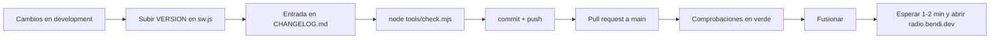

# Guía de mantenimiento: recetas paso a paso

Cómo hacer los cambios más habituales **sin ayuda de nadie**. Cada receta dice qué archivo tocar, qué escribir, cómo probarlo y cómo publicarlo.

> Antes de la primera receta, haz una vez el [TUTORIAL.md](TUTORIAL.md): explica cómo descargar el proyecto, probarlo en tu ordenador y publicar un cambio.

**Siempre, al terminar cualquier receta:**

```bash
node tools/check.mjs          # debe acabar en "✓ … comprobaciones correctas"
```

y, si vas a publicar, los pasos de [Publicar una versión](#publicar-una-versión).

## Índice

**Contenido**
- [Añadir o corregir una pregunta del examen](#añadir-o-corregir-una-pregunta-del-examen)
- [Atender un aviso de error que llega por GitHub](#atender-un-aviso-de-error-que-llega-por-github)
- [Añadir un término al glosario emergente](#añadir-un-término-al-glosario-emergente)
- [Añadir una pregunta frecuente](#añadir-una-pregunta-frecuente)
- [Añadir una grabación real](#añadir-una-grabación-real)
- [Añadir una escucha guiada](#añadir-una-escucha-guiada)
- [Añadir un evento al calendario](#añadir-un-evento-al-calendario)
- [Actualizar tasas, cifras del trámite o modelos de radio](#actualizar-tasas-cifras-del-trámite-o-modelos-de-radio)
- [Actualizar la lista de radioclubes](#actualizar-la-lista-de-radioclubes)
- [Añadir o cambiar un paso de "Tu primer mes"](#añadir-o-cambiar-un-paso-de-tu-primer-mes)

**Código**
- [Añadir una lección interactiva](#añadir-una-lección-interactiva)
- [Añadir un tipo de contacto simulado](#añadir-un-tipo-de-contacto-simulado)
- [Añadir una sección a una página](#añadir-una-sección-a-una-página)
- [Añadir una página nueva](#añadir-una-página-nueva)
- [Añadir un módulo de JavaScript](#añadir-un-módulo-de-javascript)
- [Añadir un servicio externo](#añadir-un-servicio-externo)
- [Actualizar Leaflet o satellite.js](#actualizar-leaflet-o-satellitejs)
- [Cambiar colores o tipografías](#cambiar-colores-o-tipografías)
- [Cambiar el menú o el pie](#cambiar-el-menú-o-el-pie)
- [Cambiar un texto en los dos idiomas](#cambiar-un-texto-en-los-dos-idiomas)

**Operación**
- [Publicar una versión](#publicar-una-versión)
- [Deshacer una publicación que ha salido mal](#deshacer-una-publicación-que-ha-salido-mal)
- [Un enlace externo se ha roto](#un-enlace-externo-se-ha-roto)
- [Un servicio externo ha dejado de funcionar](#un-servicio-externo-ha-dejado-de-funcionar)
- [Ver las visitas y los hitos](#ver-las-visitas-y-los-hitos)
- [Actualizar las capturas de la app](#actualizar-las-capturas-de-la-app)

---

## Contenido

### Añadir o corregir una pregunta del examen

**Archivo:** `js/exam-data.js`. Cada pregunta es una línea:

```js
{ id: 'x58', p: 1, t: 'Antenas', q: '¿Enunciado?', a: ['Correcta', 'Incorrecta 1', 'Incorrecta 2', 'Incorrecta 3'], ok: 0, why: 'Explicación breve con la fórmula o el artículo.' },
```

| Campo | Qué poner |
| --- | --- |
| `id` | Único y **para siempre**. Sigue la serie del bloque (`x58` tras `x57` en la parte 1, `y45` tras `y44` en la parte 2). **Nunca cambies ni reutilices un id**: el progreso de la gente se guarda por id. |
| `p` | `1` = Electricidad y radioelectricidad · `2` = Normativa y operación |
| `t` | Tema, uno de los que ya existen (`Electricidad`, `Componentes`, `Equipos`, `Antenas`, `Propagación`, `Seguridad y medidas`, `Normativa`, `Operación`) |
| `a` | De 3 a 4 opciones distintas. Se barajan al mostrarse, así que **no uses** "todas las anteriores" ni "A y B" |
| `ok` | Posición de la correcta dentro de `a`, empezando en 0 |
| `why` | Por qué es la correcta. En normativa, cita el artículo de la Orden IET/1311/2013 |

**Para corregir** una pregunta, cambia su texto pero **deja el mismo `id`**. **Para quitarla**, borra la línea (el progreso guardado de ese id simplemente se ignora).

**Trampas conocidas** (salieron en la revisión): ver [CONTENIDO.md](CONTENIDO.md#revisión-del-banco).

**Probar:** abre `examen/`, "Estudiar parte N" hasta que salga (o busca el texto en la consola del navegador: `EXAM.find(q => q.id === 'x58')`). `check.mjs` valida ids, opciones y respuesta.

### Atender un aviso de error que llega por GitHub

Los avisos llegan a <https://github.com/serbenda/radio/issues> con una etiqueta:

| Etiqueta | Viene de | Qué hacer |
| --- | --- | --- |
| `examen` | "¿Crees que esta pregunta tiene un error?" | El aviso trae el id de la pregunta. Búscalo en `js/exam-data.js`, compruébalo con la fuente que indica la persona y corrige (receta anterior) |
| `contenido` | "Avísanos" del pie | El aviso trae la página. Busca el texto con `grep -rn "texto" */index.html js/` |
| `idea` | Sugerencias | Valora y, si se hace, enlaza la PR |
| `enlaces` | Comprobación semanal automática | Ver [Un enlace externo se ha roto](#un-enlace-externo-se-ha-roto) |

Cierra el aviso desde la pull request escribiendo en su descripción `Arregla #12` (se cierra solo al fusionar).

### Añadir un término al glosario emergente

El glosario emergente (palabras subrayadas con bocadillo) está en `js/glossary.js`, lista `TERMS`:

```js
['SWR', 'Relación de ondas estacionarias: mide si la antena está bien ajustada. Ideal, cerca de 1.'],
```

- El término se busca como **palabra completa** y distinguiendo mayúsculas en siglas.
- Solo se marca la **primera aparición** de cada término en cada sección.
- No se marca dentro de botones, enlaces, títulos `h1`/`h2`, código ni elementos con `data-noglossary`.
- Si un término tiene dos significados (como "USB"), mejor no añadirlo.

> Hay **otro** glosario, la tabla de jerga de la página Practicar: `GLOSSARY` en `js/data.js`, con el mismo formato `[término, explicación]`. Son independientes: añade el término en los dos si quieres que salga en ambos sitios.

### Añadir una pregunta frecuente

`js/data.js`, lista `FAQ`: `['¿Pregunta?', 'Respuesta. Puede llevar <b>negritas</b> y enlaces.']`. Aparece al final de la página Empezar en el orden de la lista.

### Añadir una grabación real

`js/data.js`, lista `RECORDINGS`. Proceso completo y criterios de licencia en [CONTENIDO.md](CONTENIDO.md#grabaciones-reales). Resumen:

1. Busca el audio en [Wikimedia Commons](https://commons.wikimedia.org/wiki/Category:Audio_files_of_amateur_radio). Licencia: CC0, dominio público, CC BY o CC BY-SA.
2. En la página del archivo, pulsa en el audio → "Enlace al archivo original" para obtener la URL de `upload.wikimedia.org`. De ella, copia la parte tras `/commons/` (por ejemplo `8/85/CQ_de_DG2RBH.ogg`).
3. Añade:
   ```js
   { file: 'Nombre exacto.ogg', src: COMMONS + '8/85/Nombre_exacto.ogg', secs: 12, kind: 'Voz', author: 'Usuario en Commons', license: 'CC BY-SA 3.0',
     text: 'Qué se oye, en lenguaje llano.' },
   ```
4. Si la licencia es nueva, añade su enlace en `LIC` de `js/recordings.js`.
5. Prueba en `escuchar/#grabaciones` que suena (en Chrome y, si puedes, en un iPhone: allí se usa la versión MP3 que genera Commons).

### Añadir una escucha guiada

`js/data.js`, lista `LISTEN`:

```js
{ id: 'ft8', title: 'FT8 en 20 m', tune: '14074usb', chip: '🤖 FT8', best: 'day', text: 'Qué vas a oír y qué hacer.' },
```

- `tune`: frecuencia en **kHz** seguida del modo (`lsb`, `usb`, `cw`, `am`). Abre el receptor de Twente ya sintonizado. Pruébalo pegando `http://websdr.ewi.utwente.nl:8901/?tune=14074usb` en el navegador.
- `best`: `day`, `night` o `any`; decide cuándo se recomienda.

### Añadir un evento al calendario

`js/clubs.js`, lista `RULES`. Los eventos se **calculan** cada año con una regla, no con fechas fijas:

```js
{ name: 'Nombre', m: 5, day: 18, what: 'Qué es.', tip: 'Qué hacer.' },                 // día fijo (m: 0 = enero … 11 = diciembre)
{ name: 'Nombre', m: 2, pick: w => w.at(-1), what: '…', tip: '…' },                 // último fin de semana del mes
{ name: 'Nombre', m: 5, pick: w => w[0], what: '…', tip: '…' },                     // primer fin de semana del mes
{ name: 'Nombre', m: 11, all: true, what: '…', tip: '…' },                          // todo el mes
```

`w` es la lista de fines de semana del mes. Revisa las reglas si un organizador cambia sus fechas.

### Actualizar tasas, cifras del trámite o modelos de radio

Son textos dentro de `empezar/index.html`:

| Qué | Dónde buscar | Fuente |
| --- | --- | --- |
| Tasas, duración del examen | `grep -n "€" empezar/index.html` en la sección `id="empezar"` | [URE · obtener autorización](https://www.ure.es/obtener-autorizacion/), BOE |
| CB-27 y PMR446 | sección `id="cb27"` | [Ministerio: uso común](https://digital.gob.es/telecomunicaciones-infraestructuras-digitales/areas-interes/espectro-radioelectrico/informacion-general/uso-espectro-radioelectrico/comun) |
| Modelos y precios | sección `id="equipo"`, tabla "Modelos para empezar" | Tiendas y comparativas; revisar cada 6 meses |

Al cambiar una cifra, actualiza también la fecha en la tabla "Datos guardados en el repositorio" de [DATOS.md](DATOS.md#datos-guardados-en-el-repositorio) y, si sale en una pregunta del examen o en `FAQ`, cámbiala allí también (`grep -rn "23,67" .`).

### Actualizar la lista de radioclubes

`js/clubs-data.js`, una línea por sección: `["Provincia", "Nombre de la sección", "Indicativo o vacío", "https://web-o-vacío"]`. Fuente: <https://www.ure.es/secciones/>.

**Regla de privacidad:** solo datos de la **sección**. Nunca nombres, teléfonos ni correos de personas, aunque la web de la URE los muestre. `check.mjs` falla si detecta algo parecido a un correo, un teléfono o un cargo.

### Añadir o cambiar un paso de "Tu primer mes"

`js/journey.js`, lista `WEEKS`. Cada paso:

```js
{ text: 'Escucha 3 emisoras distintas del mapa', href: 'escuchar/#emisoras',
  done: () => count('station') >= 3, prog: () => `${Math.min(3, count('station'))}/3` },
```

- `href` es relativo a la raíz y debe apuntar a una sección que exista (`check.mjs` lo comprueba).
- `done` decide si está hecho. Puede contar eventos (`count('nombre')`), leer lo que guardan otros módulos (`lessons()`, `koch()`, `examSeen()`, `checklist('club')`) o comprobar listas (`(st.ev.qso || []).includes('primero')`).
- `prog` (opcional) muestra el avance.
- **Regla:** un paso solo cuenta si la persona **hace** algo (D08). Si necesitas un evento nuevo, haz que el módulo correspondiente llame a `Radio.emit('nombre', id)`.

---

## Código

### Añadir una lección interactiva

`js/lessons.js`:

1. En `LESSONS` añade un objeto con `id`, `title`, `icon`, `levels` (tres textos: curioso, interesado, técnico) y `quiz` (tres preguntas `{ q, a: [...], ok }`).
2. En `STAGES` añade una función con el **mismo `id`** que recibe el contenedor (`#lessonStage`), pinta la parte visual (canvas o SVG) y **devuelve una función que la para**. Si anima, usa el ayudante `animate(lienzo, start, stop)`, que ya la para fuera de pantalla y respeta "reducir movimiento". Copia la estructura de una existente (por ejemplo `onda`).
3. Prueba los tres niveles, el test (3 aciertos marca la lección como hecha) y con "reducir movimiento" activado en el sistema.

### Añadir un tipo de contacto simulado

1. `practicar/index.html`: añade una `<option value="nuevo">` en `#qsoScenario`.
2. `js/qso.js`, en `start()`: añade la línea que prepara la otra estación, banda, modo y frecuencia para `scenario === 'nuevo'` (copia la de `pota` o `emergencia`).
3. `js/qso.js`: añade los turnos del diálogo siguiendo uno de los escenarios existentes (sección "Otros escenarios").
4. Si debe contar en "Tu primer mes", no hace falta nada: `radio:qso` ya envía el nombre del escenario.
5. Añade el hito `qso/nuevo` a la tabla de [PRIVACIDAD.md](PRIVACIDAD.md#métricas-de-hitos).

### Añadir una sección a una página

1. En la página, dentro de `<main>`, antes de `<nav class="next-page">`:
   ```html
   <section id="nueva">
     <div class="section-head">
       <p class="kicker">Antetítulo</p>
       <h2>Título</h2>
       <p>Entradilla.</p>
     </div>
     …contenido…
   </section>
   ```
2. Añade el enlace en el índice de la página (`<nav class="toc">`).
3. Si necesita JavaScript, crea un módulo ([receta](#añadir-un-módulo-de-javascript)).
4. Si debe estar en "Tu primer mes", añade el paso.

### Añadir una página nueva

1. Copia la carpeta de una página parecida: `cp -r empezar/ nueva/`.
2. En `nueva/index.html` cambia: `<title>`, `description`, `canonical`, `og:*`, `twitter:*`, `data-page="nueva"`, el `page-head` y las secciones. Deja `radio-root` en `../`.
3. Ajusta los `<script>` a los módulos que use (siempre `core`, `data`, `journey` al principio y `glossary` al final).
4. Menú: añade `<a href="../nueva/" data-page="nueva">Nueva</a>` en la cabecera de **las siete** páginas (con `./nueva/` en la portada). `check.mjs` avisa si una difiere.
5. `sitemap.xml`: añade `<url><loc>https://radio.bendi.dev/nueva/</loc></url>`.
6. `sw.js`: añade `'./nueva/'` a `PRECACHE`.
7. Enlaza la página desde el "Siguiente" de la anterior.
8. `node tools/check.mjs`.

### Añadir un módulo de JavaScript

1. Crea `js/nuevo.js` con la plantilla:
   ```js
   /**
    * nuevo.js · Qué hace en una frase.
    *
    * Página: … (#seccion). Necesita: #ids…
    * Guarda: radio.nuevo → { … } (o "nada")
    * Eventos: emite … / escucha …
    * Cómo modificarlo: …
    */
   (() => {
     'use strict';
     if (!document.getElementById('seccion')) return;
     const { $, esc, store } = Radio;
     // …
   })();
   ```
2. Añade `<script src="../js/nuevo.js"></script>` en la página, **después** de `journey.js` y **antes** de `glossary.js`.
3. Añádelo a `PRECACHE` en `sw.js` (`check.mjs` lo exige).
4. Si guarda algo, usa una clave `radio.nuevo` (así entra en la copia de progreso de `backup.js`) y documéntala en [PRIVACIDAD.md](PRIVACIDAD.md).
5. Documenta el módulo en [MODULOS.md](MODULOS.md).
6. Reglas: escapa con `esc()` todo texto externo; anima solo con `Radio.whileVisible`; pide datos con `Radio.onceVisible`.

### Añadir un servicio externo

1. **Comprueba desde el navegador**, en `https://bendi.dev`, que responde con CORS: abre la consola (F12) y ejecuta `await fetch('https://servicio/api').then(r => r.status)`. Si sale error de CORS, no se puede usar sin servidor.
2. Lee sus condiciones: clave, límite de peticiones, atribución.
3. Añade su dominio a la **Content-Security-Policy** de las **seis** páginas: `connect-src` si usas `fetch`, `script-src` si cargas un script, `img-src`/`media-src` ya admiten cualquier `https:`.
4. Respeta el límite (nunca más de una petición cada pocos segundos; solo con la sección visible).
5. Muestra un mensaje claro si falla.
6. Documenta en [DATOS.md](DATOS.md) (tabla y detalle) y en [PRIVACIDAD.md](PRIVACIDAD.md#peticiones-a-otros-servidores).
7. Si tiene enlaces que no son de la API, `tools/enlaces.mjs` los revisará; si es una API, añádela a `SKIP` en ese archivo.

### Actualizar Leaflet o satellite.js

1. Busca la nueva versión en <https://cdnjs.com/libraries/leaflet> (o `satellite.js`).
2. En cdnjs, el botón "Copy SRI" da el `integrity`. Cambia en las páginas que la usan (`grep -rln "leaflet" */index.html`) la URL **y** el `integrity`.
3. Lee las notas de la versión por si cambia algo que usamos (`L.map`, `L.tileLayer`, `L.circleMarker`, `satellite.twoline2satrec`, `propagate`, `ecfToLookAngles`…).
4. Prueba los mapas de Escuchar, Entender y Empezar y los pases de la ISS.

### Cambiar colores o tipografías

Ver [ESTILOS.md](ESTILOS.md): colores en `:root` de `css/style.css`; tipografías con `tools/fuentes.py`.

### Cambiar el menú o el pie

Cámbialo **igual en todas las páginas** de cada idioma (en castellano la portada usa `./` y las demás `../`; en inglés, `en/index.html` usa `./` y las demás `../`). Truco: haz el cambio en una y cópialo con cuidado; `check.mjs` (§2) te dirá cuál ha quedado distinta.

### Cambiar un texto en los dos idiomas

- **Texto de una página:** cambia la página en castellano y su pareja en `en/` (`escuchar/` ↔ `en/listen/`, etc.).
- **Texto que pinta un módulo:** está escrito como `t('castellano', 'English')`: cambia los dos.
- **Pregunta del examen:** en `js/exam-data.js` y en `js/en/exam-data.js`, mismo `id`, mismas opciones en el mismo orden y mismo `ok`.
- Detalle y reglas: [IDIOMAS.md](IDIOMAS.md).

---

## Operación

### Publicar una versión



1. Elige número de versión ([versionado semántico](https://semver.org/lang/es/)): `2.2.1` para arreglos, `2.3.0` para algo nuevo, `3.0.0` para cambios que rompen (por ejemplo, URLs).
2. `sw.js`: `const VERSION = '2.3.0';`
3. `CHANGELOG.md`: nueva sección arriba con `### Añadido`, `### Cambiado`, `### Arreglado`.
4. `node tools/check.mjs` (comprueba que `VERSION` y CHANGELOG coinciden).
5. Commit, push a `development`, pull request a `main` y fusionar cuando esté en verde (pasos en [TUTORIAL.md](TUTORIAL.md)).
6. Comprueba la web publicada: recarga con Ctrl+F5 (o Cmd+Shift+R) y mira la pestaña Actions → "pages build and deployment".

### Deshacer una publicación que ha salido mal

La forma segura es **revertir** la pull request:

1. En GitHub, abre la pull request fusionada → botón **Revert** → crea una PR nueva que deshace los cambios → fusiónala.
2. O en local: `git checkout development && git pull && git revert -m 1 <commit-del-merge>` y sigue el flujo normal.
3. Sube `VERSION` en `sw.js` en la reversión para que los navegadores dejen la versión mala.

No uses `git push --force` sobre `main`.

### Un enlace externo se ha roto

1. El aviso semanal (etiqueta `enlaces`) dice la URL y en qué archivo está. También puedes lanzarlo a mano: pestaña **Actions → Enlaces externos → Run workflow**, o en local `node tools/enlaces.mjs`.
2. Abre la URL en el navegador: a veces es una caída temporal (vuelve a probar al día siguiente).
3. Si ha cambiado de dirección, busca la nueva y reemplázala: `grep -rn "url-vieja" . --include=*.html --include=*.js`.
4. Si ha desaparecido, quita el enlace o busca otra fuente equivalente.
5. Cierra el aviso desde la PR (`Arregla #N`).

"Dudoso" (403/429) suele significar que el servidor bloquea robots: compruébalo a mano y, si funciona, no hagas nada.

### Un servicio externo ha dejado de funcionar

Cada sección muestra un mensaje si su servicio falla, así que la web no se rompe. Para diagnosticar:

1. Abre la página, F12 → pestaña **Consola** y **Red**. Busca la petición en rojo.
2. Si dice **"Refused to connect… Content Security Policy"**, el servicio ha cambiado de dominio: actualiza la CSP de todas las páginas y la constante del módulo.
3. Si da **error de CORS** o **401/403**, el servicio ha empezado a exigir clave o ha cerrado el acceso desde navegadores: busca una alternativa en [DATOS.md](DATOS.md) (cada servicio tiene su plan B).
4. Si da **404**, ha cambiado la dirección de la API: consulta su documentación.

| Servicio | Módulo | Constante a cambiar |
| --- | --- | --- |
| Radio Browser | `stations.js` | `SERVERS` |
| HamQTH avisos | `live.js` | `API` |
| HamQTH solar | `propagation.js` | `SOLAR` |
| KC2G | `propagation.js` | `MUF` |
| CelesTrak | `iss.js` | `TLE` |
| Esri | `stations.js`, `live.js`, `iss.js`, `clubs.js` | URL de las teselas (`esri` / `L.tileLayer`) |
| WebSDR Twente | `data.js`, `sounds.js`, `live.js` | `WEBSDR` |

### Ver las visitas y los hitos

Panel de GoatCounter: <https://serbenda.goatcounter.com>. Las páginas aparecen como `/radio/…` y los hitos como eventos `radio/qso/…`, `radio/examen/…`, `radio/insignia/…` (lista completa en [PRIVACIDAD.md](PRIVACIDAD.md#métricas-de-hitos)).

Preguntas útiles: ¿qué porcentaje de quien entra a Practicar termina un contacto? ¿Cuántos simulacros acaban en APTO? ¿En qué semana de "Tu primer mes" se abandona?

### Actualizar las capturas de la app

Las capturas de `img/captura-*.png` salen en la ventana de instalación de Android. Si el diseño cambia mucho:

1. Abre la web en el modo móvil del navegador a **390 × 844** con escala 2 (resultado: 780 × 1688 px) y captura la portada y el examen; en ordenador, **1280 × 800**.
2. Guárdalas con el mismo nombre en `img/`. Si cambian las dimensiones, cambia `sizes` en `manifest.webmanifest`.
3. Sube `VERSION` en `sw.js`.
