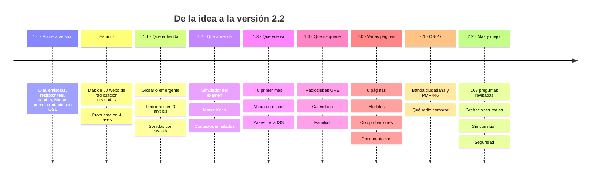
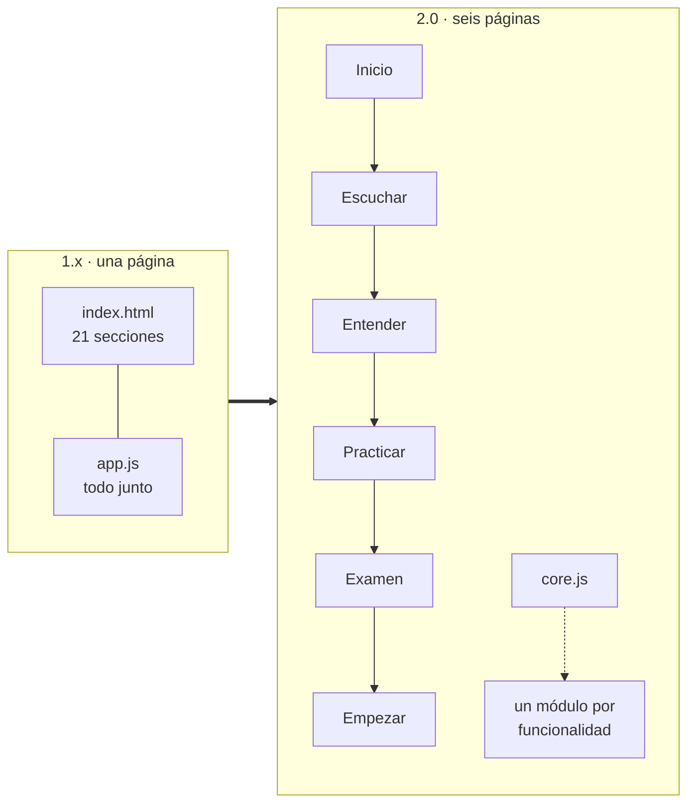

# Cómo se construyó

La historia de la web, de la idea a la versión actual: qué se hizo en cada etapa, qué se aprendió y qué decisión salió de cada problema. Sirve para entender **por qué** el código es como es antes de cambiarlo.

Fechas: todo se construyó el 1 de noviembre de 2026, en pull requests pequeñas fusionadas en `main` (historial completo en `git log` y en [CHANGELOG.md](../CHANGELOG.md)).

---

## 0. La idea

**Objetivo:** que alguien que nunca ha tocado una radio descubra la radioafición, se enganche y llegue a sacarse la licencia. En español y pensado para España.

**Restricciones desde el principio:**
- Publicar en `bendi.dev/radio` con GitHub Pages, gratis y sin servidor.
- Sin registro, sin cookies, sin publicidad.
- Que funcione en el móvil.

## 1. Primera versión (1.0)

Una sola página larga con todo lo que se le ocurre a quien empieza: un **dial** de onda corta que se puede mover, un **mapa de emisoras** del mundo (Radio Browser), enlace a un **receptor real** (WebSDR de la Universidad de Twente), las **bandas**, la **propagación**, **Morse**, la **jerga**, un **primer contacto simulado** con tarjeta QSL descargable, la **escucha guiada**, cómo empezar en España, un mini test y preguntas frecuentes.

**Problemas y lo que salió de ellos:**

| Problema | Solución | Decisión |
| --- | --- | --- |
| El primer color (verde fósforo) cansaba y parecía "de nicho" | Paleta neutra: grafito con un acento menta y un amarillo cálido | [ESTILOS.md](ESTILOS.md) |
| GitHub Pages estaba configurado para "GitHub Actions" sin flujo de despliegue → la web no salía | Cambiado a "Deploy from a branch" → `main` | [ARQUITECTURA.md §12](ARQUITECTURA.md#12-publicación) |
| El mapa mostraba "API KEY REQUIRED" | CARTO empezó a pedir clave: cambio a teselas de Esri | D02 |

## 2. El estudio

Antes de seguir añadiendo cosas se revisaron **más de 50 webs y herramientas** de radioafición (asociaciones, portales de iniciación, preparación de examen, Morse, herramientas en directo, receptores web…). Conclusión: **ninguna acompaña a un novato de "¿qué es esto?" a su indicativo, y en español no hay nada moderno**.

De ahí salió una propuesta en cuatro fases, cada una con un objetivo sobre la persona que visita la web. Resumen del estudio: [ESTUDIO.md](ESTUDIO.md).

## 3. Las cuatro fases (1.1 a 1.4)

| Fase | Objetivo | Qué se añadió | Decisiones |
| --- | --- | --- | --- |
| 1.1 | **Que entienda** | Glosario al pasar el ratón; lecciones interactivas en tres niveles; "¿Qué es este sonido?" con cascada sintetizada; propagación en lenguaje llano con datos solares de HamQTH | D01 (datos desde el navegador) |
| 1.2 | **Que aprenda** | Simulador del examen (68 preguntas, tarjetas tipo Leitner y simulacro); Morse con método Koch; contactos de concurso, parque, emergencia e ISS; el trámite en cifras | D03, D04, D05 |
| 1.3 | **Que vuelva** | "Tu primer mes" (4 semanas, 14 pasos, insignias); "Ahora en el aire" con avisos del DX cluster; pases de la ISS; contador de visitas | D08 |
| 1.4 | **Que se quede** | Las 162 secciones de la URE en un mapa; calendario de eventos calculado; "¿Es para mí?"; guía para familias; Hispanoamérica | D06 |

**Cómo se consiguieron los datos de radioclubes:** la web de la URE muestra las secciones por provincia. Se recogieron solo los campos públicos de cada sección (nombre, provincia, indicativo, web). **El nombre, teléfono y correo de quien preside cada sección no se copiaron nunca**, y una comprobación automática lo vigila.

## 4. Revisión de defectos y versión 2.0

Al terminar las fases la página tenía 21 secciones y unas 24 pantallas de alto: justo el defecto que el estudio criticaba en otras webs ("un menú enorme, no un camino"). Una revisión encontró además:

- Animaciones que seguían corriendo fuera de pantalla (batería).
- Pasos de "Tu primer mes" que se marcaban solos al desplazarse, sin hacer nada.
- El glosario marcando palabras dentro del dial; "USB" confundido entre banda lateral y conector.
- Botones de contactos anteriores que seguían activos.
- `[hidden]` que no ocultaba porque otra regla ponía `display`.
- Desbordamiento horizontal en el móvil.

**La versión 2.0** reorganizó todo:

- Seis páginas en el orden del recorrido, cada una con índice y "Siguiente" (D11).
- `app.js` partido en módulos que se desactivan solos si su sección no está, y un núcleo común `Radio` (D09).
- Cabecera y pie repetidos en cada página, sin compilación, con una comprobación que avisa si difieren (D10).
- Redirección de los enlaces antiguos (`/#ahora` → `escuchar/#ahora`) para no romper lo ya compartido.
- `tools/check.mjs` y GitHub Actions en cada pull request.
- Documentación en `docs/`.

## 5. CB-27 y qué radio comprar (2.1)

Pregunta habitual de quien empieza: "¿puedo usar una radio sin licencia?". Se añadió la **Banda Ciudadana** (uso común sin licencia desde la Orden IET/614/2015), los **walkies PMR446**, una tabla comparativa con la licencia de radioaficionado, **qué dice la ley de las Baofeng** y siete modelos para empezar con precio orientativo. Todo con su fuente oficial.

## 6. Más y mejor (2.2)

Partiendo de una autoevaluación (8,5 sobre 10) se atacó todo lo que dependía del propio proyecto:

| Carencia | Qué se hizo |
| --- | --- |
| Banco de examen pequeño | De 68 a 169 preguntas. **Revisión independiente** de todas contra el texto del BOE: 5 errores corregidos (por ejemplo, "portable" no es "portátil"). Ver [CONTENIDO.md](CONTENIDO.md#revisión-del-banco) |
| Sonidos solo sintéticos | 11 grabaciones reales de Wikimedia Commons con licencia comprobada una a una |
| Progreso atado a un navegador | Guardar y recuperar en un archivo |
| Sin cobertura no funciona | Web instalable con service worker (D12) |
| Los errores no llegan | Formularios de GitHub enlazados desde cada página y cada pregunta (D14) |
| No se sabe si la web cumple su objetivo | Métricas de hitos sin datos personales (D13) |
| Buenas prácticas | Auditoría de accesibilidad con axe y arreglos; tipografías propias en vez de Google Fonts (D15); Content-Security-Policy e integridad de librerías (D16); comprobación semanal de enlaces; documentación del código función a función |

## 7. Lecciones aprendidas

1. **Comprobar los servicios externos desde el dominio real** antes de usarlos (CORS, claves, límites). Dos servicios cambiaron sus condiciones durante el desarrollo.
2. **Un camino vale más que un menú.** Pasar de una página a seis mejoró más la experiencia que cualquier función nueva.
3. **Que los logros exijan hacer algo.** Si se marcan solos, no motivan.
4. **Revisar el contenido con la fuente delante.** Los errores del examen eran de matiz legal, no de cálculo.
5. **Automatizar lo que se olvida:** cabecera igual en todas las páginas, versión del service worker, enlaces rotos, datos personales.
6. **Documentar el porqué, no solo el qué.** El registro de decisiones evita volver a discutir lo ya decidido.

## 8. Lo que queda

Pendiente según el estudio y la autoevaluación (fuera del alcance del código):

- Revisión del banco de preguntas por un radioaficionado con licencia o un radioclub.
- Grabaciones de radioaficionados españoles con licencia libre (no existen en Commons).
- Comunidad en español (grupo de Telegram o Discord) enlazada desde la web.
- Elegir la licencia del repositorio.
- Añadir `Sitemap: https://bendi.dev/radio/sitemap.xml` al `robots.txt` de `bendi.dev`.
