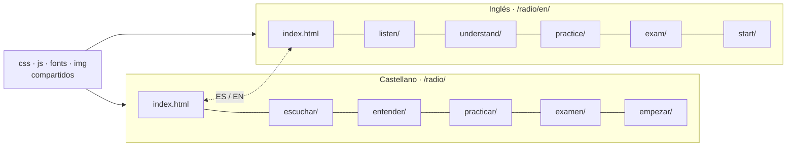

# Idiomas: castellano e inglés

La web existe en **castellano** (raíz del sitio) y en **inglés** (carpeta `en/`). Las dos versiones comparten el mismo CSS, los mismos módulos de JavaScript, los mismos `id` y el mismo progreso guardado; solo cambia el texto.

## Estructura

| Castellano | Inglés |
| --- | --- |
| `index.html` → `/radio/` | `en/index.html` → `/radio/en/` |
| `escuchar/` | `en/listen/` |
| `entender/` | `en/understand/` |
| `practicar/` | `en/practice/` |
| `examen/` | `en/exam/` |
| `empezar/` | `en/start/` |
| `js/exam-data.js` | `js/en/exam-data.js` (mismas preguntas, ids, orden de opciones y respuesta) |



## Reglas de las páginas en inglés

- `<html lang="en">`, `og:locale` `en_GB`, canónica y `og:url` con su dirección inglesa.
- `<meta name="radio-root">`: `../` en `en/index.html` y `../../` en las demás (la raíz del sitio, no la de `en/`).
- **Misma estructura que la página en castellano:** mismas `<section id>`, mismos `id`, `class` y `data-*`, mismos scripts en el mismo orden. Lo único que cambia en los scripts es la ruta (`../../js/…`) y que la página del examen carga `js/en/exam-data.js` en vez de `js/exam-data.js`.
- `<body data-page="…">` lleva **el nombre en castellano** (`inicio`, `escuchar`…) en las dos versiones: así el menú y el selector saben qué página es.
- Los tres `hreflang` (`es`, `en`, `x-default` → castellano) iguales en las dos versiones.
- Selector de idioma en la cabecera, entre el menú y el reloj:
  - en castellano: `<a class="lang-switch" id="langSwitch" href="…/en/…" hreflang="en" lang="en" …>EN</a>`
  - en inglés: `<a class="lang-switch" id="langSwitch" href="…" hreflang="es" lang="es" …>ES</a>`
- La misma Content-Security-Policy.
- Inglés británico (*licence*, *practise* como verbo, *colour*), en lenguaje llano como el castellano.
- Los enlaces a recursos que solo están en castellano (BOE, URE, Ministerio) se mantienen y se avisa: "(in Spanish)".

## Textos dentro del JavaScript

Los módulos escriben los dos idiomas juntos con `Radio.t(castellano, inglés)`:

```js
const { t } = Radio;
$('status').textContent = t('Cargando emisoras…', 'Loading stations…');
const LISTEN = [{ id: 'voz40', title: t('Voces en 40 m', 'Voices on 40 m'), tune: '7150lsb', … }];
```

- `Radio.lang` es `'es'` o `'en'` según `<html lang>`; `Radio.locale` es `'es-ES'` o `'en-GB'` para fechas y números (`toLocaleTimeString(Radio.locale, …)`).
- **Enlaces entre páginas:** siempre `Radio.url('escuchar/#emisoras')` con el nombre en castellano; en inglés se convierte solo en `en/listen/#emisoras`.
- Lo que no es texto (frecuencias, ids, indicativos, colores) se escribe una sola vez.
- Las claves de `localStorage` son las mismas en los dos idiomas: el progreso se mantiene al cambiar.

## Cómo traducir algo nuevo

1. **Texto en una página:** cambia la página en castellano **y** su pareja de `en/`. `node tools/check.mjs` (§12) avisa si las secciones no coinciden.
2. **Texto en un módulo:** escríbelo como `t('…', '…')`.
3. **Pregunta del examen:** añádela en `js/exam-data.js` **y** en `js/en/exam-data.js` con el mismo `id`, el mismo orden de opciones y el mismo `ok`. `check.mjs` (§6) lo comprueba.
4. **Página nueva:** crea las dos versiones, añade su nombre a `SLUGS` en `core.js` y en `check.mjs`, a `sitemap.xml` (con sus `xhtml:link`) y a `PRECACHE` en `sw.js`.

## Lo que sigue solo en castellano

- Los formularios de aviso de GitHub (`.github/ISSUE_TEMPLATE/`) y la documentación de `docs/`.
- Los datos de radioclubes (nombres propios) y los textos legales enlazados.
