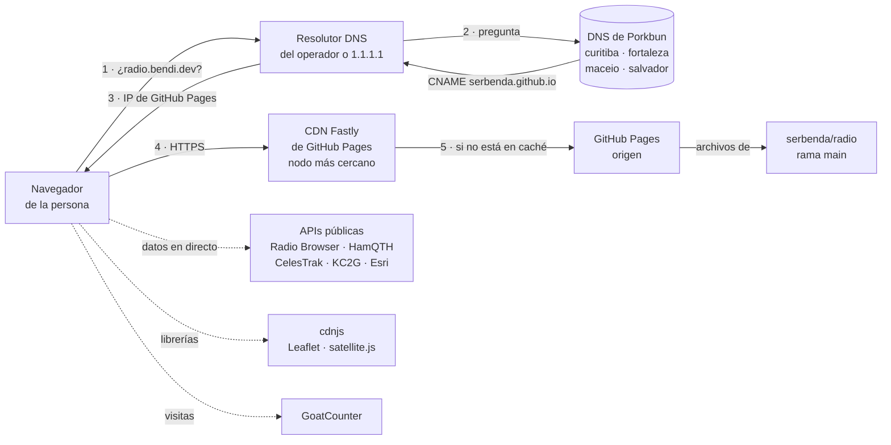
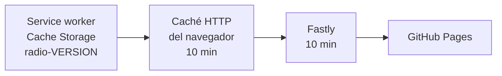

# Infraestructura

**Para quien hace de ingeniero de sistemas:** qué piezas hay entre el navegador de una persona y los archivos de este repositorio, quién controla cada una, cómo se comprueba que funcionan y cómo se cambian sin romper nada.

> Resumen en una línea: **dominio en Porkbun → DNS de Porkbun → GitHub Pages (CDN Fastly + certificado de Let's Encrypt) → rama `main` de este repositorio.** No hay servidores, máquinas virtuales, contenedores, bases de datos ni secretos.

## Índice

1. [Mapa de la infraestructura](#1-mapa-de-la-infraestructura)
2. [Inventario](#2-inventario)
3. [Dominio y DNS](#3-dominio-y-dns)
4. [GitHub Pages](#4-github-pages)
5. [HTTPS y certificados](#5-https-y-certificados)
6. [Caché: CDN, navegador y service worker](#6-caché-cdn-navegador-y-service-worker)
7. [Servicios de terceros](#7-servicios-de-terceros)
8. [Cuentas y accesos](#8-cuentas-y-accesos)
9. [Límites y capacidad](#9-límites-y-capacidad)
10. [Comprobaciones desde la línea de comandos](#10-comprobaciones-desde-la-línea-de-comandos)
11. [Procedimientos de cambio](#11-procedimientos-de-cambio)
12. [Recuperación ante desastres](#12-recuperación-ante-desastres)
13. [Lo que no hay (y por qué)](#13-lo-que-no-hay-y-por-qué)

---

## 1. Mapa de la infraestructura



- Pasos 1 a 5: la web en sí. Si cualquiera de ellos falla, **la web no carga** (salvo para quien ya la visitó: el service worker la sirve sin conexión).
- Líneas de puntos: piezas que solo afectan a **una sección**. Si fallan, esa sección muestra un mensaje y el resto funciona ([DATOS.md](DATOS.md)).

## 2. Inventario

| Pieza | Proveedor | Qué hace | Quién la controla | Coste | Si falla |
| --- | --- | --- | --- | --- | --- |
| Dominio `bendi.dev` | **Porkbun** (registrador) | Nombre del sitio. Caduca el **30 oct 2027** | Cuenta `serbenda` en Porkbun | Renovación anual | Toda la web y las demás de bendi.dev desaparecen |
| DNS autoritativo de `bendi.dev` | **Porkbun** (por dentro usa infraestructura de Cloudflare: "DNS Powered by Cloudflare") | Traduce `radio.bendi.dev` a GitHub | Cuenta `serbenda` en Porkbun | Incluido | La web deja de resolverse |
| Alojamiento y CDN | **GitHub Pages** (sobre Fastly) | Sirve los archivos de `main` por HTTPS | Repositorio `serbenda/radio` → Settings → Pages | Gratis | La web no carga |
| Certificado TLS | **Let's Encrypt**, pedido y renovado por GitHub | HTTPS | Automático | Gratis | Aviso de "conexión no segura" |
| Código y despliegue | **GitHub** (repositorio, Actions) | Guarda el código, comprueba y publica | Cuenta `serbenda` en GitHub | Gratis (repositorio público) | No se puede publicar; la web publicada sigue |
| Librerías | **cdnjs** (Cloudflare) | Leaflet 1.9.4 y satellite.js 5.0.0 | Terceros; versión fija y SRI | Gratis | Mapas o pases sin dibujar |
| Datos en directo | Radio Browser, HamQTH, CelesTrak, KC2G, Esri, Wikimedia Commons | Emisoras, avisos, órbitas, ionosfera, mapas, grabaciones | Terceros | Gratis | Solo su sección |
| Métricas | **GoatCounter** (`serbenda.goatcounter.com`) | Visitas y hitos sin cookies | Cuenta `serbenda` en GoatCounter | Gratis | No se cuenta nada; la web funciona igual |
| Apoyo económico | **GitHub Sponsors** | Botón "Apoya el proyecto" | Cuenta `serbenda` en GitHub | Gratis | El botón lleva a una página de error de GitHub |

> **Cloudflare (cuenta `serbenda`):** existe una zona `bendi.dev` en Cloudflare, pero **no es la autoritativa** (los servidores de nombres del dominio son los de Porkbun). Los registros que se creen allí no tienen efecto. Esta web no usa nada de esa cuenta.

## 3. Dominio y DNS

### Dónde se cambia

**Porkbun → Domain Management → `bendi.dev` → DNS.** No en el panel de Cloudflare.

Cómo saberlo siempre, por si algún día cambia: el DNS que manda es el que aparece en los registros `NS` del dominio.

```bash
dig +short NS bendi.dev
# curitiba.ns.porkbun.com.  fortaleza.ns.porkbun.com.  maceio.ns.porkbun.com.  salvador.ns.porkbun.com.
```

### Registros que importan a esta web

| Nombre | Tipo | Valor | TTL | Para qué |
| --- | --- | --- | --- | --- |
| `radio` | CNAME | `serbenda.github.io` | 600 s | **Esta web.** GitHub Pages sabe qué repositorio servir por el archivo `CNAME` del repositorio |
| `bendi.dev` (raíz) | A ×4 | `185.199.108.153` · `.109.153` · `.110.153` · `.111.153` | 600 s | Web personal; también hace funcionar la redirección `bendi.dev/radio/` → `radio.bendi.dev/` |
| `bendi.dev` (raíz) | AAAA ×4 | `2606:50c0:8000::153` … `8003::153` | 600 s | Lo mismo por IPv6 |
| `_github-pages-challenge-serbenda` | TXT | (código de verificación) | 600 s | **Dominio verificado** en la cuenta de GitHub: impide que otra cuenta publique en cualquier subdominio de `bendi.dev`. **No borrar** |

Las IP de la raíz son las publicadas por GitHub en su [documentación de dominios propios](https://docs.github.com/es/pages/configuring-a-custom-domain-for-your-github-pages-site/managing-a-custom-domain-for-your-github-pages-site). Otros subdominios (`www`, `hucha`, `bolsillo`) son de otras webs y siguen el mismo patrón.

### Por qué un CNAME y no registros A

Un subdominio con `CNAME` a `serbenda.github.io` sigue solo cualquier cambio de IP que haga GitHub. Los registros A solo hacen falta en la raíz del dominio, donde un CNAME no está permitido.

### Riesgo de "subdomain takeover"

Si alguien quita el dominio propio del repositorio (Settings → Pages) **y deja** el CNAME en Porkbun, otra cuenta de GitHub podría intentar reclamar `radio.bendi.dev`. Lo impide la verificación del dominio (registro TXT de arriba). Aun así, la regla es: **al dar de baja la web, borra primero el CNAME en Porkbun y después el dominio en GitHub.**

## 4. GitHub Pages

| Ajuste (Settings → Pages) | Valor |
| --- | --- |
| Source | Deploy from a branch |
| Branch | `main` · `/ (root)` |
| Custom domain | `radio.bendi.dev` (lo fija el archivo `CNAME` de la raíz del repositorio) |
| Enforce HTTPS | Activado |
| Jekyll | Desactivado por el archivo vacío `.nojekyll`: se publica tal cual, sin procesar |

Cada fusión en `main` lanza el flujo interno **"pages build and deployment"** (pestaña Actions). Tarda de 30 s a 2 min. Detalle del proceso completo en [CICD.md](CICD.md).

**Redirecciones que hace GitHub solas:**
- `http://radio.bendi.dev/…` → `https://radio.bendi.dev/…` (por "Enforce HTTPS").
- `https://bendi.dev/radio/…` y `https://serbenda.github.io/radio/…` → `https://radio.bendi.dev/…` (por tener dominio propio). Por eso los enlaces antiguos siguen funcionando.

**Cabeceras que envía GitHub Pages** (comprobado el 2 nov 2026; no se pueden cambiar):

| Cabecera | Valor | Consecuencia |
| --- | --- | --- |
| `cache-control` | `max-age=600` | Navegadores y proxies guardan cada archivo 10 minutos |
| `content-encoding` | `gzip` | Compresión automática de HTML, CSS y JS |
| `etag`, `last-modified` | Por archivo | Revalidación barata (`304`) |
| `access-control-allow-origin` | `*` | Cualquiera puede leer los archivos con `fetch` (son públicos de todas formas) |
| `server` / `via` / `x-served-by` | `GitHub.com` / `varnish` / `cache-<aeropuerto>` | Respuesta servida desde un nodo Fastly (en España, `MAD`) |

Como **no se pueden añadir cabeceras propias**, la política de seguridad (CSP) va en una etiqueta `<meta>` de cada página y no hay `frame-ancestors`, `Permissions-Policy` ni HSTS propios ([SEGURIDAD.md](SEGURIDAD.md)).

## 5. HTTPS y certificados

- GitHub pide a **Let's Encrypt** un certificado para `radio.bendi.dev` en cuanto el DNS apunta bien y el repositorio tiene el dominio. Lo renueva solo antes de que caduque (los de Let's Encrypt duran 90 días).
- No hay nada que hacer salvo que el DNS deje de apuntar a GitHub: entonces la renovación falla y, al caducar, el navegador avisa.
- Para ver el certificado: `openssl s_client -connect radio.bendi.dev:443 -servername radio.bendi.dev </dev/null 2>/dev/null | openssl x509 -noout -issuer -dates`.

Si "Enforce HTTPS" aparece gris tras un cambio de dominio: el certificado aún no está emitido. Espera hasta 1 hora; si sigue, quita y vuelve a poner el dominio en Settings → Pages (fuerza una nueva petición).

## 6. Caché: CDN, navegador y service worker

Tres capas, de fuera adentro:



| Capa | Cuánto guarda | Cómo se invalida |
| --- | --- | --- |
| Fastly (CDN de GitHub) | `max-age=600` | GitHub la purga al publicar; en el peor caso, 10 min |
| Caché HTTP del navegador | 10 min | Sola, o recarga forzada (Ctrl+F5) |
| **Service worker** (`sw.js`) | Hasta que cambie `VERSION` | Subir `VERSION` en `sw.js` en cada publicación: el navegador instala el nuevo y borra las cachés `radio-*` antiguas |

Estrategias del service worker:
- **Páginas:** red primero; sin red, la copia guardada; sin copia, `offline.html`.
- **CSS, JS, tipografías, iconos y librerías de cdnjs:** copia guardada al momento y renovación en segundo plano.
- **Datos en directo, audio y métricas:** nunca se guardan.

Detalle y razones: [ARQUITECTURA.md](ARQUITECTURA.md) y decisión D12 en [DECISIONES.md](DECISIONES.md).

## 7. Servicios de terceros

Todos se llaman **desde el navegador de la persona**, sin clave y sin servidor propio en medio. La lista de dominios permitidos está en la CSP de cada página (`connect-src`, `script-src`, `img-src`, `media-src`).

| Dominio | Para qué | Directiva CSP |
| --- | --- | --- |
| `*.api.radio-browser.info` | Emisoras | `connect-src` |
| `www.hamqth.com` | Avisos en directo y datos solares | `connect-src` |
| `celestrak.org` | Órbitas (TLE) | `connect-src` |
| `serbenda.goatcounter.com`, `gc.zgo.at` | Métricas | `connect-src`, `script-src` |
| `cdnjs.cloudflare.com` | Leaflet y satellite.js | `script-src`, `style-src` |
| `server.arcgisonline.com`, `prop.kc2g.com`, `upload.wikimedia.org` | Teselas, mapa MUF, grabaciones | `img-src https:`, `media-src https:` |

Límites, atribuciones y qué pasa si falla cada uno: [DATOS.md](DATOS.md). Qué hacer cuando uno cae: [OPERACIONES.md](OPERACIONES.md#runbooks).

## 8. Cuentas y accesos

| Cuenta | Para qué hace falta | Recomendación |
| --- | --- | --- |
| GitHub `serbenda` | Código, revisiones, Pages, Actions, Sponsors | Doble factor activado y códigos de recuperación guardados fuera del ordenador |
| Porkbun `serbenda` | Dominio y DNS | **Activar el doble factor** (Porkbun lo sugiere en el panel) y el bloqueo de transferencia del dominio (icono del candado: activado) |
| GoatCounter `serbenda` | Ver visitas | Contraseña única |
| Cloudflare `serbenda` | Nada para esta web | — |

No hay secretos en el repositorio ni en Actions: el único token es el `GITHUB_TOKEN` automático de cada ejecución, con permisos mínimos ([CICD.md](CICD.md#permisos-y-secretos)).

## 9. Límites y capacidad

Límites de GitHub Pages ([documentación oficial](https://docs.github.com/es/pages/getting-started-with-github-pages/about-github-pages#usage-limits)):

| Límite | Valor | Uso actual |
| --- | --- | --- |
| Tamaño del sitio publicado | 1 GB | ≈ 1,6 MB (0,2 %) |
| Ancho de banda | 100 GB/mes (límite blando) | Una visita completa sin caché ≈ 400 KB → ≈ 250 000 visitas/mes |
| Publicaciones | 10/hora (límite blando) | 1–3 al día |
| Tamaño máximo de archivo | 100 MB | El mayor es `og.png` (< 100 KB) |

Si algún día se superan: GitHub avisa por correo; la salida es mover el alojamiento ([§12](#12-recuperación-ante-desastres)), no hace falta cambiar nada del código.

## 10. Comprobaciones desde la línea de comandos

```bash
# DNS: ¿apunta bien?
dig +short radio.bendi.dev            # serbenda.github.io. y 4 IP 185.199.x.153
dig +short CNAME radio.bendi.dev @curitiba.ns.porkbun.com   # directo al autoritativo, sin cachés

# HTTP: ¿responde y desde dónde?
curl -sI https://radio.bendi.dev/ | grep -iE '^(HTTP|cache-control|last-modified|x-served-by)'

# Redirecciones antiguas
curl -sI http://radio.bendi.dev/      | grep -i location   # → https://radio.bendi.dev/
curl -sI https://bendi.dev/radio/     | grep -i location   # → https://radio.bendi.dev/

# Certificado
openssl s_client -connect radio.bendi.dev:443 -servername radio.bendi.dev </dev/null 2>/dev/null \
  | openssl x509 -noout -issuer -enddate

# ¿Qué versión está publicada?
curl -s https://radio.bendi.dev/sw.js | grep "const VERSION"
```

Sin terminal: <https://dnschecker.org/#CNAME/radio.bendi.dev> para el DNS en todo el mundo y la pestaña Red de las herramientas del navegador para las cabeceras.

## 11. Procedimientos de cambio

Todo cambio de infraestructura se anota en [CHANGELOG.md](../CHANGELOG.md) y, si es una decisión, en [DECISIONES.md](DECISIONES.md).

### Cambiar de dominio (por ejemplo, a `radioaficion.es`)

1. En el DNS del dominio nuevo: `CNAME` del subdominio a `serbenda.github.io` (o registros A/AAAA de §3 si es la raíz).
2. Espera a que resuelva: `dig +short <dominio>`.
3. En una rama: cambia `CNAME` y todas las URL absolutas (`grep -rln "radio.bendi.dev" .`), excepto el historial del CHANGELOG. `tools/check.mjs` comprueba canónicas, sitemap y CNAME.
4. PR, fusión y, en Settings → Pages, espera al certificado y marca "Enforce HTTPS".
5. Mantén el CNAME viejo al menos unos meses: GitHub solo redirige desde `bendi.dev/radio/`; desde `radio.bendi.dev` no redirigirá nadie.

Así se hizo el paso de `bendi.dev/radio/` a `radio.bendi.dev` (decisión D21).

### Cambiar el DNS de proveedor (por ejemplo, pasar a Cloudflare)

1. Copia **todos** los registros de Porkbun al nuevo proveedor (incluido el TXT de verificación de GitHub).
2. Compara uno a uno con `dig @<nuevo-ns>` antes de tocar nada.
3. Cambia los servidores de nombres en Porkbun → `bendi.dev` → NS. Propaga en horas (hasta 48 h).
4. Afecta a **todas** las webs de bendi.dev: hazlo en un momento tranquilo.

### Dar de baja la web

1. Borra el `CNAME radio` en Porkbun (evita el riesgo de §3).
2. Settings → Pages → quita el dominio y desactiva Pages.
3. Archiva el repositorio (Settings → Archive).

## 12. Recuperación ante desastres

La web es **un directorio de archivos estáticos sin estado en el servidor**: recuperarla es copiarla a otro sitio. Los datos de cada persona están en su navegador y no se pierden.

| Escenario | Objetivo de recuperación | Qué hacer |
| --- | --- | --- |
| Una publicación rompe la web | < 10 min | Revertir la PR ([OPERACIONES.md](OPERACIONES.md#rb-01--la-web-no-carga-o-se-ve-rota-tras-publicar)) |
| GitHub Pages caído (incidencia de GitHub) | Esperar; < 1 h normalmente | <https://www.githubstatus.com>. Quien ya la visitó la sigue usando sin conexión |
| GitHub Pages caído mucho tiempo o cuenta bloqueada | < 1 h | Publicar la copia en otro alojamiento estático (abajo) y cambiar el CNAME en Porkbun |
| Porkbun caído | Esperar | El DNS tiene 4 servidores en distintas ciudades; una caída total es muy rara |
| Dominio caducado | < 1 día | Renovar en Porkbun (hay 30 días de gracia tras la caducidad). Recordatorio en [OPERACIONES.md](OPERACIONES.md#calendario-de-mantenimiento) |
| Repositorio borrado | < 1 h | Cualquier clon local tiene la historia completa: `git push` a un repositorio nuevo, Pages y dominio de nuevo |

**Alojamientos alternativos** (cualquiera sirve porque no hay compilación; no se han probado con esta web):

```bash
# Cloudflare Pages (desde el panel: Workers & Pages → Create → Pages → Upload assets)
#   Sube la carpeta del repositorio sin .git, docs ni tools. Te da <proyecto>.pages.dev.
# Netlify: arrastra la carpeta a https://app.netlify.com/drop
# Después: en Porkbun, cambia el CNAME radio → <proyecto>.pages.dev (o el que te den)
#          y añade el dominio propio en el panel del nuevo alojamiento.
```

Copia de seguridad: el propio Git. Basta con tener al menos un clon fuera de GitHub actualizado (`git clone --mirror https://github.com/serbenda/radio.git` y `git remote update` de vez en cuando).

## 13. Lo que no hay (y por qué)

| No hay | Por qué | Decisión |
| --- | --- | --- |
| Servidor propio, base de datos, backend | Todo se resuelve en el navegador con APIs públicas con CORS; sin coste ni mantenimiento | D01 |
| Paso de compilación (bundler, npm) | Lo que hay en el repositorio es lo que se publica; cualquiera puede mantenerla | D10 |
| Cuentas de usuario | El progreso vive en el navegador (`localStorage`) y se puede guardar en un archivo | [PRIVACIDAD.md](PRIVACIDAD.md) |
| Cookies | Métricas con GoatCounter, que no las usa | D13 |
| Cabeceras HTTP propias | GitHub Pages no lo permite; la CSP va en `<meta>` | D16 |
| Monitorización de disponibilidad externa | Pendiente: propuesta en [OPERACIONES.md](OPERACIONES.md#monitorización) | — |
