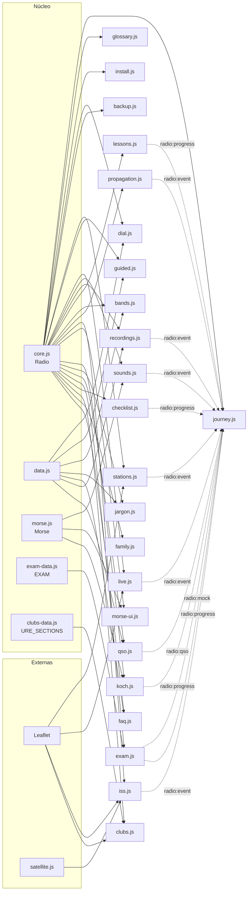

# Módulos de JavaScript

Referencia de cada archivo de `js/`. Cada archivo tiene además, por dentro, una cabecera con este resumen ampliado (qué necesita, qué guarda, qué eventos usa y **cómo modificarlo**) y un comentario JSDoc en cada función.

## Mapa de dependencias

Quién usa a quién. Las flechas continuas son dependencias de carga (el de la izquierda debe cargarse antes); las discontinuas, comunicación por eventos.




## Convenciones

- **Un archivo, una funcionalidad.** Si una función crece y hace dos cosas, se parte.
- **Función autoejecutable** `(() => { 'use strict'; … })();` para no ensuciar el ámbito global. Las únicas variables globales son los datos (`BANDS`, `EXAM`…), `Morse` y `Radio`.
- **Salvaguarda al principio**: si el elemento raíz de su sección no está en la página, el módulo termina sin hacer nada. Así cualquier módulo se puede cargar en cualquier página sin romperla.
- **Escapar siempre** lo que venga de fuera (APIs, lo que escribe la persona) con `Radio.esc` o el `esc` local antes de meterlo en `innerHTML`.
- **`localStorage` solo a través de `Radio.store`** (o con `try/catch`), con claves `radio.*`.
- **Logros con `Radio.emit(nombre, id)`**, nunca tocando `radio.journey` directamente.
- **Botones de verdad** (`<button type="button">`) para todo lo que se pulsa, con `aria-pressed` o `aria-expanded` cuando tienen estado.
- **Animaciones con `Radio.whileVisible`** y respetando `Radio.reducedMotion`.
- **Textos en español de España**, frases cortas y sin jerga sin explicar.

## Núcleo y datos

| Archivo | Qué hace | Globales que expone |
| --- | --- | --- |
| `core.js` | Utilidades compartidas, reloj UTC, menú activo, botón de compartir, enlace "Avísanos", métricas de hitos y registro del service worker | `Radio` |
| `data.js` | Contenido estático: bandas, alfabeto, jerga, FAQ, escucha guiada, receptores, grabaciones reales | `BANDS`, `DIAL_BANDS`, `PHONETIC`, `GLOSSARY`, `FAQ`, `WEBSDR`, `LISTEN`, `RECEIVERS`, `COMMONS`, `RECORDINGS` |
| `exam-data.js` | Banco de preguntas del examen | `EXAM` |
| `clubs-data.js` | Secciones de la URE (datos públicos) | `URE_SECTIONS` |
| `morse.js` | Tabla Morse, codificación y sonido | `Morse` |

### Fuera de `js/`

| Archivo | Qué hace |
| --- | --- |
| `sw.js` | Service worker: guarda la web para usarla sin conexión (estrategia en [ARQUITECTURA.md §10](ARQUITECTURA.md#10-sin-conexión-service-worker)). Subir `VERSION` en cada versión |
| `manifest.webmanifest` | Nombre, iconos (`img/`) y accesos directos para instalar la web |
| `offline.html` | Lo que se ve sin conexión en una página que aún no se había visitado |

## Módulos por página

### Todas las páginas

| Archivo | Raíz | Qué hace | Guarda | Eventos |
| --- | --- | --- | --- | --- |
| `journey.js` | `#weeks` (solo pinta en la portada) | Registra logros en cualquier página y pinta "Tu primer mes" | `radio.journey` | Escucha `radio:event`, `radio:qso`, `radio:mock`, `radio:progress`; emite `websdr` al pulsar enlaces a receptores |
| `glossary.js` | `main > section` | Marca la jerga y muestra el bocadillo | — | — |
| `install.js` | `#installApp` (pie) y `#instalar` (portada) | Botón "Instalar la app" con la ventana del sistema (Android, Chrome, Edge) o pasos de iPhone/iPad | — | Hitos `instalar/*` |

### Inicio

| Archivo | Raíz | Qué hace |
| --- | --- | --- |
| `backup.js` | `#backup` | Guarda todo el progreso (`radio.*`) en un archivo JSON y lo recupera, con validación y confirmación |
| `dial.js` | `#dialKnob` | Dial de onda corta con escala logarítmica, banda y comportamiento a esta hora; señal animada solo en pantalla |

### Escuchar

| Archivo | Raíz | Qué hace | Externo | Eventos |
| --- | --- | --- | --- | --- |
| `stations.js` | `#emisoras` | Mapa de emisoras, buscador, reproductor y línea gris | Radio Browser, Leaflet, Esri | `station` |
| `guided.js` | `#guided` | Escucha guiada en el WebSDR de Twente y receptores alternativos | WebSDR (enlace) | (`websdr` vía journey) |
| `live.js` | `#ahora` | Avisos del DX cluster en directo, en mapa y como frases | HamQTH, Leaflet, Esri | `live` |
| `sounds.js` | `#sonidos` | Ocho sonidos sintetizados con cascada en directo | — | `sound` |
| `recordings.js` | `#recList` | Grabaciones reales con autor y licencia; una a la vez; Ogg con alternativa MP3; las pasa a la cascada de `sounds.js` con el evento `radio:waterfall` | Wikimedia Commons | `sound`, `radio:waterfall` |

### Entender

| Archivo | Raíz | Qué hace | Externo | Guarda / eventos |
| --- | --- | --- | --- | --- |
| `lessons.js` | `#como-funciona` | Cuatro lecciones interactivas en tres niveles con 3 preguntas | — | `radio.lessons`, `radio:progress` |
| `bands.js` | `#bands` | Bandas de 160 m a 70 cm | — | — |
| `propagation.js` | `#propagacion` | Frase y semáforo de bandas con datos solares; mapa de la MUF | HamQTH, KC2G | `prop` |
| `iss.js` | `#iss` | Posición de la ISS y próximos pases; avisa del lugar elegido con `radio:home` | CelesTrak, satellite.js, Leaflet, Esri | `iss`, `radio:home` |
| `beacons.js` | `#balizas` | Qué baliza NCDXF transmite en cada frecuencia, calculado con la hora (sin red) | WebSDR (enlace) | — |
| `sats.js` | `#satelites` | Orientación de la parabólica al QO-100 y pases de SO-50 y AO-91 | CelesTrak, satellite.js | escucha `radio:home` |

### Practicar

| Archivo | Raíz | Qué hace | Guarda / eventos |
| --- | --- | --- | --- |
| `morse-ui.js` | `#morseIn` | Traductor a Morse con sonido | — |
| `koch.js` | `#kochStart` | Entrenador Koch con reconocimiento instantáneo | `radio.koch`, `radio:progress` |
| `jargon.js` | `#phoneticIn` | Deletreo fonético y glosario en lista | — |
| `repeater.js` | `#repOut` | Calculadora de desplazamiento de repetidores (2 m y 70 cm) | — |
| `qso.js` | `#qso` | Cinco contactos simulados y tarjeta QSL | `radio:qso` |

### Examen

| Archivo | Raíz | Qué hace | Guarda / eventos |
| --- | --- | --- | --- |
| `exam.js` | `#test` | Estudio con cajas de Leitner, repaso de fallos, termómetro y simulacro | `radio.exam`, `radio:progress`, `radio:mock` |

### Empezar

| Archivo | Raíz | Qué hace | Externo | Guarda / eventos |
| --- | --- | --- | --- | --- |
| `antenna.js` | `#antBand` | Calculadora de antenas (dipolo, vertical) y de pérdidas del coaxial | — | — |
| `checklist.js` | `#checklist` | Lista "de cero a indicativo" | — | `radio.checklist`, `radio:progress` |
| `clubs.js` | `#clubes` | Mapa de radioclubes por provincia y calendario de eventos | Leaflet, Esri | — |
| `family.js` | `#fitQs` | Autotest "¿Es para mí?" | — | — |
| `faq.js` | `#faqList` | Preguntas frecuentes | — | — |
| `classroom.js` | `#printSheet` | "La radio en clase": imprime solo la ficha (#worksheet) | — | Hito `docentes/ficha` |

## Cómo añadir un módulo nuevo

Receta completa, con la plantilla de cabecera, en [GUIA.md](GUIA.md#añadir-un-módulo-de-javascript). Resumen:

1. Crea `js/mi-modulo.js` con la cabecera de documentación (copia la de otro módulo) y la salvaguarda:

   ```js
   (() => {
     'use strict';
     const { $, esc, store } = Radio;
     const root = $('mi-seccion');
     if (!root) return;
     // …
   })();
   ```

2. Añade su `<section id="mi-seccion">` en la página que toque.
3. Carga el script en esa página, después de `journey.js` y antes de `glossary.js`, y añádelo a `PRECACHE` en `sw.js`.
4. Si debe contar para "Tu primer mes", emite `Radio.emit('nombre', id)` cuando la persona **haga** algo (no al cargar) y añade el paso en `journey.js`.
5. Documenta el módulo en esta página y, si usa un servicio externo, en [DATOS.md](DATOS.md).
6. Ejecuta `node tools/check.mjs`: avisará si el archivo no se usa en ninguna página o si un enlace está roto.
