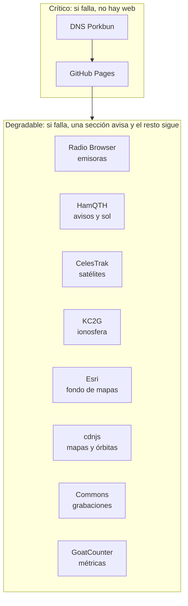

# Operaciones (SRE)

**Para quien opera la web:** qué significa que funcione, cómo se vigila, qué hacer cuando algo falla (paso a paso) y qué tareas periódicas hay. Pensado para usarlo con prisa: cada problema tiene su runbook con síntomas, diagnóstico, arreglo y comprobación.

Complementa a [INFRAESTRUCTURA.md](INFRAESTRUCTURA.md) (qué piezas hay), [CICD.md](CICD.md) (cómo se publica) y [PROBLEMAS.md](PROBLEMAS.md) (problemas al desarrollar).

## Índice

1. [El servicio en una página](#1-el-servicio-en-una-página)
2. [Niveles de servicio (SLI y SLO)](#2-niveles-de-servicio-sli-y-slo)
3. [Monitorización](#monitorización)
4. [Gravedad de las incidencias](#4-gravedad-de-las-incidencias)
5. [Runbooks](#runbooks)
6. [Después de una incidencia](#6-después-de-una-incidencia)
7. [Calendario de mantenimiento](#calendario-de-mantenimiento)
8. [Trabajo repetitivo y cómo reducirlo](#8-trabajo-repetitivo-y-cómo-reducirlo)
9. [Dependencias y su modo de fallo](#9-dependencias-y-su-modo-de-fallo)

---

## 1. El servicio en una página

| | |
| --- | --- |
| **Qué es** | Web estática de iniciación a la radioafición, en castellano e inglés |
| **Dirección** | <https://radio.bendi.dev> (inglés: <https://radio.bendi.dev/en/>) |
| **Usuarios** | Personas sin conocimientos de radio, en móvil sobre todo; docentes; radioaficionados que la recomiendan |
| **Dónde corre** | GitHub Pages (CDN Fastly). Sin servidor propio |
| **Estado en el servidor** | Ninguno. El progreso de cada persona está en su navegador |
| **Publicación** | Fusionar una pull request en `main` (1–2 min) |
| **Vuelta atrás** | Revertir la pull request (< 10 min) |
| **Dependencias críticas** | DNS de Porkbun, GitHub Pages |
| **Dependencias degradables** | Radio Browser, HamQTH, CelesTrak, KC2G, Esri, cdnjs, Wikimedia Commons, GoatCounter |
| **Responsable** | Sergio Santiago Bendaña Quesada (`serbenda`) |
| **Avisos de la gente** | Formularios de GitHub (enlace "¿Ves un error?" del pie) |



## 2. Niveles de servicio (SLI y SLO)

Objetivos realistas para una web estática sin guardias. Sirven para decidir **cuándo algo merece arreglarse ya** y cuándo puede esperar.

| SLI (qué se mide) | Cómo se mide | SLO (objetivo) | Margen de error en 30 días |
| --- | --- | --- | --- |
| **Disponibilidad**: la portada responde `200` por HTTPS | Monitor externo cada 5 min ([abajo](#monitorización)) | 99,5 % | ≈ 3 h 36 min |
| **Publicaciones correctas**: una fusión no rompe la web | Comprobaciones en verde + revisión tras publicar | 100 % de publicaciones con `check.mjs` en verde | 0 publicaciones en rojo |
| **Tiempo de vuelta atrás** | Desde que se detecta hasta que la versión buena está publicada | < 30 min | — |
| **Enlaces externos**: enlaces de la web que responden | Flujo semanal "Enlaces externos" | 98 % | — |
| **Secciones en directo**: la sección muestra datos o un aviso claro, nunca se queda en blanco | Prueba manual de [PRUEBAS.md](PRUEBAS.md#probar-los-datos-en-directo) | 100 % de secciones con aviso si su servicio cae | — |
| **Contenido al día**: datos con fecha (tasas, autorizaciones, frecuencias) revisados | [Calendario](#calendario-de-mantenimiento) | Ningún dato vencido más de 30 días | — |

**Política del margen de error:** si en un mes se gasta el margen de disponibilidad por culpa propia (no de GitHub), las siguientes publicaciones solo arreglan, no añaden funciones, hasta entender la causa.

## Monitorización

### Qué hay hoy

| Señal | Herramienta | Dónde se ve | Avisa |
| --- | --- | --- | --- |
| Calidad de cada cambio | `tools/check.mjs` en GitHub Actions (flujo **Comprobaciones**) | Pull request (verde/rojo) | Bloquea la fusión si falla |
| Publicación | Flujo interno **pages build and deployment** | Pestaña Actions | Correo de GitHub si falla |
| Enlaces externos rotos | `tools/enlaces.mjs` cada lunes 06:17 UTC (flujo **Enlaces externos**) | Aviso con etiqueta `enlaces` | Notificación de GitHub |
| Uso real | GoatCounter (`serbenda.goatcounter.com`) | Panel; páginas como `/radio/…`, hitos como `radio/…` | No |
| Errores que ve la gente | Formularios de aviso | Pestaña Issues | Notificación de GitHub |
| Estado de GitHub | <https://www.githubstatus.com> | Web | Suscripción opcional |

### Lo que falta y cómo añadirlo

**Monitor de disponibilidad externo.** Hoy nadie avisa si la web deja de responder. Opciones gratuitas, de menos a más trabajo:

1. **UptimeRobot / Better Stack / Freshping** (gratis): monitor HTTP(S) de `https://radio.bendi.dev/` cada 5 min, palabra clave `radioafición` en la respuesta y aviso por correo o al móvil. Activa también el aviso de caducidad del certificado. Es lo recomendado.
2. **Flujo de GitHub Actions programado** que haga `curl -fsS https://radio.bendi.dev/ | grep -q radioafición` cada hora y abra un aviso si falla (mismo patrón que `enlaces.yml`). Gratis pero con hasta 1 h de retraso y GitHub puede retrasar los flujos programados.

**Errores de JavaScript en los navegadores.** No se recogen (decisión de privacidad, D13). Si hiciera falta, la opción menos invasiva es contar un hito `radio/error/<módulo>` con `Radio.track` desde un `window.onerror`, sin mensaje ni datos.

## 4. Gravedad de las incidencias

| Nivel | Qué es | Ejemplos | Respuesta |
| --- | --- | --- | --- |
| **S1 · Caída** | La web no carga para nadie | DNS mal, Pages desactivado, certificado caducado, HTML roto en la portada | Ya. Revertir primero, investigar después |
| **S2 · Función principal rota** | Una página o una función clave no funciona | El examen no corrige, el menú no navega, una página da 404 | En el día |
| **S3 · Degradada** | Una sección en directo sin datos, un enlace roto, un texto mal | HamQTH caído, grabación borrada de Commons | Esta semana; muchas se arreglan solas |
| **S4 · Cosmético** | Detalle visual o de redacción | Un salto de línea feo en un móvil concreto | Cuando toque |

Información **incorrecta** sobre normativa o seguridad (por ejemplo, una frecuencia que no se puede usar) es **S2** aunque la web funcione: puede llevar a alguien a emitir donde no debe.

## Runbooks

Formato: **Síntomas → Diagnóstico → Arreglo → Comprobar**. Todos los comandos se pueden sustituir por el navegador; ver [INFRAESTRUCTURA.md §10](INFRAESTRUCTURA.md#10-comprobaciones-desde-la-línea-de-comandos).

### RB-01 · La web no carga o se ve rota tras publicar

**Síntomas:** página en blanco, sin estilos, errores en la consola o 404 justo después de fusionar.

**Diagnóstico**
1. Pestaña Actions → "pages build and deployment": ¿terminó en verde? Si está en curso, espera 2 min.
2. `curl -s https://radio.bendi.dev/sw.js | grep "const VERSION"` → ¿es la versión que acabas de publicar?
3. Abre la web en una ventana privada (sin service worker ni caché). Si ahí va bien, es caché (RB-05).
4. Consola del navegador (F12): ¿error de CSP (`Refused to…`)? → RB-07. ¿`404` de un `.js`? → ruta mal escrita.

**Arreglo:** **revertir primero**. En GitHub, la PR fusionada → **Revert** → fusiona la PR de reversión. Después, con calma, arregla en `development` ([CICD.md](CICD.md#vuelta-atrás)).

**Comprobar:** ventana privada, todas las páginas abren; `check.mjs` en verde en la PR del arreglo.

### RB-02 · El dominio no resuelve (`DNS_PROBE_FINISHED_NXDOMAIN`)

**Diagnóstico**
```bash
dig +short NS bendi.dev                                   # ¿siguen siendo los de Porkbun?
dig +short CNAME radio.bendi.dev @curitiba.ns.porkbun.com # ¿existe el registro en el autoritativo?
whois bendi.dev | grep -i expir                           # ¿ha caducado el dominio?
```

**Arreglo**
- Falta el registro: Porkbun → `bendi.dev` → DNS → **Add record**: tipo `CNAME`, host `radio`, valor `serbenda.github.io`, TTL 600.
- Cambiaron los NS sin querer: restaurarlos en Porkbun (los cuatro `*.ns.porkbun.com`).
- Dominio caducado: renovar en Porkbun.

**Comprobar:** `dig +short radio.bendi.dev` devuelve `serbenda.github.io.` (la propagación puede tardar hasta el TTL, 10 min).

### RB-03 · Aviso de certificado o "Enforce HTTPS" desactivado

**Diagnóstico:** Settings → Pages: ¿muestra un aviso en "Custom domain"? `openssl … -enddate` ([INFRAESTRUCTURA.md §5](INFRAESTRUCTURA.md#5-https-y-certificados)).

**Arreglo**
1. Comprueba que el DNS apunta a GitHub (RB-02). Sin eso, GitHub no puede renovar.
2. Settings → Pages → borra el dominio, **Save**, vuelve a escribir `radio.bendi.dev`, **Save** (vuelve a pedir el certificado). Ojo: esto borra el archivo `CNAME` de `main` con un commit de GitHub; el siguiente commit de `development` lo restaurará, o `check.mjs` lo marcará en rojo.
3. Cuando aparezca, marca **Enforce HTTPS**.

**Comprobar:** candado en el navegador; `curl -sI http://radio.bendi.dev/` redirige a `https://`.

### RB-04 · 404 en `radio.bendi.dev` pero el DNS está bien

**Causa típica:** el repositorio perdió el dominio (archivo `CNAME` borrado, Pages desactivado o repositorio renombrado).

**Arreglo:** comprueba que `CNAME` existe en `main` con `radio.bendi.dev`; Settings → Pages → Source `main` / root; Custom domain `radio.bendi.dev`.

### RB-05 · Hay gente que sigue viendo la versión antigua

**Causa:** caché del service worker; se olvidó subir `VERSION` en `sw.js`.

**Diagnóstico:** en el navegador afectado, F12 → Aplicación → Service workers: ¿la versión activa es la vieja? Cache Storage: ¿hay `radio-<versión vieja>`?

**Arreglo:** publica una versión con `VERSION` nueva (aunque sea `x.y.z+1` sin otros cambios). A la persona: cerrar todas las pestañas de la web y volver a abrirla (o en la app instalada, cerrarla del todo).

**Comprobar:** Aplicación → Cache Storage solo tiene `radio-<versión nueva>`.

### RB-06 · Una sección en directo no muestra datos

**Síntomas:** "No hay señal del directorio", "No se han podido cargar…", mapa sin fondo, lista de pases vacía.

**Diagnóstico** (en la consola del navegador, en la página afectada):

| Sección | Prueba rápida |
| --- | --- |
| Emisoras | `fetch('https://de1.api.radio-browser.info/json/stats').then(r=>r.status)` |
| Ahora en el aire | `fetch('https://www.hamqth.com/api/v2/spots?limit=1').then(r=>r.status)` |
| Propagación | `fetch('https://www.hamqth.com/api/v2/solar').then(r=>r.status)` |
| Satélites | `fetch('https://celestrak.org/NORAD/elements/gp.php?CATNR=25544&FORMAT=TLE').then(r=>r.text())` |

- Respuesta 5xx o tiempo agotado: el servicio está caído. **No hay que hacer nada**: la sección ya avisa. Si dura más de una semana, mira su web o su cuenta de avisos.
- Error de CORS o CSP: cambió el dominio o sus cabeceras → RB-07 o buscar alternativa ([GUIA.md](GUIA.md#un-servicio-externo-ha-dejado-de-funcionar)).
- Respuesta 200 pero la sección falla: cambió el formato. Mira la cabecera del módulo (`js/live.js`, `js/stations.js`…), que documenta el formato esperado.

### RB-07 · La consola dice `Refused to … because it violates the Content Security Policy`

**Causa:** un dominio nuevo (o cambiado) no está en la CSP.

**Arreglo:** añade el dominio a la directiva que diga el error (`connect-src`, `script-src`…) en **todas las páginas a la vez** (deben ser idénticas; `check.mjs` lo exige) y en la tabla de [INFRAESTRUCTURA.md §7](INFRAESTRUCTURA.md#7-servicios-de-terceros). Nunca uses `*` ni `'unsafe-eval'`.

### RB-08 · Las comprobaciones salen en rojo en la PR

Lee el registro del paso "Comprobar páginas…": cada fallo dice archivo y motivo. Reprodúcelo con `node tools/check.mjs`. Recetas por mensaje en [PROBLEMAS.md](PROBLEMAS.md#node-toolscheckmjs-falla). **Nunca** se desactiva la protección de `main` para saltárselas.

### RB-09 · Aviso semanal de enlaces rotos

Sigue [GUIA.md → Un enlace externo se ha roto](GUIA.md#un-enlace-externo-se-ha-roto). Un "dudoso" (401/403/429 o tiempo agotado) casi siempre es un servidor que bloquea robots: compruébalo a mano.

### RB-10 · Un aviso de la gente dice que un dato es incorrecto

1. Contrasta con la fuente oficial (BOE, CNAF, IARU, URE). Las fuentes de cada dato están en [DATOS.md](DATOS.md#datos-fijos-de-radio-comprobados-el-2-nov-2026) y [CONTENIDO.md](CONTENIDO.md).
2. Si es normativa o seguridad: **S2**, arréglalo en el día en los dos idiomas.
3. Actualiza la fecha de comprobación en DATOS.md y responde en el aviso con la fuente.

### RB-11 · Se ha publicado algo que no debía (dato personal, texto de terceros)

1. Revertir ya (RB-01).
2. El contenido sigue en el historial de Git y en cachés: si es un dato personal de alguien, pide su borrado a GitHub Support (formulario de "sensitive data") y considera reescribir el historial con `git filter-repo` en una rama, con mucho cuidado y avisando de que cambian los commits.
3. Anota en el postmortem cómo se coló.

## 6. Después de una incidencia

Para S1 y S2, un postmortem breve en un aviso de GitHub con la etiqueta `incidencia`, **sin culpables**:

```markdown
## Resumen
Qué pasó, en una frase. Gravedad (S1–S4). Duración: de HH:MM a HH:MM (hora de Madrid).

## Impacto
Qué no funcionaba y para quién (todas las personas, solo la app instalada, solo inglés…).

## Cronología
- HH:MM  Se fusiona la PR #N.
- HH:MM  Se detecta (cómo: aviso, monitor, por casualidad).
- HH:MM  Se revierte.
- HH:MM  Comprobado que funciona.

## Causa
La causa técnica y por qué no la paró ninguna comprobación.

## Qué cambiamos
- [ ] Comprobación nueva en tools/check.mjs que lo habría detectado.
- [ ] Documentación actualizada (runbook nuevo o corregido).
```

Regla: **cada incidencia deja al menos una comprobación automática nueva o un runbook mejor.**

## Calendario de mantenimiento

| Cuándo | Qué | Dónde | Runbook / receta |
| --- | --- | --- | --- |
| Cada lunes (automático) | Comprobar enlaces externos | Actions → Enlaces externos | RB-09 |
| Cada mes | Mirar avisos abiertos y GoatCounter (¿alguna página sin visitas? ¿hitos que no se cumplen?) | Issues, GoatCounter | [GUIA.md](GUIA.md#ver-las-visitas-y-los-hitos) |
| **Antes del 26 dic 2026** | La autorización temporal de 2,4 GHz en España (QO-100) caduca: comprobar si se prorroga y actualizar el texto | `entender/` y `en/understand/` (#satelites), [DATOS.md](DATOS.md) | RB-10 |
| Cada enero | Tasas del examen y de la licencia, fechas de convocatorias | `empezar/`, `en/start/`, `js/data.js` | [GUIA.md](GUIA.md#actualizar-tasas-cifras-del-trámite-o-modelos-de-radio) |
| Cada enero | Calendario de concursos y eventos del año | `js/data.js` | [GUIA.md](GUIA.md#añadir-un-evento-al-calendario) |
| Cada 6 meses | Lista de radioclubes de la URE | `js/clubs-data.js` | [GUIA.md](GUIA.md#actualizar-la-lista-de-radioclubes) |
| Cada 6 meses | Nuevas versiones de Leaflet y satellite.js (con su SRI) | Páginas con mapas y Entender | [GUIA.md](GUIA.md#actualizar-leaflet-o-satellitejs) |
| Cada 6 meses | Versión de las acciones (`actions/checkout`, `setup-node`) y de Node en los flujos | `.github/workflows/` | [CICD.md](CICD.md#dependencias-de-la-tubería) |
| Cada año | Auditoría de accesibilidad con axe y prueba en un iPhone y un Android reales | — | [PRUEBAS.md](PRUEBAS.md#auditoría-de-accesibilidad) |
| Cada año | Repasar el examen contra la normativa vigente (Orden IET/1311/2013 o la que la sustituya) | `js/exam-data.js`, `js/en/exam-data.js` | [CONTENIDO.md](CONTENIDO.md) |
| **Antes del 30 oct 2027** | Renovar el dominio `bendi.dev` (o activar la renovación automática en Porkbun) | Porkbun | [INFRAESTRUCTURA.md](INFRAESTRUCTURA.md#2-inventario) |

## 8. Trabajo repetitivo y cómo reducirlo

| Tarea manual | Frecuencia | Automatizable con |
| --- | --- | --- |
| Subir `VERSION` y que coincida con el CHANGELOG | Cada publicación | Ya lo vigila `check.mjs` (falla si no coinciden) |
| Revisar enlaces | Semanal | Ya automático |
| Comprobar que la web responde | Continua | Monitor externo ([arriba](#lo-que-falta-y-cómo-añadirlo)) |
| Actualizar versiones de acciones | Semestral | Dependabot para `github-actions` ([CICD.md](CICD.md#dependencias-de-la-tubería)) |
| Comprobar fechas de datos | Ver calendario | Una comprobación en `check.mjs` que falle si una fecha de "válido hasta" está a menos de 30 días |

## 9. Dependencias y su modo de fallo

| Dependencia | Modo de fallo observado o esperado | Qué ve la persona | Detección |
| --- | --- | --- | --- |
| GitHub Pages | Caída general (rara, minutos) | Error del navegador; la app instalada sigue funcionando | githubstatus.com, monitor |
| DNS Porkbun | Registro borrado por error | Error de DNS | Monitor |
| Radio Browser | Un servidor caído (pasa a menudo) | Nada: se prueban 4 servidores | — |
| HamQTH | Caída o lentitud | Aviso en la sección; reintento al minuto | Manual |
| CelesTrak | Limita peticiones repetidas | Aviso; sin pases | Manual |
| KC2G | Imagen no disponible | La tarjeta del mapa se oculta | Manual |
| Esri | Teselas no disponibles | Mapa sin fondo, datos visibles | Manual |
| cdnjs | Caída o bloqueo por un cortafuegos de empresa o colegio | Sin mapas ni pases; listados visibles | Manual |
| Wikimedia Commons | Archivo borrado o renombrado | Mensaje bajo el reproductor | Aviso semanal de enlaces |
| GoatCounter | Caída o bloqueado por un bloqueador de anuncios | Nada | — |
