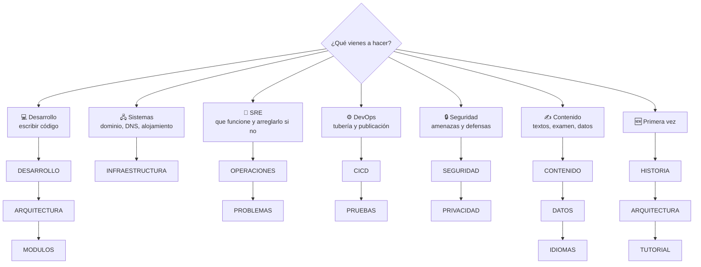

# Documentación

Todo lo necesario para entender, mantener, operar y ampliar la web **sin ayuda externa**. 21 documentos en esta carpeta (más CONTRIBUTING, CHANGELOG y SECURITY en la raíz), en español de España y en lenguaje llano, con diagramas que GitHub dibuja solo.

## Elige tu papel

| Papel | Empieza por | Después | Para el día a día |
| --- | --- | --- | --- |
| 🆕 **Primera vez** (≈ 1 hora) | [HISTORIA](HISTORIA.md) | [ARQUITECTURA](ARQUITECTURA.md) → [TUTORIAL](TUTORIAL.md) | [GUIA](GUIA.md) |
| 💻 **Desarrollo** | [DESARROLLO](DESARROLLO.md) | [ARQUITECTURA](ARQUITECTURA.md) → [MODULOS](MODULOS.md) | [GUIA](GUIA.md) · [ESTILOS](ESTILOS.md) · [IDIOMAS](IDIOMAS.md) |
| 🖧 **Ingeniería de sistemas** | [INFRAESTRUCTURA](INFRAESTRUCTURA.md) | [DATOS](DATOS.md) | [INFRAESTRUCTURA §10](INFRAESTRUCTURA.md#10-comprobaciones-desde-la-línea-de-comandos) (comandos) |
| 🚨 **SRE / guardia** | [OPERACIONES](OPERACIONES.md) | [INFRAESTRUCTURA](INFRAESTRUCTURA.md) | [Runbooks](OPERACIONES.md#runbooks) · [Calendario](OPERACIONES.md#calendario-de-mantenimiento) |
| ⚙️ **DevOps** | [CICD](CICD.md) | [PRUEBAS](PRUEBAS.md) | [Publicar](CICD.md#6-publicar-una-versión) · [Vuelta atrás](CICD.md#vuelta-atrás) |
| 🔒 **Seguridad** | [SEGURIDAD](SEGURIDAD.md) | [PRIVACIDAD](PRIVACIDAD.md) | [Lista para PR](SEGURIDAD.md#11-lista-de-revisión-de-seguridad-para-una-pr) |
| ✍️ **Contenido** | [CONTENIDO](CONTENIDO.md) | [DATOS](DATOS.md) → [IDIOMAS](IDIOMAS.md) | [GUIA → Contenido](GUIA.md#contenido) |

## Si tienes prisa

| Situación | Ve directo a |
| --- | --- |
| **La web no carga** | [OPERACIONES → RB-01](OPERACIONES.md#rb-01--la-web-no-carga-o-se-ve-rota-tras-publicar) |
| **He publicado algo roto** | [CICD → Vuelta atrás](CICD.md#vuelta-atrás) |
| El dominio no resuelve | [OPERACIONES → RB-02](OPERACIONES.md#rb-02--el-dominio-no-resuelve-dns_probe_finished_nxdomain) |
| Una sección en directo no muestra datos | [OPERACIONES → RB-06](OPERACIONES.md#rb-06--una-sección-en-directo-no-muestra-datos) |
| Mi cambio no aparece | [PROBLEMAS](PROBLEMAS.md#la-web-no-muestra-mi-cambio) |
| Las comprobaciones salen en rojo | [PROBLEMAS](PROBLEMAS.md#node-toolscheckmjs-falla) |
| ¿Dónde se cambia el DNS? | [INFRAESTRUCTURA §3](INFRAESTRUCTURA.md#3-dominio-y-dns) (en **Porkbun**) |
| Encontré una vulnerabilidad | [SECURITY.md](../SECURITY.md) |

## Todos los documentos

### Entender

| Documento | Qué cuenta |
| --- | --- |
| [HISTORIA.md](HISTORIA.md) | Cómo se construyó, etapa por etapa, problemas y lecciones aprendidas |
| [ARQUITECTURA.md](ARQUITECTURA.md) | Vista general, carpetas, páginas, carga, módulos, núcleo `Radio`, eventos, datos, sin conexión, seguridad y publicación. Con diagramas |
| [MODULOS.md](MODULOS.md) | Referencia de cada archivo de JavaScript: qué hace, qué necesita, qué guarda, qué eventos usa |
| [ESTILOS.md](ESTILOS.md) | Identidad "Dial nocturno": colores (con contraste), tipografías, medidas, puntos de corte, componentes |
| [DECISIONES.md](DECISIONES.md) | Registro de decisiones (D01–D22): contexto, decisión y consecuencias |
| [ESTUDIO.md](ESTUDIO.md) | Resumen del estudio de más de 50 webs de radioafición que guió el proyecto |
| [IDIOMAS.md](IDIOMAS.md) | Cómo está hecha la versión en inglés y cómo traducir |
| [GLOSARIO.md](GLOSARIO.md) | Términos de web y de radio usados en el código y la documentación |

### Construir

| Documento | Qué cuenta |
| --- | --- |
| [DESARROLLO.md](DESARROLLO.md) | **Manual de desarrollo:** entorno, ciclo diario, reglas del código, depuración, navegadores, presupuesto de peso, definición de terminado, revisión |
| [TUTORIAL.md](TUTORIAL.md) | De cero a tu primer cambio publicado, paso a paso |
| [GUIA.md](GUIA.md) | Recetas: preguntas, grabaciones, glosario, calendario, páginas, módulos, servicios, publicar, deshacer… |
| [CONTENIDO.md](CONTENIDO.md) | Estilo de los textos y detalles de cada tipo de contenido; revisión del examen |
| [../CONTRIBUTING.md](../CONTRIBUTING.md) | Normas: ramas, commits, estilo de código, qué documentar |

### Operar

| Documento | Qué cuenta |
| --- | --- |
| [INFRAESTRUCTURA.md](INFRAESTRUCTURA.md) | **Sistemas:** dominio y DNS (Porkbun), GitHub Pages, certificados, cachés, terceros, cuentas, límites, comandos, cambios y recuperación ante desastres |
| [OPERACIONES.md](OPERACIONES.md) | **SRE:** SLI/SLO, monitorización, gravedad, 11 runbooks, postmortem, calendario de mantenimiento, dependencias |
| [CICD.md](CICD.md) | **DevOps:** tubería, ramas y protecciones, Actions, comprobaciones, versionado, publicar, vuelta atrás, arreglos urgentes, permisos, métricas DORA |
| [SEGURIDAD.md](SEGURIDAD.md) | Superficie de ataque, modelo de amenazas, CSP directiva a directiva, SRI, cadena de suministro, cuentas, riesgos aceptados |
| [PRUEBAS.md](PRUEBAS.md) | Comprobaciones automáticas, enlaces, accesibilidad, sin conexión y lista manual |
| [CALIDAD.md](CALIDAD.md) | Accesibilidad, rendimiento, seguridad, SEO y limitaciones conocidas |
| [PRIVACIDAD.md](PRIVACIDAD.md) | Qué se guarda, métricas, peticiones a terceros, datos personales |
| [DATOS.md](DATOS.md) | Cada servicio externo: dirección, límites, atribución, qué pasa si falla y alternativa |
| [PROBLEMAS.md](PROBLEMAS.md) | Síntomas, causas y soluciones al desarrollar |
| [../CHANGELOG.md](../CHANGELOG.md) | Historial de versiones |
| [../SECURITY.md](../SECURITY.md) | Cómo avisar de una vulnerabilidad |

## Documentación dentro del código

Además de estos documentos, **cada archivo está documentado por dentro**:

- Cada módulo de `js/` empieza con una cabecera: qué hace, en qué página, qué elementos necesita, qué guarda, qué eventos usa y **cómo modificarlo**.
- Cada función lleva un comentario JSDoc (`/** … */`) con qué hace, sus parámetros, qué devuelve y sus efectos.
- `css/style.css` empieza con un índice de sus secciones.
- `sw.js`, `tools/*` y `.github/workflows/*.yml` explican en su cabecera qué hacen y cómo se usan.

## Convenciones de esta documentación

- En español de España, en lenguaje llano.
- Los diagramas están en [Mermaid](https://mermaid.js.org/): GitHub los dibuja solos. Para editarlos, cambia el texto; para previsualizarlos, <https://mermaid.live>.
- Las capturas están en `docs/img/` (se regeneran a mano cuando cambia mucho el diseño).
- Cuando cambies código, actualiza el documento correspondiente en la misma pull request (tabla en [CONTRIBUTING.md](../CONTRIBUTING.md#qué-documentación-actualizar)).
- Los datos que caducan llevan su fecha de comprobación y están en el [calendario de mantenimiento](OPERACIONES.md#calendario-de-mantenimiento).
