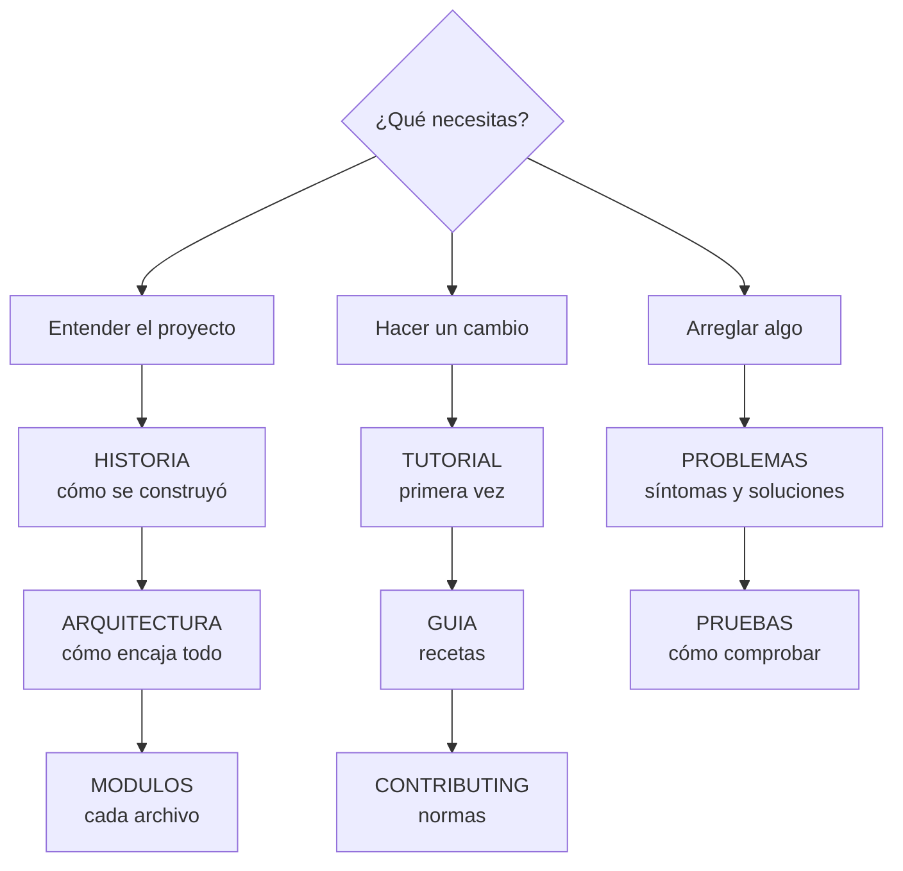

# Documentación

Todo lo necesario para entender, mantener y ampliar la web **sin ayuda externa**.

## Por dónde empezar

**Si es tu primera vez**, lee en este orden (≈ 1 hora): [HISTORIA](HISTORIA.md) → [ARQUITECTURA](ARQUITECTURA.md) → [TUTORIAL](TUTORIAL.md). Lo demás se consulta cuando haga falta.

## Todos los documentos

### Entender

| Documento | Qué cuenta |
| --- | --- |
| [HISTORIA.md](HISTORIA.md) | Cómo se construyó, etapa por etapa, problemas y lecciones aprendidas |
| [ARQUITECTURA.md](ARQUITECTURA.md) | Vista general, carpetas, páginas, carga, módulos, núcleo `Radio`, eventos, datos, sin conexión, seguridad y publicación. Con diagramas |
| [MODULOS.md](MODULOS.md) | Referencia de cada archivo de JavaScript: qué hace, qué necesita, qué guarda, qué eventos usa |
| [ESTILOS.md](ESTILOS.md) | Colores (con contraste), tipografías, medidas, puntos de corte, componentes |
| [DECISIONES.md](DECISIONES.md) | Registro de decisiones (D01–D17): contexto, decisión y consecuencias |
| [ESTUDIO.md](ESTUDIO.md) | Resumen del estudio de más de 50 webs de radioafición que guió el proyecto |
| [GLOSARIO.md](GLOSARIO.md) | Términos de web y de radio usados en el código y la documentación |

### Cambiar

| Documento | Qué cuenta |
| --- | --- |
| [TUTORIAL.md](TUTORIAL.md) | De cero a tu primer cambio publicado, paso a paso |
| [GUIA.md](GUIA.md) | Recetas: preguntas, grabaciones, glosario, calendario, páginas, módulos, servicios, publicar, deshacer… |
| [CONTENIDO.md](CONTENIDO.md) | Estilo de los textos y detalles de cada tipo de contenido; revisión del examen |
| [../CONTRIBUTING.md](../CONTRIBUTING.md) | Normas: ramas, commits, estilo de código, qué documentar |

### Comprobar y operar

| Documento | Qué cuenta |
| --- | --- |
| [PRUEBAS.md](PRUEBAS.md) | Comprobaciones automáticas, enlaces, accesibilidad, sin conexión y lista manual |
| [CALIDAD.md](CALIDAD.md) | Accesibilidad, rendimiento, seguridad, SEO y limitaciones conocidas |
| [PRIVACIDAD.md](PRIVACIDAD.md) | Qué se guarda, métricas, peticiones a terceros, datos personales |
| [DATOS.md](DATOS.md) | Cada servicio externo: dirección, límites, atribución, qué pasa si falla y alternativa |
| [PROBLEMAS.md](PROBLEMAS.md) | Síntomas, causas y soluciones |
| [../CHANGELOG.md](../CHANGELOG.md) | Historial de versiones |

## Documentación dentro del código

Además de estos documentos, **cada archivo está documentado por dentro**:

- Cada módulo de `js/` empieza con una cabecera: qué hace, en qué página, qué elementos necesita, qué guarda, qué eventos usa y **cómo modificarlo**.
- Cada función lleva un comentario JSDoc (`/** … */`) con qué hace, sus parámetros, qué devuelve y sus efectos.
- `css/style.css` empieza con un índice de sus secciones.
- `tools/*.mjs` y `.github/workflows/*.yml` explican en su cabecera qué hacen y cómo se usan.

## Convenciones de esta documentación

- En español de España, en lenguaje llano.
- Los diagramas están en [Mermaid](https://mermaid.js.org/): GitHub los dibuja solos. Para editarlos, cambia el texto; para previsualizarlos, <https://mermaid.live>.
- Las capturas están en `docs/img/` (se regeneran a mano cuando cambia mucho el diseño).
- Cuando cambies código, actualiza el documento correspondiente en la misma pull request (tabla en [CONTRIBUTING.md](../CONTRIBUTING.md#qué-documentación-actualizar)).
