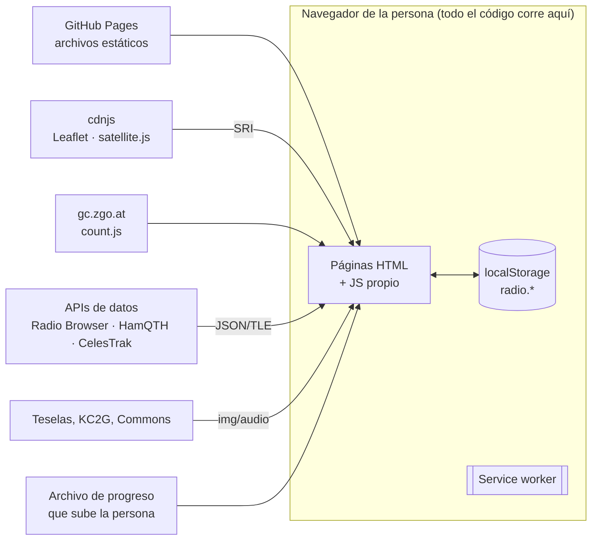

# Seguridad

**Para quien revisa la seguridad:** qué se protege, de quién, qué defensas hay, dónde están y qué riesgos se aceptan. Las medidas concretas de cada archivo están resumidas en [CALIDAD.md](CALIDAD.md#seguridad); aquí está el porqué y el modelo completo.

Cómo avisar de una vulnerabilidad: [SECURITY.md](../SECURITY.md).

## Índice

1. [Superficie de ataque](#1-superficie-de-ataque)
2. [Qué se protege](#2-qué-se-protege)
3. [Modelo de amenazas](#3-modelo-de-amenazas)
4. [Content-Security-Policy, directiva a directiva](#4-content-security-policy-directiva-a-directiva)
5. [Integridad de librerías (SRI)](#5-integridad-de-librerías-sri)
6. [Datos de fuera: cómo se pintan](#6-datos-de-fuera-cómo-se-pintan)
7. [Progreso guardado e importado](#7-progreso-guardado-e-importado)
8. [Cadena de suministro](#8-cadena-de-suministro)
9. [Cuentas y dominio](#9-cuentas-y-dominio)
10. [Riesgos aceptados](#10-riesgos-aceptados)
11. [Lista de revisión de seguridad para una PR](#11-lista-de-revisión-de-seguridad-para-una-pr)

---

## 1. Superficie de ataque



- **No hay servidor propio** que atacar: ni base de datos, ni formularios que lleguen a un backend, ni sesiones, ni contraseñas.
- Todo lo que entra al navegador viene de cinco orígenes: los archivos de la web, dos CDN de scripts, las APIs de datos, recursos multimedia y el archivo de progreso que la propia persona sube.

## 2. Qué se protege

| Activo | Por qué importa | Dónde está |
| --- | --- | --- |
| **Integridad de la web** | Que nadie inyecte código que robe datos de otras webs, mine criptomonedas o engañe a quien la visita | GitHub, DNS, CDN |
| **Contenido correcto** | Información falsa sobre frecuencias o normativa puede llevar a alguien a emitir ilegalmente | Repositorio, revisión |
| **Privacidad** | Nadie debe poder seguir a una persona por la web | Sin cookies; métricas sin datos personales ([PRIVACIDAD.md](PRIVACIDAD.md)) |
| **Progreso de cada persona** | Su trabajo de semanas (Morse, examen, insignias) | Su navegador |
| **Dominio `bendi.dev`** | Si se pierde, se pierden todas las webs y se puede suplantar | Porkbun |

## 3. Modelo de amenazas

Formato STRIDE simplificado: amenaza → defensa → riesgo que queda.

| # | Amenaza | Defensa | Riesgo residual |
| --- | --- | --- | --- |
| T1 | **XSS por datos de una API** (un nombre de emisora con `<script>`) | Todo texto externo pasa por `Radio.esc` antes de entrar como HTML; la CSP no permite scripts en línea ni de dominios no listados | Bajo |
| T2 | **Librería de cdnjs comprometida** | Versión fija + `integrity` SHA-512 + `crossorigin="anonymous"`: si cambia un byte, el navegador no la ejecuta | Muy bajo |
| T3 | **Script de GoatCounter comprometido** | Dominio limitado por CSP; **sin SRI** (el script no es versionado) | **Medio-bajo** (ver §8) |
| T4 | **Cuenta de GitHub robada** → código malicioso publicado | Doble factor; `main` protegida (también para administradores); comprobaciones obligatorias | Bajo si hay 2FA |
| T5 | **Dominio o DNS secuestrado** (cuenta de Porkbun) | Bloqueo de transferencia; **2FA en Porkbun (pendiente de activar)** | **Medio** hasta activar 2FA |
| T6 | **Subdominio abandonado reclamado** en GitHub Pages por otro | Dominio verificado en GitHub (TXT `_github-pages-challenge-serbenda`); procedimiento de baja ordenado ([INFRAESTRUCTURA.md](INFRAESTRUCTURA.md#riesgo-de-subdomain-takeover)) | Muy bajo |
| T7 | **Archivo de progreso manipulado** (alguien pasa un JSON preparado) | Se valida `app: "radio"`, solo se aceptan claves `radio.*`, se pide confirmación y los valores se leen como datos | Bajo: como mucho, falsea el propio progreso |
| T8 | **La web metida en un iframe** para engañar (clickjacking) | No hay acciones sensibles que robar (ni pagos, ni sesiones). `frame-ancestors` no es posible en `<meta>` | Aceptado |
| T9 | **Rastreo de visitantes** por terceros | Tipografías propias (sin Google Fonts), sin cookies, `referrer` limitado, datos en directo sin identificadores | Bajo: las APIs ven la IP, como cualquier web |
| T10 | **Acción de GitHub comprometida** en la tubería | Permisos mínimos; los flujos no tienen secretos que robar ni escriben en el código | Bajo |
| T11 | **Información falsa** (aviso malintencionado que pide cambiar un dato) | Todo cambio de dato se contrasta con la fuente oficial antes de fusionar ([OPERACIONES.md RB-10](OPERACIONES.md#rb-10--un-aviso-de-la-gente-dice-que-un-dato-es-incorrecto)) | Bajo |
| T12 | **Denegación de servicio** | La CDN de GitHub absorbe el tráfico; no hay nada propio que saturar | Muy bajo |

## 4. Content-Security-Policy, directiva a directiva

Igual en todas las páginas (lo exige `check.mjs` §11). Va en `<meta http-equiv>` porque GitHub Pages no admite cabeceras propias.

| Directiva | Valor | Por qué |
| --- | --- | --- |
| `default-src` | `'self'` | Todo lo no listado, solo de la propia web |
| `script-src` | `'self' https://cdnjs.cloudflare.com https://gc.zgo.at` | Módulos propios, Leaflet/satellite.js y GoatCounter. **Sin `'unsafe-inline'` ni `'unsafe-eval'`**: ni `<script>` en línea ni `onclick="…"` (lo vigila `check.mjs`) |
| `style-src` | `'self' 'unsafe-inline' https://cdnjs.cloudflare.com` | `'unsafe-inline'` hace falta para los estilos que Leaflet y los módulos ponen con `style=` (posiciones, colores de cada banda). Un estilo inyectado no ejecuta código |
| `font-src` | `'self'` | Solo tipografías propias |
| `img-src` | `'self' data: blob: https:` | Teselas, mapa de KC2G, iconos de Leaflet (`data:`) y la tarjeta QSL generada (`blob:`). Amplio a propósito: una imagen no ejecuta código |
| `media-src` | `'self' blob: https:` | Grabaciones de Wikimedia Commons y emisoras de Radio Browser (miles de dominios distintos) |
| `connect-src` | `'self' https://*.api.radio-browser.info https://www.hamqth.com https://celestrak.org https://serbenda.goatcounter.com` | **Solo** los servicios de datos. Si un script se colara, no podría enviar datos a otro sitio con `fetch` |
| `worker-src` | `'self'` | Solo el service worker propio |
| `manifest-src` | `'self'` | Solo el manifest propio |
| `object-src` | `'none'` | Sin Flash, applets ni `<embed>` |
| `base-uri` | `'self'` | Nadie puede cambiar la base de las rutas relativas con `<base>` |
| `form-action` | `'none'` | La web no envía formularios a ningún sitio |

Además: `<meta name="referrer" content="strict-origin-when-cross-origin">` (a otros sitios solo llega `https://radio.bendi.dev/`, nunca la página ni el `#`), y todo enlace con `target="_blank"` lleva `rel="noopener"`.

**Probarla:** abre cada página con la consola (F12) abierta y recorre sus secciones: no debe aparecer ningún `Refused to…`. Receta en [PRUEBAS.md](PRUEBAS.md#comprobar-la-content-security-policy).

## 5. Integridad de librerías (SRI)

```html
<script src="https://cdnjs.cloudflare.com/ajax/libs/leaflet/1.9.4/leaflet.min.js"
        integrity="sha512-puJW3E/qXDqYp9IfhAI54BJEaWIfloJ7JWs7OeD5i6ruC9JZL1gERT1wjtwXFlh7CjE7ZJ+/vcRZRkIYIb6p4g=="
        crossorigin="anonymous" referrerpolicy="no-referrer"></script>
```

- El navegador calcula el SHA-512 del archivo recibido y lo compara con `integrity`. Si no coincide, **no lo ejecuta**.
- Para actualizar: copia la etiqueta completa de <https://cdnjs.com> (incluye el hash) o calcúlalo: `curl -s <url> | openssl dgst -sha512 -binary | openssl base64 -A`. Receta: [GUIA.md](GUIA.md#actualizar-leaflet-o-satellitejs).
- `check.mjs` §11 falla si una librería de cdnjs no lleva versión exacta o `integrity`.

## 6. Datos de fuera: cómo se pintan

| Origen | Cómo entra en la página | Defensa |
| --- | --- | --- |
| Textos de APIs (nombres de emisoras, indicativos, comentarios de los avisos) | `innerHTML` con plantillas | **Siempre** con `Radio.esc()` (escapa `& < > " '`) |
| Números de APIs (frecuencias, índices solares) | Plantillas | Se formatean como números; si se pintan tal cual llegan, pasan por `Radio.esc` como cualquier texto |
| URLs de APIs (stream de una emisora, ficha) | Atributos `src`/`href` | Solo `https:`; las emisoras se filtran con `is_https=true` |
| Textos fijos del repositorio (FAQ, radioclubes, familias) | `innerHTML` sin escapar | Los escribe quien mantiene la web; nunca datos de fuera |
| TLE de CelesTrak | Texto que lee satellite.js | Nunca se inserta como HTML |

Regla para código nuevo: **¿viene de fuera? → `Radio.esc`.** La cabecera de cada módulo dice qué datos externos usa ([MODULOS.md](MODULOS.md)).

## 7. Progreso guardado e importado

- Se guarda en `localStorage` con claves `radio.*` y nunca sale del dispositivo ([PRIVACIDAD.md](PRIVACIDAD.md)).
- **Exportar:** genera un JSON en el propio navegador y lo descarga; no pasa por ningún servidor.
- **Importar** (`js/backup.js`): `JSON.parse` dentro de `try`; exige `app: "radio"`; filtra solo claves que empiezan por `radio.`; pide confirmación antes de sobrescribir. Los valores se leen como datos y los módulos los tratan como tales.
- Con origen propio (`radio.bendi.dev`), este almacenamiento ya no se comparte con otras webs de `bendi.dev` (decisión D21).

## 8. Cadena de suministro

| Pieza externa | Fijada | Verificada | Mejora posible |
| --- | --- | --- | --- |
| Leaflet 1.9.4 | Versión exacta | SRI | — |
| satellite.js 5.0.0 | Versión exacta | SRI | — |
| GoatCounter `count.js` | **No** (siempre la última) | **No** | Usar el script versionado de GoatCounter con su `integrity`, o servir una copia propia desde `js/` |
| Tipografías | Copia propia en `fonts/` | Generadas con `tools/fuentes.py` desde google/fonts | — |
| `actions/checkout`, `actions/setup-node` | Etiqueta `v4` | No | Fijar por SHA y Dependabot ([CICD.md](CICD.md#dependencias-de-la-tubería)) |
| Node (Actions) | Versión mayor 20 | — | — |

Sin `npm`, sin `node_modules`, sin dependencias transitivas: la superficie de cadena de suministro es la tabla de arriba y nada más.

## 9. Cuentas y dominio

Lo que más protege esta web no es el código, sino las cuentas:

- [ ] **GitHub:** doble factor (llave física o app), códigos de recuperación guardados fuera del ordenador, revisar *Settings → Sessions* y *Applications* de vez en cuando.
- [ ] **Porkbun:** **doble factor** (el panel lo sugiere: aún no está activado), bloqueo de transferencia del dominio activado, renovación automática.
- [ ] **Correo** asociado a esas cuentas: doble factor (quien controla el correo puede recuperar las demás).
- [ ] Nunca reutilizar contraseñas entre estas cuentas.

## 10. Riesgos aceptados

| Riesgo | Por qué se acepta |
| --- | --- |
| Sin `frame-ancestors` ni `X-Frame-Options` | Imposible en GitHub Pages; no hay acciones sensibles que suplantar |
| Sin HSTS propio | GitHub fuerza HTTPS con redirección; `.dev` está en la lista HSTS precargada de los navegadores, así que **todo `*.bendi.dev` va siempre por HTTPS** |
| `style-src 'unsafe-inline'` | Necesario para Leaflet; los estilos no ejecutan código |
| `img-src https:` y `media-src https:` amplios | Miles de emisoras y servidores de teselas; una imagen o audio no ejecuta código ni lee la página |
| Las APIs ven la IP de quien visita | Inevitable al pedir datos en directo desde el navegador; se informa en [PRIVACIDAD.md](PRIVACIDAD.md) |
| GoatCounter sin SRI | Ver §8; impacto limitado por `connect-src` |

## 11. Lista de revisión de seguridad para una PR

- [ ] ¿Algún texto nuevo que venga de una API se pinta sin `Radio.esc`?
- [ ] ¿Algún `onclick=`, `<script>` en línea o `eval`? (`check.mjs` lo detecta)
- [ ] ¿Dominio nuevo? → CSP en todas las páginas, tabla de [INFRAESTRUCTURA.md](INFRAESTRUCTURA.md#7-servicios-de-terceros) y [DATOS.md](DATOS.md)
- [ ] ¿Librería nueva? → versión exacta + SRI, y en `STATIC_HOSTS` de `sw.js` solo si debe funcionar sin conexión
- [ ] ¿Se guarda algo nuevo? → clave `radio.*`, sin datos personales, en [PRIVACIDAD.md](PRIVACIDAD.md)
- [ ] ¿Hito nuevo? → nombre fijo (`check.mjs` §10)
- [ ] ¿Algún dato de normativa? → fuente oficial citada en DATOS.md
