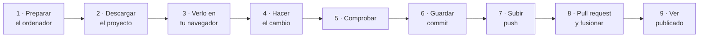
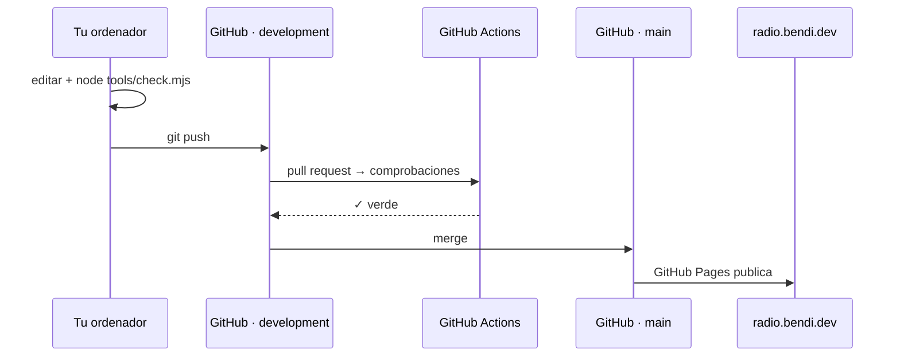

# Tutorial: tu primer cambio, de principio a fin

Un recorrido completo, desde no tener nada instalado hasta ver tu cambio publicado en `radio.bendi.dev`. Como ejemplo, corregiremos una pregunta frecuente. Tiempo: unos 30 minutos la primera vez.



## 1. Preparar el ordenador (solo la primera vez)

Necesitas tres programas gratuitos:

| Programa | Para qué | Cómo comprobar que está |
| --- | --- | --- |
| [Git](https://git-scm.com/downloads) | Guardar versiones y subirlas a GitHub | `git --version` |
| [Node.js](https://nodejs.org/) 18 o superior | Ejecutar las comprobaciones | `node --version` |
| Un editor, por ejemplo [Visual Studio Code](https://code.visualstudio.com/) | Editar archivos | — |

Python 3 (que viene con macOS y Linux) sirve para el servidor local; si no lo tienes, Node también vale (ver paso 3).

Configura tu identidad en Git **una vez** (los commits salen con este nombre):

```bash
git config --global user.name "Sergio Santiago Bendaña Quesada"
git config --global user.email "serbenda@gmail.com"
```

Y conecta Git con tu cuenta de GitHub: lo más sencillo es instalar [GitHub CLI](https://cli.github.com/) y ejecutar `gh auth login`.

## 2. Descargar el proyecto

```bash
git clone https://github.com/serbenda/radio.git
cd radio
git checkout development      # SIEMPRE se trabaja en development, nunca en main
git pull                      # trae lo último
```

Abre la carpeta `radio` en el editor.

## 3. Verlo en tu navegador

```bash
python3 -m http.server 8000
# o, sin Python:  npx serve -l 8000 .
```

Abre <http://localhost:8000/>. Para pararlo, `Ctrl+C` en la terminal.

> También se puede abrir `index.html` con doble clic, pero así no funcionan el modo sin conexión ni algunos servicios. Para probar el modo sin conexión tal como en la web real, ver [PRUEBAS.md](PRUEBAS.md#probar-el-modo-sin-conexión).

## 4. Hacer el cambio

Las preguntas frecuentes están en `js/data.js`, en la lista `FAQ`. Busca la que quieras cambiar (en VS Code: `Ctrl+P` → `data.js`, y `Ctrl+F` para buscar):

```js
['¿Es caro?', 'Para escuchar te basta con el navegador…'],
```

Cambia el texto de la respuesta, **respetando las comillas y la coma final**. Guarda.

Recarga <http://localhost:8000/empezar/#faq> y comprueba que se ve tu cambio.

> Si no ves el cambio: recarga forzando (Ctrl+F5 / Cmd+Shift+R). Si sigue sin verse, el service worker puede estar sirviendo la copia antigua: F12 → Aplicación → Service workers → "Update on reload".

¿Qué archivo toca cada cosa? Ver [GUIA.md](GUIA.md).

## 5. Comprobar

```bash
node tools/check.mjs
```

Debe terminar en `✓ N de N comprobaciones correctas`. Si algo sale con `✗`, el mensaje dice qué y dónde. Lo más habitual tras editar `data.js` es un error de sintaxis (una comilla o una coma): el apartado "5. Sintaxis" señala el archivo.

Prueba también la página en modo móvil: F12 → icono de móvil → 390 px de ancho.

## 6. Guardar el cambio (commit)

```bash
git status                    # qué archivos has cambiado
git diff                      # qué líneas exactamente
git add js/data.js            # prepara el archivo
git commit -m "FAQ: precio actualizado de un SDR para empezar"
```

Escribe el mensaje en español y en presente, diciendo **qué** cambia para quien usa la web.

## 7. Subirlo (push)

```bash
git push origin development
```

## 8. Pull request y fusionar

1. Ve a <https://github.com/serbenda/radio>. Aparece un aviso amarillo "development had recent pushes" → **Compare & pull request**. (O en la terminal: `gh pr create --base main --head development --fill`.)
2. Rellena la plantilla: qué cambia, por qué, cómo lo has probado.
3. Espera a que la comprobación "Comprobaciones / comprobar" se ponga en **verde** (1 minuto).
4. Revisa la pestaña **Files changed**.
5. **Merge pull request** → **Confirm merge**.

Si la comprobación sale en **rojo**, pulsa en "Details" para ver qué falla, arréglalo en tu ordenador, y repite los pasos 5 a 7: la PR se actualiza sola.

## 9. Verlo publicado

GitHub Pages publica `main` en 1-2 minutos. Puedes seguirlo en la pestaña **Actions** → "pages build and deployment". Después abre <https://radio.bendi.dev/empezar/#faq> y recarga forzando.

## Lo que acabas de hacer



## Siguientes pasos

- Recetas para cada tipo de cambio: [GUIA.md](GUIA.md).
- Si algo no funciona: [PROBLEMAS.md](PROBLEMAS.md).
- Para cambios que afectan al código o a varias páginas, haz una versión nueva: [GUIA.md · Publicar una versión](GUIA.md#publicar-una-versión).
